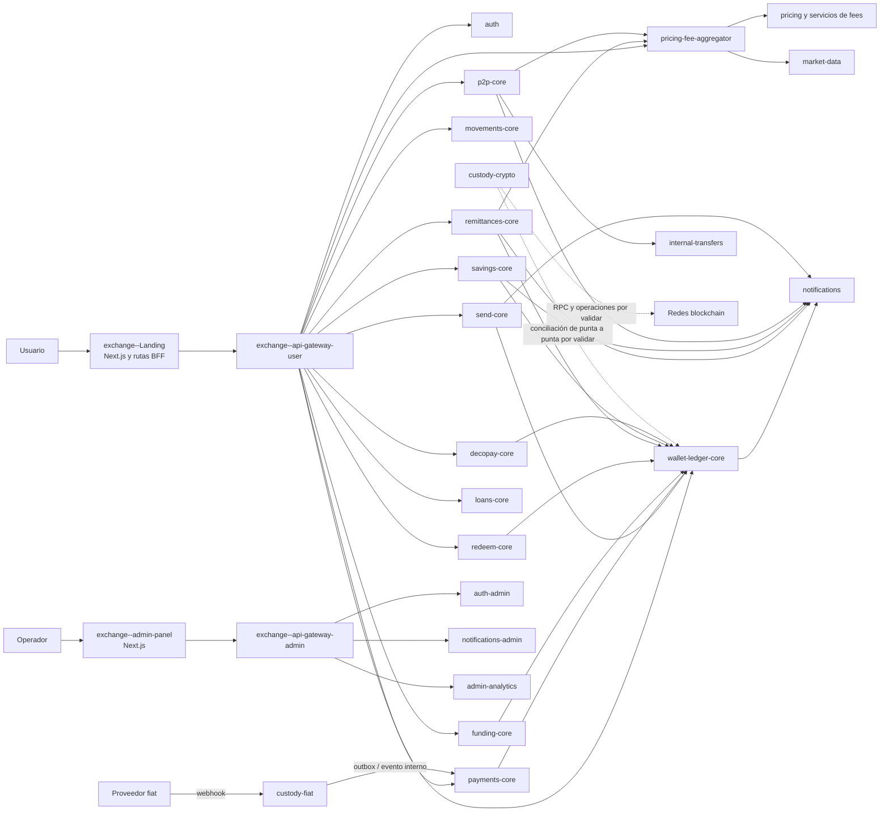
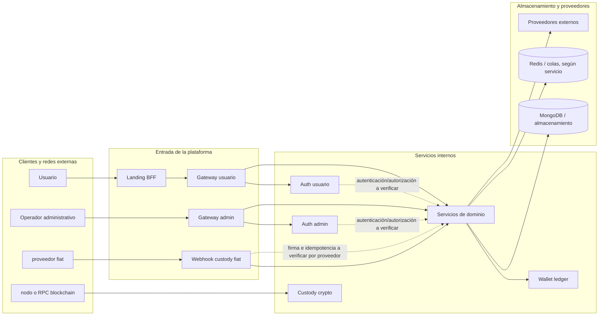
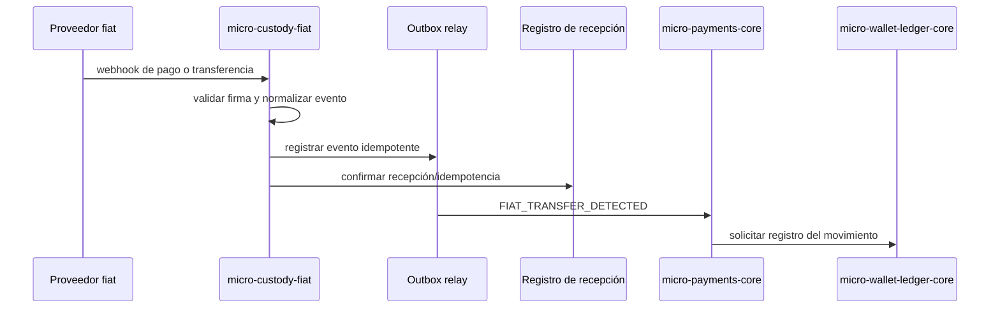
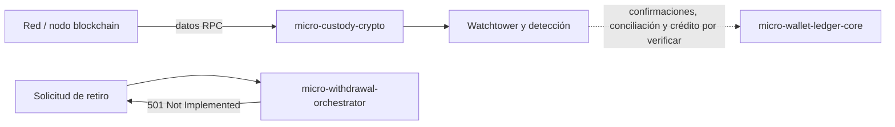
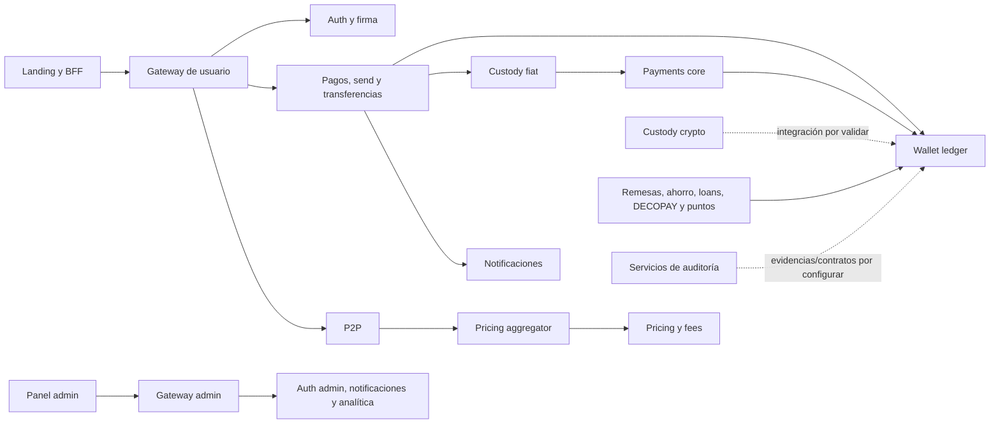

# Deco Exchange — primera versión

  

  
  
  
  
  

**Deco Exchange** reúne las aplicaciones, gateways y servicios de la primera etapa del exchange fiat/cripto que empecé a construir en **Deco31416**. Comparto esta copia como registro de esa etapa y como base para estudiar las decisiones que tomé al desarrollar el MVP.

El desarrollo vigente que mantengo ha evolucionado a más de **120 microservicios**. Este repositorio conserva una versión temprana y separada: **no representa la arquitectura vigente ni incluye la plataforma actual**.

> [!CAUTION]
> **Prototipo inicial; no apto para producción.** No lo conectes a fondos, wallets, cuentas bancarias, datos de clientes ni credenciales reales de proveedores. Los servicios, controles e integraciones pueden estar incompletos, simulados o no haber sido verificados de extremo a extremo.
>
> Comparto el código tal como está y no garantizo seguridad, disponibilidad, exactitud contable ni idoneidad financiera. Cada persona es responsable del uso o modificación que haga. Si quieres hablar conmigo sobre el proyecto, visita [deco31416.com](https://deco31416.com).

## Contenido

- [Deco Exchange — primera versión](#deco-exchange--primera-versión)
  - [Contenido](#contenido)
  - [Alcance y estado](#alcance-y-estado)
  - [Contexto de negocio](#contexto-de-negocio)
  - [Estado de madurez de algunos flujos](#estado-de-madurez-de-algunos-flujos)
  - [Por qué elegí una arquitectura de microservicios](#por-qué-elegí-una-arquitectura-de-microservicios)
  - [Capacidad y rendimiento: sin cifras verificadas](#capacidad-y-rendimiento-sin-cifras-verificadas)
  - [Arquitectura](#arquitectura)
    - [Límites entre componentes](#límites-entre-componentes)
    - [Límites de confianza (vista conceptual)](#límites-de-confianza-vista-conceptual)
  - [Flujo fiat de referencia](#flujo-fiat-de-referencia)
  - [Límite del flujo cripto](#límite-del-flujo-cripto)
  - [Guía de lectura para evaluación técnica](#guía-de-lectura-para-evaluación-técnica)
  - [Mapa de proyectos](#mapa-de-proyectos)
  - [Índice de documentación y relaciones entre proyectos](#índice-de-documentación-y-relaciones-entre-proyectos)
  - [Tecnologías y ejecución local](#tecnologías-y-ejecución-local)
    - [Stack principal](#stack-principal)
  - [Seguridad y configuración](#seguridad-y-configuración)
  - [Limitaciones conocidas](#limitaciones-conocidas)
  - [Contribuciones](#contribuciones)
  - [Qué demuestra esta copia](#qué-demuestra-esta-copia)
  - [Licencias](#licencias)
  - [Contacto](#contacto)

## Alcance y estado

En esta publicación reúno **38 carpetas de proyecto**: dos interfaces web, dos gateways y 34 servicios de dominio o soporte. Cada carpeta se administra de forma independiente; no hay un único paquete raíz que instale o arranque toda la plataforma.

El código y la documentación muestran piezas para identidad, balances, movimientos, pagos, custodia, webhooks, precios y productos relacionados. La presencia de un cliente, una ruta o un servicio **no demuestra que el flujo completo esté integrado, probado o listo para operar**.

El alcance visible se centra en wallets, pagos, transferencias y conversión de activos. En esta copia no hay un motor de matching ni un libro de órdenes que pueda presentar como verificado; por eso no describo esta versión como un exchange de trading con order book.

## Contexto de negocio

Mi hipótesis de producto para esta etapa era reducir la fricción entre rieles fiat locales y operaciones con activos digitales, pagos y remesas. También quería explorar dónde ubicar controles de identidad y riesgo antes de autorizar movimientos hacia el ledger.

El repositorio incluye componentes llamados KYC/risk y limits-policy, pero eso **no demuestra que exista un proceso completo de cumplimiento normativo, prevención AML ni bloqueo efectivo previo al ledger**. Este README no compara funciones con Binance, Kraken u otros exchanges: describe el problema que yo intentaba explorar y los límites de esta copia.

## Estado de madurez de algunos flujos

Esta matriz distingue entre código que aparece en la copia y validación operativa. No es una certificación de seguridad ni una lista exhaustiva de los 38 proyectos.

| Área | Evidencia en esta copia | Estado de validación |
|---|---|---|
| Gateway de usuario | Rutas y `ThrottlerGuard` en `exchange--api-gateway-user` | Falta validar el recorrido completo con servicios y carga representativa. |
| Webhooks fiat | Validación de firma, idempotencia y outbox en `exchange--micro-custody-fiat` | La integración con proveedores y el registro final en ledger requieren pruebas sandbox y de recuperación. |
| Wallet ledger | Servicios de cuentas, balances, movimientos e inbox en `exchange--micro-wallet-ledger-core` | La consistencia, concurrencia y conciliación end-to-end no se certifican aquí. |
| Custodia cripto | Adaptadores de red y detección de actividad en `exchange--micro-custody-crypto` | La acreditación al ledger y la conciliación de depósitos/retiros no están verificadas de extremo a extremo. |
| Retiros | El orquestador responde `501 Not Implemented` | Deshabilitados en esta versión; no se mueven fondos. |
| Rendimiento | No hay resultados de carga reproducibles | Usuarios concurrentes, TPS y latencias siguen sin medir. |

## Por qué elegí una arquitectura de microservicios

Elegí separar dominios como identidad, ledger, pagos, custodia fiat/cripto, precios, notificaciones y productos para darles responsabilidades e interfaces propias. Mi intención era poder revisar permisos y cambios por componente y, si la operación lo justificaba, desplegar o escalar servicios de forma independiente.

También acepté costos: las llamadas de red fallan, los datos quedan distribuidos, los contratos deben evolucionar de forma compatible y una operación puede atravesar varios servicios. Para sostener esta arquitectura hacen falta observabilidad, autenticación entre servicios, idempotencia, conciliación, reintentos y despliegues coordinados. **Tener carpetas separadas no produce por sí solo independencia, resiliencia ni más capacidad.** En esta versión muestro la dirección de diseño; no afirmo que todas esas propiedades estén implementadas o verificadas.

## Capacidad y rendimiento: sin cifras verificadas

No publiqué resultados reproducibles de pruebas de carga ni una ficha de infraestructura que permita afirmar cuántos usuarios concurrentes o transacciones por segundo soporta esta versión. Por eso, para esta copia:

| Métrica | Estado |
|---|---|
| Usuarios concurrentes soportados | No medido |
| Transacciones por segundo sostenidas | No medido |
| Latencias p95/p99 y tasa de error bajo carga | No documentadas |
| Capacidad con proveedores, base de datos y colas conectados | No medida de extremo a extremo |
| Número y tamaño de servidores/instancias | No definido en esta copia |

Publicar una cifra sin mediciones sería especulativo. La capacidad debe determinarse con pruebas aisladas y end-to-end en un entorno de pruebas equivalente al despliegue previsto, con límites de latencia y error definidos. Mide cada servicio y su dependencia más lenta (base de datos, Redis/colas, RPC y APIs de proveedor), además de la latencia p50/p95/p99, tasa de errores, saturación de CPU/memoria, conexiones y retraso de colas. La concurrencia de usuarios depende de cuántas operaciones haga cada usuario; no equivale directamente a TPS. No ejecutes pruebas de carga contra proveedores o redes de dinero real.

Como modelo inicial de sizing, el caudal de un flujo síncrono queda limitado por el componente más lento de su ruta: `TPS_end-to-end ≤ min(TPS_servicio, TPS_base_de_datos, TPS_cola, cuotas_del_proveedor)`. Una vez medido ese límite, una aproximación de usuarios activos es `TPS_sostenido / operaciones_por_usuario_por_segundo`. Estas relaciones sirven para planear pruebas; no son resultados ni promesas de esta versión.

## Arquitectura

El siguiente esquema resume las rutas de entrada y las principales dependencias que aparecen en el código y la documentación. Es un **mapa lógico**, no un diagrama de despliegue. Las líneas sólidas representan rutas o clientes documentados en esta copia; las punteadas señalan relaciones previstas o que requieren validación integral.

### Límites entre componentes

- **Landing y BFF:** la interfaz de usuario incluye rutas de servidor que actúan como backend para el frontend. La documentación del proyecto describe el uso de cookies `HttpOnly` para sesiones y el envío servidor a servidor de credenciales internas; cada ruta debe revisarse antes de considerarla segura.
- **Gateways:** separan el acceso de usuario del acceso administrativo y enrutan solicitudes hacia servicios de dominio. El diagrama no implica que todas las carpetas estén registradas en ambos gateways.
- **Servicios de dominio:** implementan partes de autenticación, ledger, pagos, custodia, pricing y productos. Las dependencias concretas cambian por servicio y se configuran de manera independiente.
- **Integraciones externas:** los webhooks, proveedores de pagos y endpoints RPC requieren configuración, credenciales propias, sandbox y pruebas de contrato. No se proporcionan credenciales válidas en este repositorio.

### Límites de confianza (vista conceptual)

Este segundo esquema separa clientes públicos, puntos de entrada y dependencias externas. **Es una guía para revisar fronteras; no afirma que cada control indicado esté aplicado en todos los servicios.**

Al revisar cada frontera, yo comprobaría quién autentica la solicitud, cómo se limita el permiso, dónde se almacenan los secretos y cómo se audita un rechazo o un reintento. La ubicación de un componente en el esquema no sustituye esa revisión.

## Flujo fiat de referencia

Este diagrama representa el recorrido documentado para un evento recibido por custody-fiat. La implementación, la modalidad de procesamiento y la conexión final al ledger deben validarse en el entorno de pruebas de cada proveedor.

**Patrón de consistencia:** en el camino fiat aparecen un **Outbox relay** y un **Inbox/idempotencia**. El objetivo es conservar eventos para publicación y reconocer reintentos duplicados. El código también contempla reintentos y un estado `dead_letter` para eventos que agotan esos intentos.

No afirmo que esta copia garantice entrega `At-Least-Once`, una transacción atómica entre servicios ni consistencia exactamente una vez. Esas propiedades dependen de los límites transaccionales, contratos, claves de idempotencia y consumidores concretos, y requieren pruebas de integración.

**Escenario que falta demostrar:** si el proveedor repite el webhook mientras payments-core o el ledger no responden, hay que verificar que el duplicado no genere un segundo movimiento, que el evento pendiente se recupere y que cualquier diferencia se reconcilie. La ruta unificada en modo Bull falla antes de aceptar eventos si no hay un consumidor compatible; revisa la configuración y el README de custody-fiat antes de probarla.

## Límite del flujo cripto

La copia incluye servicios de custodia y adaptadores para consultar redes. La conectividad depende de endpoints configurados por quien despliega el servicio. Una conexión RPC funcional no demuestra que depósitos, confirmaciones, conciliación y acreditación al ledger estén integrados de forma segura.

El orquestador de retiros de esta versión rechaza nuevas solicitudes con `501 Not Implemented`; los registros heredados pendientes se marcan como fallidos indicando que no se movieron fondos. **No interpretes una pantalla, registro o estado como evidencia de una transferencia real.**

## Guía de lectura para evaluación técnica

Si quieres revisar decisiones concretas sin recorrer las 38 carpetas en orden, estos archivos son buenos puntos de partida. Los propongo como rutas de lectura, no como prueba de que el sistema completo esté certificado:

1. **Ledger y manejo de eventos:** [`ledger-core.service.ts`](exchange--micro-wallet-ledger-core/src/modules/ledger/ledger-core.service.ts), [`inbox.service.ts`](exchange--micro-wallet-ledger-core/src/idempotency/inbox.service.ts) y el [README de wallet-ledger](exchange--micro-wallet-ledger-core/README.md). Ahí puedes revisar cómo se representan las entradas y la idempotencia.
2. **Recepción fiat:** [`unified-webhook.controller.ts`](exchange--micro-custody-fiat/src/webhooks/controllers/unified-webhook.controller.ts), [`unified-webhook.service.ts`](exchange--micro-custody-fiat/src/webhooks/services/unified-webhook.service.ts) y [`payments-core.client.ts`](exchange--micro-custody-fiat/src/outbox-relay/payments-core.client.ts). Ahí puedes seguir la validación, normalización y publicación de eventos.
3. **Frontera de entrada de usuario:** [`proxy.controller.ts`](exchange--api-gateway-user/src/proxy/proxy.controller.ts), [`app.module.ts`](exchange--api-gateway-user/src/app.module.ts) y [`configuration.ts`](exchange--api-gateway-user/src/config/configuration.ts). Ahí puedes revisar rutas, `ThrottlerGuard` y configuración del gateway.

## Mapa de proyectos

Agrupé los proyectos por el propósito que sugieren su código y documentación. Los nombres son los de las carpetas del repositorio; estas descripciones no certifican que un servicio esté completo ni conectado en producción.

| Área | Proyectos incluidos | Propósito general |
|---|---|---|
| Aplicaciones y entrada | `exchange--Landing`, `exchange--admin-panel`, `exchange--api-gateway-user`, `exchange--api-gateway-admin` | Interfaces Next.js y gateways separados para usuario y administración. |
| Identidad, control y administración | `exchange--micro-auth`, `exchange--micro-auth-admin`, `exchange--micro-signature-keys`, `exchange--micro-kyc-risk`, `exchange--micro-limits-policy`, `exchange--micro-admin-analytics` | Autenticación, firma/OTP, evaluación inicial de riesgo, políticas y analítica administrativa. |
| Ledger, pagos y transferencias | `exchange--micro-wallet-ledger-core`, `exchange--micro-movements-core`, `exchange--micro-send-core`, `exchange--micro-payments-core`, `exchange--micro-funding-core`, `exchange--micro-internal-transfers`, `exchange--micro--redeem-core`, `exchange--micro-withdrawal-orchestrator` | Saldos, movimientos y componentes para pagos, funding, envíos y transferencias. El flujo de retiros está deshabilitado en el orquestador. |
| Custodia | `exchange--micro-custody-fiat`, `exchange--micro-custody-crypto` | Webhooks y adaptadores de proveedores fiat o redes cripto; requieren configuración y validación independiente. |
| Activos, mercado y pricing | `exchange--micro-asset-registry`, `exchange--micro-market-data`, `exchange--micro-pricing-fee-aggregator`, `exchange--micro-pricing-fee-crypto`, `exchange--micro-pricing-fee-fiat`, `exchange--micro-pricing-fee-launchpad` | Catálogo de activos, datos de mercado y cálculo/agregación de precios y fees. |
| Productos | `exchange--micro-p2p-core`, `exchange--micro-p2p-tunnel`, `exchange--micro-remittances-core`, `exchange--micro-savings-core`, `exchange--micro-loans-core`, `exchange--micro-decopay-core`, `exchange--micro-points-deco-core` | Componentes iniciales de P2P, remesas, ahorro, préstamos, DECOPAY y puntos. La disponibilidad de cada flujo debe verificarse. |
| Notificaciones | `exchange--micro-notifications`, `exchange--micro-notifications-admin` | Envío de notificaciones y operaciones administrativas asociadas. |
| Auditoría | `exchange--micro-audit-fiat-flows`, `exchange--micro-audit-crypto-flows`, `exchange--micro-audit-balance-integrity` | Herramientas o servicios de auditoría para flujos fiat, cripto y consistencia de balances. |

## Índice de documentación y relaciones entre proyectos

Cada enlace abre el README específico del componente. Las conexiones del diagrama resumen relaciones descritas en esta copia; una flecha no es garantía de despliegue, disponibilidad ni contrato estable.

| Grupo | READMEs |
|---|---|
| Aplicaciones y gateways | [Landing](exchange--Landing/README.md) · [Admin panel](exchange--admin-panel/README.md) · [Gateway user](exchange--api-gateway-user/README.md) · [Gateway admin](exchange--api-gateway-admin/README.md) |
| Identidad, riesgo y firma | [Auth](exchange--micro-auth/README.md) · [Auth admin](exchange--micro-auth-admin/README.md) · [KYC/risk](exchange--micro-kyc-risk/README.md) · [Limits policy](exchange--micro-limits-policy/README.md) · [Signature keys](exchange--micro-signature-keys/README.md) · [Admin analytics](exchange--micro-admin-analytics/README.md) |
| Ledger, pagos y movimientos | [Wallet ledger](exchange--micro-wallet-ledger-core/README.md) · [Payments](exchange--micro-payments-core/README.md) · [Send](exchange--micro-send-core/README.md) · [Funding](exchange--micro-funding-core/README.md) · [Movements](exchange--micro-movements-core/README.md) · [Internal transfers](exchange--micro-internal-transfers/README.md) · [Redeem](exchange--micro--redeem-core/README.md) · [Withdrawal orchestrator](exchange--micro-withdrawal-orchestrator/README.md) |
| Custodia y activos | [Custody fiat](exchange--micro-custody-fiat/README.md) · [Custody crypto](exchange--micro-custody-crypto/README.md) · [Asset registry](exchange--micro-asset-registry/README.md) |
| Pricing y mercado | [Market data](exchange--micro-market-data/README.md) · [Pricing aggregator](exchange--micro-pricing-fee-aggregator/README.md) · [Pricing crypto](exchange--micro-pricing-fee-crypto/README.md) · [Pricing fiat](exchange--micro-pricing-fee-fiat/README.md) · [Pricing launchpad](exchange--micro-pricing-fee-launchpad/README.md) |
| Productos | [P2P core](exchange--micro-p2p-core/README.md) · [P2P tunnel](exchange--micro-p2p-tunnel/README.md) · [Remittances](exchange--micro-remittances-core/README.md) · [Savings](exchange--micro-savings-core/README.md) · [Loans](exchange--micro-loans-core/README.md) · [DECOPAY](exchange--micro-decopay-core/README.md) · [Points DECO](exchange--micro-points-deco-core/README.md) |
| Notificaciones y auditoría | [Notifications](exchange--micro-notifications/README.md) · [Notifications admin](exchange--micro-notifications-admin/README.md) · [Audit fiat](exchange--micro-audit-fiat-flows/README.md) · [Audit crypto](exchange--micro-audit-crypto-flows/README.md) · [Audit balance integrity](exchange--micro-audit-balance-integrity/README.md) |

## Tecnologías y ejecución local

### Stack principal

- **Frontend y BFF:** Next.js, React y TypeScript.
- **Servicios backend:** principalmente NestJS, TypeScript y Node.js.
- **Auditoría cripto:** un componente documentado en Go.
- **Comunicación:** gateways/API HTTP, webhooks de proveedores y clientes entre servicios.
- **Consistencia asíncrona:** outbox/inbox y Redis/Bull en los componentes que los configuran; no son un bus uniforme para todos los servicios.
- **Datos:** MongoDB aparece en varios servicios; persistencia y colas se configuran por componente.

Los proyectos usan gestores de paquetes distintos, entre ellos Yarn y pnpm, y algunos directorios no tienen un `package.json` convencional. Por ello:

1. Entra en la carpeta del componente que quieras estudiar.
2. Lee su `README.md`, manifiesto y configuración antes de instalar dependencias.
3. Usa la versión de Node.js y el gestor indicados por ese proyecto, si están especificados.
4. Si existe `.env.example`, copia la plantilla a un `.env` **local** y configura únicamente servicios sandbox y datos sintéticos.
5. Ejecuta solo los comandos definidos por el proyecto seleccionado. No existe un comando raíz que arranque los 38 proyectos.

No se encontró un manifiesto raíz de workspace ni una definición central de despliegue para levantar toda la plataforma. Puertos, dependencias, persistencia y procesos de arranque se configuran por separado; consulta la documentación de cada servicio.

## Seguridad y configuración

- Los valores `xxxxx--xxxxx` son marcadores. **No son credenciales, no permiten conectar con proveedores y no deben reemplazarse por secretos en un commit público.**
- No subas `.env` locales, claves API, tokens, secretos de webhook, contraseñas, semillas, claves privadas, certificados, dumps, logs con datos personales ni credenciales cloud.
- Configura secretos en el gestor de secretos del entorno de ejecución. Usa credenciales de sandbox con permisos mínimos para desarrollo y rotación controlada.
- Si una credencial real estuvo en Git alguna vez, revócala y rótala. Borrar el archivo en un commit posterior no la elimina del historial, forks, artefactos o cachés.
- Revisa `.gitignore` y el contenido que quedaría en el commit antes de publicar. Las plantillas de ejemplo se conservan intencionalmente; comprueba que solo contengan valores sintéticos.
- Valida autenticación entre servicios, permisos, CORS, firmas de webhook, idempotencia, reintentos y conciliación mediante pruebas aisladas antes de habilitar integraciones.

## Limitaciones conocidas

- Esta es una **versión de prototipo/MVP inicial**, no un producto financiero listo para clientes.
- Las integraciones visibles pueden ser parciales, simuladas, no desplegadas o depender de configuración externa que no está incluida.
- Los retiros están deshabilitados en `exchange--micro-withdrawal-orchestrator`.
- Los flujos de depósitos, webhooks, ledger, balances y conciliación necesitan verificación de extremo a extremo con proveedores sandbox.
- No se identificó un motor de matching/libro de órdenes verificable en este repositorio.
- No hay evidencia aquí de una topología productiva centralizada, acuerdos con proveedores, auditoría externa o certificación de seguridad.
- Los manifiestos y licencias varían por subproyecto; revisa también las dependencias externas y sus términos.

## Contribuciones

Lee [`CONTRIBUTING.md`](CONTRIBUTING.md) antes de proponer cambios. Para una contribución segura:

1. Limita el cambio a un servicio y describe sus dependencias.
2. No incluyas credenciales, datos reales ni configuraciones de producción.
3. Documenta qué integraciones son simuladas y qué servicios externos hacen falta.
4. Incluye evidencia de validación adecuada al componente, sin usar fondos ni cuentas reales.
5. No presentes una mejora aislada como certificación de seguridad o preparación para producción.

## Qué demuestra esta copia

Con esta publicación quiero mostrar cómo fui separando dominios financieros, qué relaciones llegué a prototipar y qué preguntas siguen abiertas sobre fallos, conciliación, rendimiento y licencias. Para mí, su valor está en poder revisar esas decisiones y sus costos, no en contar carpetas o presentar los flujos como terminados.

### Lecciones aprendidas de esta etapa

- **Validaciones en la ruta crítica:** explorar controles de identidad y riesgo antes de autorizar movimientos me hizo ver el equilibrio entre reducir exposición y sumar latencia y dependencias. En esta copia no medí esos tiempos ni comprobé que todos los recorridos al ledger pasen por esos controles.
- **Custodia y ledger separados:** dividir la recepción de operaciones externas del registro contable aclara responsabilidades, pero deja estados que deben conciliarse entre servicios. Outbox, inbox e idempotencia ayudan a organizar ese trabajo; no demuestran por sí solos que no haya duplicados ni que todo evento se recupere automáticamente.

La evolución del proyecto continuó fuera de esta copia. No publiques secretos, configuraciones privadas ni detalles de infraestructura actual para explicar esa evolución.

## Licencias

Publiqué este proyecto bajo la licencia [MIT](LICENSE), a nombre de **Deco31416**. Añadí una copia de esa licencia en cada uno de los 38 subproyectos para que el alcance quede visible al consultar cada carpeta.

La MIT cubre el código de este proyecto según sus términos; no concede derechos sobre mis marcas, dominios, servicios, diseños, infraestructura ni credenciales de Deco31416. Las dependencias de terceros conservan sus propias licencias, que deben revisarse antes de redistribuir una versión del proyecto.

## Contacto

Si quieres conversar conmigo sobre este prototipo o el desarrollo vigente, visita [deco31416.com](https://deco31416.com) o escríbeme por [WhatsApp al +57 301 309 9880](https://wa.me/573013099880).

