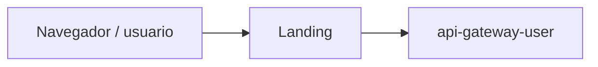

# deco-exchange Landing

<!-- DECO-RELEASE-BADGES -->
[](../README.md#alcance-y-estado) [](../README.md#limitaciones-conocidas) [](../README.md#arquitectura)
<!-- /DECO-RELEASE-BADGES -->

<!-- DECO-NON-PRODUCTION-NOTICE -->
> **Advertencia:** prototipo en fase inicial, no apto para producción. No conectes este servicio a fondos, cuentas bancarias, wallets, datos de clientes ni credenciales reales. Las capacidades descritas son referencias al código y no pruebas de aceptación; las rutas, controles y dependencias requieren validación independiente.
<!-- /DECO-NON-PRODUCTION-NOTICE -->


---

## Descripcion

**deco-exchange Landing** es la pagina publica oficial de la plataforma **deco-exchange** -- un exchange de criptomonedas y activos digitales del ecosistema **DECOX**, que ofrece:

- Trading Spot y P2P
- Compra/Venta de Criptomonedas con conversion en tiempo real
- Staking y Custodia de Criptoactivos (UTXO/EVM Compatible)
- Launchpad de nuevos proyectos (DECOX, DECO, DECO)
- Dashboard interactivo de usuario con wallets multi-moneda
- Fondeo fiat multi-metodo (SPEI, ACH, Wire, PSE, Nequi, SEPA, Tarjeta)
- Recepcion crypto multi-red (ERC-20, TRC-20, BEP-20, SPL)

Construida con **Next.js 15 App Router**, **React 18**, **TypeScript strict**, **TailwindCSS 3** y **shadcn/ui**.

**Version actual: 0.16.0**

### Release 0.16.0

- **Páginas institucionales** agregadas y componentizadas: `/roadmap`, `/unete-al-equipo`, `/brand`, `/business/crypto-processing` y `/business/ecommerce-plugins`.
- **Documentos legales asociados** agregados: `/legals/roadmap`, `/legals/unete-al-equipo`, `/legals/brand`, `/legals/crypto-processing` y `/legals/ecommerce-plugins`.
- **Estado del Servicio** agregado en `/status` como status page Deco con sistemas operativos, servicios, incidentes recientes y enlace a soporte.
- **Footer actualizado** para reemplazar anchors o páginas prestadas por rutas propias de producto: Roadmap, Equipo, Marca, Procesamiento Cripto, E-Commerce plugins y Status.
- **Calculadora legal** renovada con gráfica dinámica por par, monto, origen, destino y tasa estimada.
- **Gráficas legales genéricas** renovadas con estilo Deco para tasas, monedas, electrónicos, efectivo, Red Deco y Aliado Deco.
- **Careers** agrega puestos buscados: Frontend, Backend/Gateway, Security, KYC/AML, Red Deco y Soporte.
- **Plan de páginas de compañía** documentado en `plan-company-pages.md`.
- **Documentación** actualizada con badges, diagrama de flujo Mermaid, guía de contribución y licencia MIT 2026.
- Verificación de cierre: `git diff --check`, `pnpm exec tsc --noEmit --pretty false` y `pnpm run build`.

### Release 0.15.4

- **Soporte Deco global** agregado como widget tipo help desk con inicio, chat mock, ticket mock y evento `deco:support`.
- **Help Center** conecta `Iniciar chat` y `Crear ticket de soporte` con el widget global.
- **Cookies** agrega modal global de consentimiento con resumen, personalizacion por categoria, `Aceptar todo`, `Solo necesarias` y `Guardar seleccion`.
- **Preferencias de cookies** quedan persistidas y reutilizables desde `lib/privacy/cookie-consent.ts`; `/legals/cookies` puede reabrir la configuracion.
- **Widgets globales cliente** centralizados en `GlobalClientWidgets` para soporte, consentimiento y toaster.
- **Navbar** corrige mismatch de hidratacion por IDs dinamicos de Radix/Gooey montando piezas sensibles despues de hidratar.
- **Botones flotantes** ajustados: soporte debajo, subir arriba, panel de soporte con altura segura y scroll interno.
- Verificacion de cierre: `git diff --check`, `pnpm exec tsc --noEmit --pretty false` y `pnpm run build`.

### Release 0.15.3

- **Developers** agregado como seccion propia en `/developers` para separar integraciones tecnicas de Mercados.
- **Data API** se mueve a `/developers/data-api`; `/markets/data-api` queda como redirect de compatibilidad.
- Legales, Help Center y Footer conectan Developers como portal tecnico, manteniendo `/legals/api-developer` como documento legal.
- **Red y Aliados** agregado al navbar como seccion propia para Red Deco, puntos cercanos, deposito/retiro efectivo, remesas presenciales y Aliado Deco.
- **Bolsillito** deja Red Deco fuera del menu de saldo fiat y **Ganar** deja Aliado Deco fuera del menu de recompensas para evitar mezcla de conceptos.
- **Aliado Deco** mejora niveles y operaciones del punto con layouts compactos sin cajas internas que rompan montos, resultados o comisiones.
- **Futuros** mejora control de riesgo y posiciones para soportar listas largas con scroll interno, resumen compacto y filtros visuales.
- **Historial de Ordenes** mejora exportacion con acciones visibles para CSV/PDF y reporte fiscal deshabilitado como proximo.
- **Red Deco** mejora rutas entre paises con cards mas legibles y metricas compactas.
- Verificacion de cierre: `pnpm exec tsc --noEmit --pretty false`, `pnpm run build` y `git diff --check`.

### Release 0.15.2

- **Home / Acceso global** reemplaza el cubo experimental por `coin-deco.gif` como asset oficial de moneda DECO.
- **Visual light/dark corregido**: la moneda mantiene tamano consistente y queda sin sombras, fondos radiales ni halos externos.
- **Hidratacion corregida**: `GlobalAccessSwarm` deja de depender del tema del cliente para evitar diferencias SSR/CSR.
- **CSP/HSTS ajustados a produccion** para mantener hardening real sin romper HMR, overlays de Next DevTools ni pruebas locales.
- **Documentacion de auditoria** ampliada con checks visuales para la moneda, modo claro/oscuro y consistencia de tema.
- Verificacion de cierre: `pnpm exec tsc --noEmit --pretty false`, `pnpm run build`, `pnpm audit --prod` y `git diff --check`.

### Release 0.15.1

- **CSP de produccion activa** con allowlist para BFF, assets propios y TradingView en iframe.
- **Origin guard** en mutaciones BFF para bloquear requests cross-origin no permitidos.
- **Rate limit BFF** en login, register, refresh, sesiones y recuperacion/verificacion de auth.
- **Checklist de auditoria frontend** agregado en `docs/frontend-audit-checklist.md`.
- Pendiente backend/gateway: rate limit distribuido, RBAC definitivo, auditoria transaccional y CSP sin `unsafe-inline` cuando haya nonce/pipeline final.

### Release 0.15.0

- **Hardening de seguridad BFF**: `x-user-id` enviado por el browser ya no se acepta como fuente de identidad.
- **Auth catch-all cerrado**: `/api/auth/[[...path]]` queda limitado por allowlist y ya no expone cualquier ruta del micro-auth.
- **Refresh seguro**: `/api/auth/refresh` rota cookies HttpOnly sin devolver `accessToken` ni `refreshToken` en JSON.
- **Logout/expiracion mas segura**: el borrado de cookies respeta el path real de access y refresh para evitar sesiones residuales.
- **Token injection bloqueado**: `/api/auth/set-tokens` queda deshabilitado para evitar fijacion de sesion desde el cliente.
- **Token interno centralizado** con `getInternalAuthToken()`: desarrollo mantiene fallback controlado y produccion falla cerrado si falta `INTERNAL_AUTH_TOKEN`.
- **Catalogo publico read-only**: rutas admin y metodos de escritura quedan bloqueados desde el BFF publico.
- **P2P Market endurecido**: GET publico se mantiene, pero escrituras sin sesion quedan bloqueadas antes de llegar al gateway.
- **DevGuard Deco** agregado para advertencia anti fraude/self-XSS en produccion, controlado por `NEXT_PUBLIC_ENABLE_DEVTOOLS`.
- **Headers globales** agregados: anti-clickjacking, nosniff, referrer policy, permissions policy, HSTS y source maps de produccion desactivados.
- **Dependencias criticas actualizadas con pnpm**: Next `15.5.18` y axios `1.16.0`.
- Pendiente: RBAC/admin real cuando el gateway de usuario y admin panel definan contratos finales.

### Release 0.14.0

- Seccion **Ganar** implementada como Nivel 5 - Embajador con rutas dashboard landing independientes y componetizadas.
- Rutas nuevas: `/earn`, `/earn/referrals`, `/earn/deco-points`, `/earn/cashback`, `/earn/learn-and-earn`, `/earn/missions`, `/earn/sponsor-ads`, `/earn/launchpad` y `/earn/top-earners`.
- Componentes compartidos `components/earn/*` agregados para heroes, metricas, panels, summaries, cards, timelines y modales de accion.
- **Puntos Deco** agregado como capa de fidelizacion con balance, fuentes, canjes, historial y reglas de puntos.
- **Aprende y Gana** agregado con rutas educativas, progreso, racha, quiz mock y flujo de recompensa.
- **Misiones** agregado con retos diarios/semanales, juego online destacado, progreso, estados y reclamo mock.
- **Sponsor Ads** agregado como programa de usuarios/embajadores para promocionar Deco con evidencia, canales, reglas antiabuso y recompensas en tokens/puntos.
- **Reservas** en `/rendimiento/reservas` ampliada con reservas crypto, reservas fiat, consolidado de fondos de usuarios y cobertura total.
- **Asi esta tu dinero** agregado en Reservas como panel privado con desglose crypto/fiat/bloqueado, porcentaje del usuario sobre fondos/reservas y prueba Merkle.
- Gating por login en Reservas: el desglose personal y Merkle se ocultan sin sesion activa y abren el modal real de inicio de sesion.
- Navbar `Ganar` actualizado con las rutas nuevas y Market Maker se mantiene solo en `Mercados`.
- `plan-ganar.md` y `plan-rendimientos.md` actualizados con estados, decisiones de producto, backend futuro y tareas de cierre.
- Verificado con `pnpm exec tsc --noEmit --pretty false` y `pnpm run build`.
- Pendiente: QA visual completo desktop/mobile/light/dark antes de marcar los planes como cerrados definitivamente.

### Release 0.13.0

- Seccion **Crypto facil** renovada como suite de experiencias dashboard landing, siguiendo el patron aprobado de Bolsillito, Market Maker y Rendimiento.
- Rutas principales ajustadas: `/easy-crypto/buy`, `/easy-crypto/sell`, `/easy-crypto/convert`, `/easy-crypto/send` y `/easy-crypto/spot-lite`.
- Componentes compartidos `components/easy-crypto/*` agregados para hero, paneles, metricas, buscadores, metodos, resumen y modales de confirmacion.
- Compra, venta, conversion y envio ahora tienen flujos visuales mas compactos, resumen lateral, estados mock y modales accionables.
- Spot Lite incorpora referencia TradingView por activo publico, selector custom de activo y columna lateral con resumen operativo, riesgo y estado de ejecucion pendiente.
- Selector de activos en trading actions refinado para evitar controles nativos sin estilo y mantener coherencia visual.
- API mock de compra cripto agrega fallback de metodos por moneda/region para mantener experiencia operativa sin backend activo.
- Rendimiento conserva rutas independientes por producto y `/rendimiento/security` redirige hacia Reservas como ruta canonica.
- `plan-crypto-facil.md` agregado como tablero tipo Jira para controlar QA, copy, componentes y estado de Crypto facil.
- `plan-ganar.md` agregado como tablero tipo Jira para planificar Ganar como Nivel 5 - Embajador, con rutas independientes y enfoque comercial.
- Verificado con `pnpm exec tsc --noEmit --pretty false`, `pnpm run build` y revision local de rutas principales.
- Pendiente: QA visual completo desktop/mobile de Crypto facil y ejecucion del plan Ganar por rutas individuales.

### Release 0.12.0

- Seccion **Rendimiento** agregada como dashboard landing operativo, siguiendo el patron aprobado de P2P, Market Maker y Mercados.
- Rutas nuevas: `/rendimiento`, `/rendimiento/staking-tokens`, `/rendimiento/boveda-programada`, `/rendimiento/reservas`, `/rendimiento/activity` y `/rendimiento/calculator`.
- Menu `Rendimiento` actualizado con Staking de Tokens, Boveda Programada, Reservas y Calculadora de Retorno.
- Staking de tokens con cards por activo, condiciones visibles y modal reutilizable de simulacion.
- Boveda Programada con plazos mockup, proyeccion variable y modal de simulacion con aceptacion de riesgo.
- Actividad interna con posiciones, filtros, timeline, vencimientos y flujo modal de retiro flexible.
- Reservas muestra reservas totales, reservas de usuarios, fondos bloqueados, cobertura referencial y respaldo estimado del usuario.
- Calculadora de retorno agrega escenarios estimados, comisiones, liquidez, disponibilidad por pais/KYC y CTA contextual.
- `plan-rendimientos.md` agregado como tablero tipo Jira para controlar avance, estados, criterios legales y QA.
- Copy de Rendimiento auditado para evitar promesas fijas: se usa rendimiento estimado, variable y sujeto a condiciones.
- Verificado con `pnpm exec tsc --noEmit --pretty false`, `pnpm run build` y rutas principales `200 OK`.
- Pendiente: QA visual completo desktop/mobile/light/dark antes de marcar `RND-010` como `HECHO`.

### Release 0.11.0

- Market BFF `/api/markets/*` agregado para pares, ticker, candles, order book y trades.
- `MarketDataService` centraliza el consumo frontend de datos de mercado.
- Tipos canonicos de mercado agregados en `types/markets.ts`.
- Spot, Futuros, Trading Pro, Analisis de Mercado, Alertas de Precio y API de datos conectados al Market BFF con fallback local.
- TradingView queda como proveedor principal para pares publicos y Deco Chart como grafica interna para tokens propios o fallback.
- Tokens propios DECO/USDT y DECOX/USDT preparados con proveedor Deco Chart.
- API de datos mide endpoints reales de `/api/markets/*` y muestra latencias/logs mock conectables.
- Fallback del Market BFF endurecido con timeout configurable `MARKET_BACKEND_TIMEOUT_MS`.
- Parser compartido para volumenes compactos (`B`, `M`, `K`) usado por Spot, Futuros y Analisis.
- Verificado con `pnpm exec tsc --noEmit --pretty false` y rutas principales `200 OK`.
- Pendiente: QA visual completo en navegador antes de marcar todos los modulos de Mercados como `HECHO`.

### Release 0.10.0

- Suite Mercados convertida a dashboard landing operativo, siguiendo el patron aprobado de P2P y Market Maker.
- Spot en `/markets/spot` con resumen, terminal, pares, ordenes, historial, favoritos y `MarketChart`.
- Futuros en `/markets/futures` con terminal long/short, posiciones, riesgo, funding, margen y liquidacion.
- Trading Pro en `/markets/advanced-orders` con Limit/Market, Stop-limit, OCO, TP/SL, ordenes avanzadas e historial.
- Analisis de Mercado en `/markets/market-analysis` con movers, volumen, oportunidades y watchlist.
- Historial de Ordenes en `/markets/order-history` con filtros, detalle, fills, timeline y exportacion mock.
- Alertas de Precio en `/markets/price-alerts` con crear alerta, activas, disparadas y canales.
- API de datos en `/markets/data-api` con keys, permisos, endpoints, logs y contratos para backend/BFF/gateway de usuario.
- `MarketChart` compartido usa TradingView para pares publicos y Deco Chart como respaldo para tokens propios.
- `planmercado.md` agregado como tablero tipo Jira para controlar avance, auditoria y tareas.
- Regla reforzada: usar siempre `pnpm`, nunca `npm`.

### Release 0.9.0

- Bolsillito incorporado como modulo de producto con rutas `/bolsillito/add-money`, `/bolsillito/send-money`, `/bolsillito/remittances` y `/bolsillito/withdraw-credit`.
- Recarga de saldo redisenada como mockup UX para Colombia/COP, con deposito minimo `10,000 COP`, metodos por categoria, montos rapidos y modal de instrucciones.
- Envio de saldo redisenado con selector de destinatarios, monto por moneda preferida, resumen lateral y modal de confirmacion/firma.
- Remesas redisenadas con selector de destino, cotizacion referencial, resumen de ruta y modal de validaciones.
- Market Maker OTC agregado en `/markets/market-maker` como dashboard guia para makers que publican liquidez mayorista o abastecen directamente a Deco.
- Flujos mockup de Market Maker: mercado OTC, mis ofertas, propuesta a Deco, acuerdos, chat comercial y configuracion de perfil.
- Modales por pasos para crear oferta OTC, revisar/contactar una oferta y enviar propuesta directa de inventario a Deco.
- Spot Terminal inicial agregado en `/markets/spot` con enfoque dashboard landing operativo: resumen, terminal, pares, ordenes, historial y favoritos.
- Menu Mercados reorganizado para priorizar Spot y Futuros, seguido de P2P, Market Maker, Trading Pro y herramientas de mercado.
- Preferencias de idioma, pais/region y moneda reutilizadas desde el modal global para adaptar flujos de Bolsillito.
- Guia oficial de diseno agregada en `docs/design-guidelines.md`: el home es la referencia aprobada y el naranja debe usarse como acento, no como borde dominante.

### Release 0.8.0

- Landing legal `/legals` rediseñada con hero regulatorio, categorias, centro de control y recursos clave del ecosistema DECO EXCHANGE.
- Paginas legales internas unificadas con navbar/footer canonicos, hero legal compartido, breadcrumb y boton para volver arriba.
- Help Center renovado con selector interactivo de equipo de soporte, canales, tutoriales, FAQ y CTA hacia la base de conocimiento.
- Footer principal y footer P2P conectados a rutas reales, soporte por Telegram/email, documentos legales y anclas internas del home.
- Anclas del home agregadas para `productos`, `wallet`, `tasas`, `mercados`, `recompensas`, `destacados` y `comunidad`.
- Layout duplicado de P2P eliminado: P2P reutiliza el navbar y footer canonicos de `components/Main/layout`.
- Referencias heredadas reemplazadas por rutas nuevas de `deco-token` y `deco-custody`.

### Release 0.7.0

- Modal central de idioma, pais/region y moneda conectado al icono global del navbar principal y P2P.
- Selector regional ampliado con 25 idiomas, banderas, monedas fiat y preferencias persistidas en `localStorage`.
- Iconos fiat redondos centralizados con `FiatCurrencyIcon` usando assets locales de `public/images/FiatAccepted`.
- Globo 3D migrado a Three.js puro con `three-globe`, removiendo React Three Fiber para evitar fallos runtime en Next 15.
- Onboarding refinado: modales de login/registro con logo `logo-name`, QR real de DECO31416 y modal de bienvenida mas compacto.
- Partners del ecosistema actualizados con CTA `Visitar`, nombres revisados (`alter|alma`, `BlackCEX`, `DECOToken`, `DECO Exchange`) y copy alineado al ecosistema DECO.
- Scrollbars centralizados, tabs visuales y bordes refinados para mantener consistencia entre light/dark y distintos displays.

### Release 0.6.0

- Seccion de acceso global con globo 3D interactivo, responsivo y estabilizado para modo claro/oscuro.
- Estadisticas, tabs de tasas y tarjetas fiat refinadas visualmente, con copys en espanol y soporte para banderas por moneda.
- Tasas fiat ampliadas para USD, COP, EUR, MXN, CLP, PEN, ARS, VES, AWG, DOP y BRL, con formato uniforme a dos decimales.
- Navbar principal y P2P incorporan busqueda visual con Gooey Input y ajustes de alineacion responsive.
- Hero, badges, tarjetas y bordes ajustados a la nueva linea visual DECO Exchange con radio amplio, sombras controladas y color primario `#ff6c02`.
- BFF de precios actualizado con fallback fiat regional para mantener experiencia visual aun si el agregador local no responde.

### Release 0.5.0

- Branding visual DECO Exchange actualizado con logos por tema, color primario `#ff6c02`, favicon y modo claro/oscuro.
- Modal de bienvenida compactado, legal copy simplificado y footer con logo oficial.
- Mockup mobile DECO Wallet importado, componentizado y conectado en la seccion mobile access.
- QR y assets de App Store / Google Play ajustados por tema para modo dark y white.
- Footer, comunidad, productos, partners y onboarding migrados a iconos Lucide React y enlaces reales de DECO31416.
- BFF de precios con fallback controlado cuando el agregador local no responde.

---

## Mapa dinamico del ecosistema

```mermaid
flowchart TB
  U[Usuario / Visitante] --> NAV[Navbar + Footer]
  NAV --> HOME[Home]
  NAV --> EASY[Crypto facil]
  NAV --> BOLS[Bolsillito]
  NAV --> MARKETS[Mercados]
  NAV --> YIELD[Rendimiento]
  NAV --> EARN[Ganar]
  NAV --> RED[Red y Aliados]
  NAV --> COMPANY[Compania]
  NAV --> LEGALS[Centro legal]
  NAV --> HELP[Help Center + Soporte]

  COMPANY --> ROAD[/roadmap/]
  COMPANY --> CAREERS[/unete-al-equipo/]
  COMPANY --> BRAND[/brand/]
  COMPANY --> BIZ1[/business/crypto-processing/]
  COMPANY --> BIZ2[/business/ecommerce-plugins/]
  COMPANY --> STATUS[/status/]

  EASY --> BUY[/easy-crypto/buy/]
  EASY --> SELL[/easy-crypto/sell/]
  EASY --> CONVERT[/easy-crypto/convert/]
  EASY --> SEND[/easy-crypto/send/]
  EASY --> SPOTLITE[/easy-crypto/spot-lite/]

  BOLS --> ADD[/bolsillito/add-money/]
  BOLS --> SENDM[/bolsillito/send-money/]
  BOLS --> REMIT[/bolsillito/remittances/]
  BOLS --> WITHDRAW[/bolsillito/withdraw-credit/]
  RED --> REDDECO[/bolsillito/red-deco/]
  RED --> ALLY[/earn/aliado-deco/]

  MARKETS --> SPOT[/markets/spot/]
  MARKETS --> FUT[/markets/futures/]
  MARKETS --> P2P[/markets/p2p/]
  MARKETS --> MAKER[/markets/market-maker/]
  MARKETS --> ANALYSIS[/markets/market-analysis/]

  YIELD --> STAKING[/rendimiento/staking-tokens/]
  YIELD --> VAULT[/rendimiento/boveda-programada/]
  YIELD --> RESERVES[/rendimiento/reservas/]
  YIELD --> CALC[/rendimiento/calculator/]

  EARN --> REF[/earn/referrals/]
  EARN --> POINTS[/earn/deco-points/]
  EARN --> CASH[/earn/cashback/]
  EARN --> LAUNCH[/earn/launchpad/]
  EARN --> MISSIONS[/earn/missions/]

  LEGALS --> LEGALDOCS[Politicas, riesgos, cookies, marca, roadmap, equipo e integraciones]
  HELP --> SUPPORT[Deco Support Widget]
  HELP --> TICKETS[Ticket mock trazable]
  SUPPORT --> SESSION[Chat mock]

  STATUS --> SERVICES[Servicios operativos]
  STATUS --> INCIDENTS[Incidentes y mantenimientos]

  BUY --> BFF[Next.js BFF /api]
  SPOT --> BFF
  FUT --> BFF
  P2P --> BFF
  RESERVES --> BFF
  BFF --> GATEWAY[Gateway de usuario / micros futuros]
  BFF --> MARKET[Market backend / pricing]
  BFF --> AUTH[Auth + cookies HttpOnly]

  COOKIES[Cookie Consent Modal] --> PREFS[localStorage: deco_cookie_consent_v1]
  NAV --> COOKIES
```



---

## Arquitectura BFF - Diagrama de flujo

Todo el trafico de datos sigue el patron **BFF (Backend For Frontend)**. El browser nunca llama directamente a un microservicio ni al gateway.

```
+-------------------------------------------------------------------------+
|                        BROWSER  (:3000)                                 |
|                                                                         |
|   fetch('/api/prices/all')          fetch('/api/landing-stats')         |
|   fetch('/api/prices/convert/...')  fetch('/api/markets/...')           |
+----------------------------+--------------------------------------------+
                             |  HTTP  (server-side only)
                             v
+-------------------------------------------------------------------------+
|                  NEXT.JS BFF  --  app/api/                              |
|                                                                         |
|   /api/prices/all            -->  pricing-aggregator (:3013)            |
|   /api/prices/convert/:f/:t  -->  pricing-aggregator (:3013)            |
|   /api/markets/*             -->  pricing/market backend (:3013)        |
|   /api/landing-stats         -->  api-gateway-user   (:8081)            |
|                                                                         |
|   +--------------------------------------------------------------------+|
|   |  Dashboard interno  (app/dashboard/)                               ||
|   |                                                                    ||
|   |  /api/dashboard/wallet    --> api-gateway-user (:8081)             ||
|   |  /api/dashboard/fund      --> api-gateway-user (:8081)             ||
|   |  /api/dashboard/receive   --> api-gateway-user (:8081)             ||
|   |  /api/dashboard/txns      --> api-gateway-user (:8081)             ||
|   +--------------------------------------------------------------------+|
+----------------------------+--------------------------------------------+
                             |  HTTP + x-internal-auth
                             v
+-------------------------------------------------------------------------+
|               API GATEWAY USER  (:8081)                                 |
|                                                                         |
|   /auth/*         -->  micro-auth          (:7000)                      |
|   /wallet/*       -->  wallet-ledger       (:9001)                      |
|   /send/*         -->  send-core           (:9010)                      |
|   /savings/*      -->  savings-core        (:9014)                      |
|   /loans/*        -->  loans-core          (:9013)                      |
|   /movements/*    -->  movements-core      (:9012)                      |
|   /remittances/*  -->  remittances-core    (:9015)                      |
|   /funding/*      -->  funding-core        (:9016)                      |
|   /redeem/*       -->  redeem-core         (:9011)                      |
|   /DECOPAY/*      -->  DECOPAY-core        (:9017)                      |
|   /signature/*    -->  signature-keys      (:3007)                      |
|   /p2p/*          -->  internal-transfers  (:3006)                      |
|   /notifications/*-->  micro-notifications (:7004)                      |
+-------------------------------------------------------------------------+

Regla absoluta:
  Browser --> BFF route (app/api/) --> Gateway (:8081) --> Microservicio
  Browser --> BFF route (app/api/markets) --> Market backend/Pricing (:3013)
  NUNCA: Browser --> Gateway directamente
  NUNCA: Browser --> Microservicio directamente
  NUNCA: Tokens JWT o INTERNAL_AUTH_TOKEN expuestos al browser
```

### BFF de Mercados

Las interfaces de trading usan `/api/markets/*` como contrato unico de frontend. Si el backend de mercado todavia no esta disponible, el BFF responde con fallback server-side para mantener viva la experiencia mock.

| Endpoint | Uso |
|----------|-----|
| `/api/markets/pairs` | Pares Spot, Futuros y tokens propios con metadata de proveedor grafico |
| `/api/markets/ticker?symbol=BTCUSDT` | Precio, cambio 24h, volumen, high/low y timestamp |
| `/api/markets/candles?symbol=BTCUSDT&interval=1d&limit=120` | OHLCV para TradingView/Deco Chart |
| `/api/markets/order-book?symbol=BTCUSDT&depth=20` | Bids, asks y profundidad |
| `/api/markets/trades?symbol=BTCUSDT&limit=50` | Ultimas ejecuciones publicas |

Modulos conectados al Market BFF:

- `/markets/spot`
- `/markets/futures`
- `/markets/advanced-orders`
- `/markets/market-analysis`
- `/markets/price-alerts`
- `/developers/data-api`

`/markets/order-history` sigue como mockup UX hasta conectar gateway de usuario, ordenes privadas y permisos.

### Flujo de modales de fondeo y recepcion

```
Usuario abre modal "Cargar" (fiat)
  +-- ModalFundFiat
       +-- Lee meta.fundMethods[] de currency-metadata.ts
       +-- MXN --> [SPEI, Tarjeta, Tiendas, Deposito]
       +-- USD --> [Wire, ACH, Tarjeta]
       +-- COP --> [PSE, Nequi, Tarjeta, Deposito]
       +-- EUR --> [SEPA, Tarjeta, Wire]

Usuario abre modal "Recibir" (crypto)
  +-- ModalFundCrypto
       +-- Lee meta.networks[] de currency-metadata.ts
       +-- Multi-red (USDT/USDC) --> Selector de red --> QR + direccion
       +-- Mono-red (BTC/ETH/DECOX) --> QR + direccion directamente
```

---

## Dependencias de microservicios

| Servicio | Puerto local | Uso en landing |
|---------|-------------|----------------|
| `pricing-aggregator` / market backend | 3013 | Precios crypto/fiat, Market Cap, conversiones, contratos `/api/markets/*` |
| `api-gateway-user` | 8081 | Proxy BFF --> todos los micros de usuario |
| `micro-auth` | 7000 | Conteo de usuarios para stats publicas |
| `wallet-ledger` | 9001 | Conteo de transacciones para stats publicas |

---

## Tecnologias

| Categoria | Stack |
|-----------|-------|
| Framework | Next.js 15 (App Router) |
| UI | React 18, TailwindCSS 3, shadcn/ui, Radix UI |
| Lenguaje | TypeScript 5 (strict) |
| Animaciones | Framer Motion |
| Formularios | React Hook Form + Zod |
| Iconos | Lucide React |
| QR | qrcode.react (QRCodeSVG) |
| Graficas | TradingView, Recharts y Deco Chart SVG |
| 3D / Assets | Three.js, three-globe y assets propios |
| Package manager | **pnpm** -- NUNCA mezclar npm/yarn |

---

## Estructura del proyecto

```
deco-exchange--Landing/
+-- app/
|   +-- api/                      BFF routes (server-side proxy)
|   |   +-- prices/               --> pricing-aggregator
|   |   +-- markets/              --> pricing/market backend + fallback server-side
|   |   +-- landing-stats/        --> api-gateway-user --> micros
|   |   +-- _shared/              helpers: gateway.ts, proxy.ts, auth.ts
|   +-- dashboard/                Dashboard interactivo de usuario
|   +-- developers/               Portal tecnico, Data API y futuras integraciones
|   +-- brand/                    Guia de Marca publica
|   +-- business/                 Paginas B2B: crypto processing y e-commerce plugins
|   +-- status/                   Estado del Servicio
|   +-- markets/                  Rutas de mercados: spot, futures, trading pro, analysis, alerts
|   +-- [page]/                   Rutas del App Router
+-- components/
|   +-- company/                  Paginas institucionales y B2B componentizadas
|   |   +-- shared/               Shell, hero, cards y secciones reutilizables
|   |   +-- roadmap/              Roadmap publico
|   |   +-- careers/              Unete al equipo y puestos buscados
|   |   +-- brand/                Guia de Marca
|   |   +-- business/             Procesamiento Cripto y E-Commerce plugins
|   +-- status/                   Status page Deco
|   +-- developers/               Portal Developers dashboard landing
|   +-- common/legals/            Centro legal, paginas legales y graficas referenciales
|   +-- Main/views/               Secciones de la landing (1-hero ... 12-partners)
|   |   +-- 1-hero/
|   |       +-- currency-icons.ts LOCAL_CURRENCY_ICONS
|   +-- wallet/                   Mockup movil DECO Wallet componentizado
|   +-- common/mockup-wallet/     Mockup movil historico
|   +-- dashboard/                Componentes del dashboard
|   |   +-- balance-card.tsx      Card de wallet con QR / Info / Cargar
|   |   +-- currency-metadata.ts  Metadatos: fundMethods[], networks[]
|   |   +-- modal-fund-fiat.tsx   Modal fondeo fiat multi-metodo
|   |   +-- modal-fund-crypto.tsx Modal recepcion crypto multi-red
|   |   +-- modal-currency-detail.tsx  Detalle de activo
|   +-- p2p/                      Feature P2P completa
|   +-- markets/                  Suite Mercados componentizada por modulo
|   |   +-- market-card.tsx       Card base compartida
|   |   +-- market-chart.tsx      TradingView + Deco Chart fallback
|   |   +-- spot/                 Spot dashboard landing trading
|   |   +-- futures/              Futuros / perps
|   |   +-- trading-pro/          Ordenes avanzadas
|   |   +-- market-analysis/      Analisis de mercado
|   |   +-- order-history/        Historial global mockup
|   |   +-- price-alerts/         Alertas de precio
|   |   +-- data-api/             Consola Data API reutilizada por Developers
|   +-- ui/                       shadcn/ui base -- NO modificar manualmente
+-- services/
|   +-- CryptoService.ts          Cliente BFF
|   +-- MarketDataService.ts      Cliente Market BFF
+-- types/                        DTOs y modelos compartidos
|   +-- markets.ts                Contratos canonicos de mercado
+-- hooks/                        use-toast, use-mobile, etc.
+-- lib/                          utils, formatters, axiosClient
+-- styles/                       globals.css
+-- public/                       Assets estaticos
+-- CHANGELOG.md
+-- README.md
```

---

## Variables de entorno

Crear `.env.local` en la raiz (nunca commitear):

```env
# Pricing aggregator (DECOX ecosystem -- BFF server-side)
PRICING_AGGREGATOR_URL=http://localhost:3013

# Market BFF timeout antes de usar fallback server-side
MARKET_BACKEND_TIMEOUT_MS=800

# API Gateway User (DECOX ecosystem)
NEXT_PUBLIC_GATEWAY_URL=http://localhost:8081

# Token interno service-to-service
INTERNAL_AUTH_TOKEN=xxxxx--xxxxx

# Entorno
NODE_ENV=development
```

> Las variables `NEXT_PUBLIC_API_DEV` / `NEXT_PUBLIC_API_PROD` que apuntaban a Heroku son **obsoletas**.

---

## Scripts disponibles

| Comando | Descripcion |
|---------|-------------|
| `pnpm dev` | Servidor de desarrollo en http://localhost:3000 |
| `pnpm build` | Build de produccion |
| `pnpm start` | Servidor de produccion |
| `pnpm lint` | Linter |

---

## Instalacion rapida

```bash
git clone https://github.com/deco-exchange/exchange--Landing.git
cd deco-exchange--Landing
pnpm install
cp .env.example .env.local
pnpm dev
```

---

## Guia rapida de contribucion

- Usa **pnpm siempre**. No usar `npm`, `yarn` ni mezclar lockfiles.
- Mantén todo componentizado por modulo: las rutas de `app/` deben importar componentes principales, no contener pantallas completas.
- Sigue el estilo aprobado del home, legales, Bolsillito, Mercados y Company Pages: naranja como acento, cards sobrias, textos compactos y sin bordes naranjas dominantes.
- Antes de proponer merge o push ejecuta:

```bash
pnpm exec tsc --noEmit --pretty false
pnpm run build
git diff --check
```

Consulta la guia completa en [`CONTRIBUTING.md`](./CONTRIBUTING.md).

---

## Estado operativo (2026-06-29)

| Seccion | Estado | Fuente de datos |
|---------|--------|----------------|
| Hero | OK | estatico + pricing |
| Stats | OK | gateway-user --> ledger/auth/pricing |
| Fiat Currency Rates | OK | pricing-aggregator + RATES-CONFIG-003 |
| Market Overview | OK | pricing-aggregator |
| Portfolio Builder | OK | pricing-aggregator |
| Token Price Ticker | OK | pricing-aggregator |
| Mobile Wallet Mockup | PARCIAL | precios reales, balance demo |
| P2P | UI OK | pendiente backend P2P |
| Market Maker OTC | UI OK | mockup UX comercial, pendiente backend OTC |
| Spot | BFF OK | `/api/markets/*` + fallback local |
| Futuros | BFF OK | `/api/markets/*` + fallback local |
| Trading Pro | BFF OK | `/api/markets/*` para par/ticker, ordenes mock |
| Analisis de Mercado | BFF OK | `/api/markets/*` + fallback local |
| Historial de Ordenes | UI OK | pendiente gateway de usuario |
| Alertas de Precio | BFF OK | `/api/markets/*` para pares/tickers, persistencia pendiente |
| API de Datos | BFF OK | medicion real de `/api/markets/*` |
| Company Pages | UI OK | `/roadmap`, `/brand`, `/unete-al-equipo`, `/business/*` |
| Status Page | UI OK | `/status`, servicios mock reemplazables por API |
| Legal Charts | UI OK | graficas SVG referenciales conectables a API |
| Cookie Consent | OK | preferencias en `localStorage` + evento `deco:cookies` |
| Support Widget | UI OK | chat/ticket mock + evento `deco:support` |
| Modal Fondeo Fiat | OK | multi-metodo por moneda |
| Modal Recepcion Crypto | OK | multi-red USDT/USDC, mono-red BTC/ETH |
| Modal Detalle Activo | OK | currency-metadata + pricing |

### Deudas tecnicas abiertas

| ID | Descripcion |
|----|-------------|
| MOBILEAPP-DEBT-001 | Graficos con sin() deterministico -- sin historico real |
| MOBILEAPP-DEBT-002 | Math.random() en coin-detail y analytics views |
| PORTFOLIO-DEAD-001 | Arrays dead code en portfolio-builder |
| MARKET-DEBT-001 | Endpoint dedicado /api/market-overview pendiente |
| MARKET-QA-001 | QA visual completo pendiente para marcar todos los modulos de Mercados como HECHO |
| MARKET-BACKEND-001 | Conectar ordenes privadas, alertas persistidas, riesgo y cuentas al gateway de usuario |
| RATES-DEBT-002 | Sin polling en Fiat Currency Rates |

---

## Deploy

Recomendado: **Vercel** o **Railway**.

Variables requeridas en produccion: `PRICING_AGGREGATOR_URL`, `NEXT_PUBLIC_GATEWAY_URL`, `INTERNAL_AUTH_TOKEN`, `NODE_ENV=production`.

Variable recomendada para mercados: `MARKET_BACKEND_TIMEOUT_MS=2500` o el valor que defina infraestructura segun latencia real del market backend.

---

## Licencia

MIT - Copyright (c) 2026 DECO Exchange

---

> deco-exchange -- DECO EXCHANGE Ecosystem -- 2026

## Relación con otros proyectos

Este esquema resume relaciones de alto nivel descritas en el repositorio. Las líneas punteadas indican integraciones incompletas o pendientes de validación; ninguna flecha certifica que el flujo esté desplegado o probado.



**Documentación relacionada:** [api-gateway-user](../exchange--api-gateway-user/README.md).

**Capacidad:** no hay resultados de carga publicados para este componente. Consulta la sección de [capacidad y rendimiento](../README.md#capacity) del README raíz.

**Archivos del componente:** [`.env.example`](.env.example) · [`CHANGELOG.md`](CHANGELOG.md) · [mapa general](../README.md#service-docs).

<!-- DECO-RELATION-DIAGRAM -->
