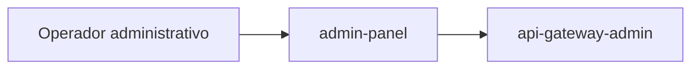

# Exchange — Admin Panel

<!-- DECO-RELEASE-BADGES -->
[](../README.md#alcance-y-estado) [](../README.md#limitaciones-conocidas) [](../README.md#arquitectura)
<!-- /DECO-RELEASE-BADGES -->

<!-- DECO-NON-PRODUCTION-NOTICE -->
> **Advertencia:** prototipo en fase inicial, no apto para producción. No conectes este servicio a fondos, cuentas bancarias, wallets, datos de clientes ni credenciales reales. Las capacidades descritas son referencias al código y no pruebas de aceptación; las rutas, controles y dependencias requieren validación independiente.
<!-- /DECO-NON-PRODUCTION-NOTICE -->


[](https://nextjs.org/)
[](https://www.typescriptlang.org/)
[](https://pnpm.io/)
[](LICENSE)
[](#)

Panel administrativo (Next.js) para operar, auditar y monitorear DECO EXCHANGE desde un centro conectado por Gateway Admin.

## Integraciones actuales

- Autenticación administrativa, verificación de sesión, roles y usuarios admin por Gateway Admin.
- Dashboard con Admin Analytics conectado y badges por fuente: auth, ledger, P2P y KYC/riesgo.
- Plan de conexión de Mercados en `docs/MARKETS_CONNECTION_PLAN.md`; `exchange--micro-market-data` ya existe y pasa por Gateway Admin/User.
- Fees y comisiones conectados por Gateway Admin para lectura y activación/pausa de reglas de fee schedules.
- Config de spreads conectado por Gateway Admin para lectura de bandas fiat/crypto y alertas de pricing.
- Límites globales conectados por Gateway Admin con reglas de política, evaluación operativa, solicitudes de cambio y aprobación maker-checker.
- Custodia crypto conectada por Gateway Admin para lectura de wallets reales, depósitos recientes y watchtower.
- Custodia fiat conectada por Gateway Admin para lectura inicial de pasarelas, fees externos y conciliación.
- Integridad de balances conectada por Gateway Admin para lectura inicial de activos, pasivos, ratio de solvencia y controles.
- Flujos crypto conectados por Gateway Admin para lectura inicial de hashes, confirmaciones, barridos y conciliación on-chain.
- Flujos crypto incluyen bitácora visible, historial de acciones auditadas, registro de bloqueo de retiro, liberación de saldo o investigación y flujo maker-checker con aprobación, rechazo y ejecución simulada.
- Flujos fiat conectados por Gateway Admin para lectura inicial de conciliación, alertas y diferencias operativas.
- Mapa central de conexión por dominio: conectado, parcial o pendiente.
- Operaciones conectadas progresivamente: funding, retiros, remesas, DECOPAY, QR P2P, pricing y P2P admin.
- Puntos Deco agregado como línea operativa independiente para red física verificada; consume BFF `/api/points-deco` y Gateway Admin hacia `exchange--micro-points-deco-core`.
- Puntos Deco muestra caja interna, movimientos recientes, comprobantes operativos, disputas operativas con estado maker-checker, bitácora visual de ejecución, acciones económicas sin hold confirmado, intenciones custody-fiat, liquidaciones y reporte fiscal JSON/CSV para conciliación administrativa; el Admin Panel ya puede ejecutar resoluciones aprobadas por maker-checker, transicionar acciones económicas sin hold y registrar dispatch fiat mediante BFF/Gateway Admin con guarda de roles `super_admin`/`admin` y reautenticación OTP reciente. Los adapters seguros de `refund_user` y `release_to_point` ya registran intención en custody-fiat antes del payout contable por wallet-ledger; falta confirmar settlement real de proveedor por país.
- KYC/Risk conectado a `exchange--micro-kyc-risk` por `/api/kyc-risk`.
- Usuarios finales, catálogo de activos, wallets fiat/crypto y ledger consultados por BFF routes internas.
- Vistas conectadas reutilizables para activos, wallets y transacciones, manteniendo placeholders honestos donde falta microservicio.
- Tema light/dark, logo DECO EXCHANGE y favicon del panel administrativo.

## Arquitectura de conexión

La interfaz no debe llamar microservicios directamente. El flujo esperado es:

```text
Admin Panel -> /api/* BFF -> Gateway Admin -> microservicio
```

Las vistas que todavía no tienen endpoint productivo deben mostrar estado pendiente o parcial, nunca datos falsos como si fueran reales.

## Estado de conexión por dominio

- `Usuarios y roles`: admins, roles y usuarios finales conectados; tier/VIP queda pendiente de perfil financiero.
- `Catálogo de activos`: activos fiat/crypto y canales de fondeo conectados; pares/redes operativas siguen pendientes.
- `Wallet ledger`: wallets fiat/crypto, balances, ledger, custodia crypto y custodia fiat conectados; reconciliación profunda sigue pendiente.
- `Operaciones`: funding, retiros, remesas, DECOPAY, QR P2P y transferencias ledger conectadas.
- `Puntos Deco`: red física verificada para recargas, retiros, remesas y efectivo asistido; caja, movimientos, comprobantes, disputas con maker-checker, ejecución controlada hold-based, bitácora visual, acciones económicas sin hold confirmado, intenciones custody-fiat, liquidaciones y reporte fiscal CSV conectados por Gateway Admin. Los botones sensibles solo se habilitan para roles administrativos elevados y OTP de reautenticación vigente. `refund_user` y `release_to_point` sin hold ya tienen intención custody-fiat, dispatch auditado y adapter seguro por wallet-ledger; KYB avanzado, GPS protegido, settlement real de proveedores fiat y PDF fiscal quedan como fases controladas.
- `KYC/Risk`: conectado por Gateway Admin, con fuentes externas y analítica avanzada pendientes.
- `Dashboard operativo`: Admin Analytics agrega auth, ledger, P2P y KYC/riesgo; faltan series históricas, volumen USD y revenue reales.
- `Trading`: Landing de Mercados creada; `exchange--micro-market-data` conectado por gateway y pendiente de consumo visual.
- `Fees y comisiones`: lectura y activación/pausa de reglas conectadas; creación, edición, simulación y auditoría de cambios quedan como siguiente fase.
- `Config de spreads`: lectura de bandas fiat/crypto conectada; edición y simulación quedan pendientes de auditoría y aprobación.
- `Límites globales`: lectura, evaluación, solicitudes y aprobación maker-checker conectadas; ejecución contra ledger/custodia queda pendiente de contratos controlados.
- `Custodia crypto`: lectura de wallets, depósitos y watchtower conectada; bloqueo/desbloqueo y límites quedan pendientes de flujo auditado.
- `Custodia fiat`: lectura de proveedores, fees externos y conciliación conectada; saldos reales por proveedor, retenciones y acciones quedan pendientes de flujo auditado.
- `Auditoría y custodia`: KYC/Risk, custodia crypto, custodia fiat, integridad de balances, flujos crypto y flujos fiat conectados; evidencias y acciones auditadas ya tienen base maker-checker, pero la ejecución real contra custodia/límites queda como siguiente fase.

## Requisitos

- Node.js `>= 20`
- `pnpm` (recomendado: el que indica `packageManager` en `package.json`)

## Arranque local

```bash
cd Exchange--admin-panel
pnpm install
pnpm dev
```

Abrirá en `http://localhost:3000` (si `3000` está ocupado, puedes usar `pnpm dev -- -p 3001`).

## Lint / Build

```bash
pnpm lint
pnpm build
pnpm start
```

Nota: en Next.js 16 la CLI ya no incluye `next lint`. El comando `pnpm lint` queda como informativo; el comando `pnpm build` ejecuta el chequeo de TypeScript.

## Nota sobre scripts bloqueados (pnpm)

Si ves warnings del estilo "Ignored build scripts" (por ejemplo `sharp`), puedes habilitarlos explícitamente con:

```bash
pnpm approve-builds
```

(Esto es más seguro que habilitar todos los scripts globalmente.)

## Deploy en Vercel / Railway

### Variables de entorno requeridas:

```env
NEXT_PUBLIC_AUTH_API=https://tu-api.railway.app/api
NEXT_PUBLIC_ADMIN_PATH=tu-path-secreto-aqui
NEXT_PUBLIC_REQUIRE_OTP=false
SESSION_SECRET=genera-string-aleatorio-seguro
ADMIN_GATEWAY_URL=http://localhost:8080
ADMIN_GATEWAY_API_PREFIX=/api/v1
INTERNAL_AUTH_TOKEN=xxxxx--xxxxx
```

### Vercel:
- Framework: Next.js (auto-detectado)
- Install: `pnpm install --frozen-lockfile`
- Build: `pnpm build`
- Configura las variables en: Project Settings → Environment Variables

### Railway:
- Agrega las variables de entorno en el panel de Railway
- El path del login será: `https://tu-dominio.railway.app/[TU_ADMIN_PATH]`
- Ejemplo: si pones `NEXT_PUBLIC_ADMIN_PATH=control-x9k2p`, el login estará en `/control-x9k2p`

## Relación con otros proyectos

Este esquema resume relaciones de alto nivel descritas en el repositorio. Las líneas punteadas indican integraciones incompletas o pendientes de validación; ninguna flecha certifica que el flujo esté desplegado o probado.



**Documentación relacionada:** [api-gateway-admin](../exchange--api-gateway-admin/README.md).

**Capacidad:** no hay resultados de carga publicados para este componente. Consulta la sección de [capacidad y rendimiento](../README.md#capacity) del README raíz.

**Archivos del componente:** [`.env.example`](.env.example) · [`CHANGELOG.md`](CHANGELOG.md) · [mapa general](../README.md#service-docs).

<!-- DECO-RELATION-DIAGRAM -->
