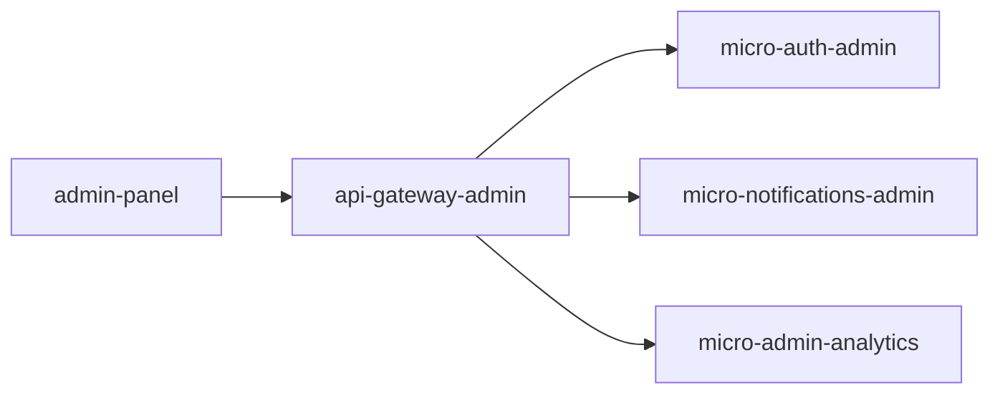

# Admin API Gateway

<!-- DECO-RELEASE-BADGES -->
[](../README.md#alcance-y-estado) [](../README.md#limitaciones-conocidas) [](../README.md#arquitectura)
<!-- /DECO-RELEASE-BADGES -->

<!-- DECO-NON-PRODUCTION-NOTICE -->
> **Advertencia:** prototipo en fase inicial, no apto para producción. No conectes este servicio a fondos, cuentas bancarias, wallets, datos de clientes ni credenciales reales. Las capacidades descritas son referencias al código y no pruebas de aceptación; las rutas, controles y dependencias requieren validación independiente.
<!-- /DECO-NON-PRODUCTION-NOTICE -->


[](https://nestjs.com/)
[](https://nodejs.org/)
[](https://www.typescriptlang.org/)
[](LICENSE)
[](#)

API Gateway for administrative operations in DECO EXCHANGE platform.

## Overview

This gateway routes requests to admin-specific microservices:
- **Auth Service** (Port 7002): Admin authentication and authorization
- **Notifications Service** (Port 7003): Admin notifications and alerts

## Configuration

### Environment Variables

Copy `.env.example` to `.env` and configure:

```bash
PORT=8080
CORS_ORIGINS=http://localhost:3001,http://localhost:3002
RATE_LIMIT_TTL=60
RATE_LIMIT_MAX=200
INTERNAL_AUTH_TOKEN=xxxxx--xxxxx
AUTH_SERVICE_URL=http://localhost:7002
NOTIFICATIONS_SERVICE_URL=http://localhost:7003
JWT_SECRET=xxxxx--xxxxx
```

### Installation

```bash
yarn install
```

### Running the Gateway

```bash
# Development
yarn start:dev

# Production
yarn build
yarn start:prod
```

## API Documentation

Swagger documentation available at: `http://localhost:8080/api/docs`

## Endpoints

### Health Checks
- `GET /health` - Health check
- `GET /health/ready` - Readiness probe
- `GET /health/live` - Liveness probe

### Proxied Services
- `/api/v1/auth/*` - Admin authentication service
- `/api/v1/notifications/*` - Admin notifications service

## Security

- **Rate Limiting**: 200 requests per minute
- **CORS**: Restricted to admin frontend origins
- **Internal Auth**: All microservice requests include internal authentication token
- **Helmet**: Security headers enabled

## Architecture

```
Admin Panel (3001)
      ↓
API Gateway Admin (8080)
      ↓
   ┌──────────────────┐
   ↓                  ↓
Auth Admin (7002)   Notifications Admin (7003)
```

## Development

```bash
# Watch mode
yarn start:dev

# Debug mode
yarn start:debug
```

## Testing

```bash
# Unit tests
yarn test

# E2E tests
yarn test:e2e

# Coverage
yarn test:cov
```

## Relación con otros proyectos

Este esquema resume relaciones de alto nivel descritas en el repositorio. Las líneas punteadas indican integraciones incompletas o pendientes de validación; ninguna flecha certifica que el flujo esté desplegado o probado.



**Documentación relacionada:** [admin-panel](../exchange--admin-panel/README.md) · [micro-auth-admin](../exchange--micro-auth-admin/README.md) · [micro-notifications-admin](../exchange--micro-notifications-admin/README.md) · [micro-admin-analytics](../exchange--micro-admin-analytics/README.md).

**Capacidad:** no hay resultados de carga publicados para este componente. Consulta la sección de [capacidad y rendimiento](../README.md#capacity) del README raíz.

**Archivos del componente:** [`.env.example`](.env.example) · [`CHANGELOG.md`](CHANGELOG.md) · [mapa general](../README.md#service-docs).

<!-- DECO-RELATION-DIAGRAM -->
