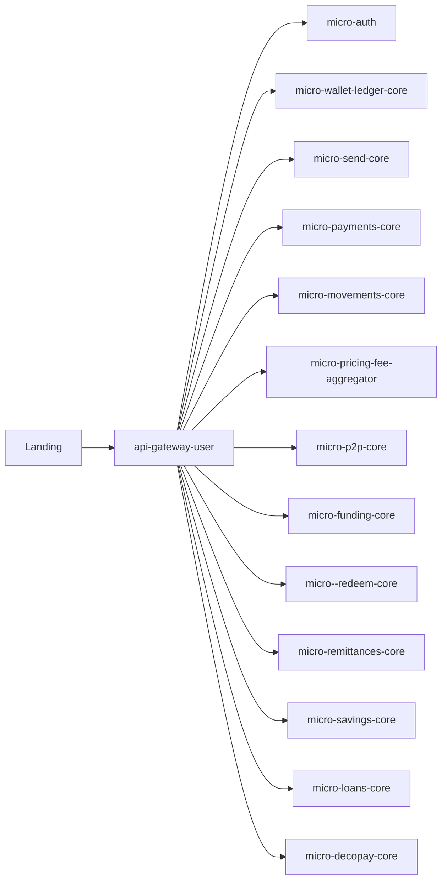

# User API Gateway

<!-- DECO-RELEASE-BADGES -->
[](../README.md#alcance-y-estado) [](../README.md#limitaciones-conocidas) [](../README.md#arquitectura)
<!-- /DECO-RELEASE-BADGES -->

<!-- DECO-NON-PRODUCTION-NOTICE -->
> **Advertencia:** prototipo en fase inicial, no apto para producción. No conectes este servicio a fondos, cuentas bancarias, wallets, datos de clientes ni credenciales reales. Las capacidades descritas son referencias al código y no pruebas de aceptación; las rutas, controles y dependencias requieren validación independiente.
<!-- /DECO-NON-PRODUCTION-NOTICE -->


[](https://nestjs.com/)
[](https://nodejs.org/)
[](https://www.typescriptlang.org/)
[](LICENSE)
[](#)

API Gateway for end-user operations in DECO EXCHANGE platform.

## Overview

This gateway routes requests to user-specific microservices:
- **Auth Service** (Port 7001): User authentication and authorization
- **Notifications Service** (Port 7004): User notifications and alerts
- **Wallet Ledger Core** (Port 9001): Wallets/ledger internal operations
- **Payments Core** (Port 3002): Payments internal operations
- **Internal Transfers** (Port 3006): P2P transfers between users

## Configuration

### Environment Variables

Copy `.env.example` to `.env` and configure:

```bash
PORT=8081
CORS_ORIGINS=http://localhost:3000,http://localhost:3002
RATE_LIMIT_TTL=60
RATE_LIMIT_MAX=50
INTERNAL_AUTH_TOKEN=xxxxx--xxxxx
AUTH_SERVICE_URL=http://localhost:7001
NOTIFICATIONS_SERVICE_URL=http://localhost:7004
WALLET_LEDGER_SERVICE_URL=http://localhost:9001
PAYMENTS_SERVICE_URL=http://localhost:3002
INTERNAL_TRANSFERS_SERVICE_URL=http://localhost:3006
JWT_SECRET=xxxxx--xxxxx
```

### Installation

```bash
yarn install
```

### Running the Gateway

```bash
# Development
yarn start:dev

# Production
yarn build
yarn start:prod
```

## API Documentation

Swagger documentation available at: `http://localhost:8081/api/docs`

## Endpoints

### Health Checks
- `GET /health` - Health check
- `GET /health/ready` - Readiness probe
- `GET /health/live` - Liveness probe

### Proxied Services
- `/api/v1/auth/*` - User authentication service
- `/api/v1/notifications/*` - User notifications service
- `/api/v1/wallet/*` - Wallet Ledger Core (forwarded to internal endpoints)
- `/api/v1/p2p/*` - Payments Core (forwarded to internal endpoints)
- `/api/v1/internal-transfers/*` - Internal Transfers / P2P (forwarded to internal endpoints)

## Security

- **Rate Limiting**: 50 requests per minute
- **CORS**: Restricted to user frontend origins
- **Internal Auth**: All microservice requests include internal authentication token
- **Helmet**: Security headers enabled

## Architecture

```
User Dashboard (3000)
      ↓
API Gateway User (8081)
      ↓
   ┌──────────────────┐
   ↓                  ↓
Auth User (7001)    Notifications User (7004)

Wallet Ledger Core (9001)   Payments Core (3002)   Internal Transfers (3006)
```

## Development

```bash
# Watch mode
yarn start:dev

# Debug mode
yarn start:debug
```

## Testing

```bash
# Unit tests
yarn test

# E2E tests
yarn test:e2e

# Coverage
yarn test:cov
```

## Relación con otros proyectos

Este esquema resume relaciones de alto nivel descritas en el repositorio. Las líneas punteadas indican integraciones incompletas o pendientes de validación; ninguna flecha certifica que el flujo esté desplegado o probado.



**Documentación relacionada:** [Landing](../exchange--Landing/README.md) · [micro-auth](../exchange--micro-auth/README.md) · [micro-wallet-ledger-core](../exchange--micro-wallet-ledger-core/README.md) · [micro-send-core](../exchange--micro-send-core/README.md) · [micro-payments-core](../exchange--micro-payments-core/README.md) · [micro-movements-core](../exchange--micro-movements-core/README.md) · [micro-pricing-fee-aggregator](../exchange--micro-pricing-fee-aggregator/README.md) · [micro-p2p-core](../exchange--micro-p2p-core/README.md) · [micro-funding-core](../exchange--micro-funding-core/README.md) · [micro--redeem-core](../exchange--micro--redeem-core/README.md) · [micro-remittances-core](../exchange--micro-remittances-core/README.md) · [micro-savings-core](../exchange--micro-savings-core/README.md) · [micro-loans-core](../exchange--micro-loans-core/README.md) · [micro-decopay-core](../exchange--micro-decopay-core/README.md).

**Capacidad:** no hay resultados de carga publicados para este componente. Consulta la sección de [capacidad y rendimiento](../README.md#capacity) del README raíz.

**Archivos del componente:** [`.env.example`](.env.example) · [`CHANGELOG.md`](CHANGELOG.md) · [mapa general](../README.md#service-docs).

<!-- DECO-RELATION-DIAGRAM -->
