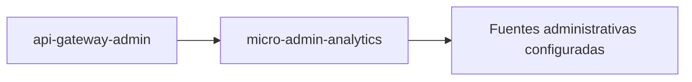

# exchange--micro-admin-analytics

<!-- DECO-RELEASE-BADGES -->
[](../README.md#alcance-y-estado) [](../README.md#limitaciones-conocidas) [](../README.md#arquitectura)
<!-- /DECO-RELEASE-BADGES -->

<!-- DECO-NON-PRODUCTION-NOTICE -->
> **Advertencia:** prototipo en fase inicial, no apto para producción. No conectes este servicio a fondos, cuentas bancarias, wallets, datos de clientes ni credenciales reales. Las capacidades descritas son referencias al código y no pruebas de aceptación; las rutas, controles y dependencias requieren validación independiente.
<!-- /DECO-NON-PRODUCTION-NOTICE -->


Microservicio de analitica administrativa para DECO EXCHANGE.

## Estado

- Servicio base creado.
- Endpoints internos protegidos por `INTERNAL_AUTH_TOKEN`.
- Agrega metricas reales desde micros internos cuando estan disponibles.
- No genera metricas inventadas: si una fuente no responde, conserva valores en cero para esa fuente y la reporta como no disponible.

## Fuentes actuales

- `exchange--micro-auth`: conteo de usuarios activos.
- `exchange--micro-wallet-ledger-core`: conteo de movimientos de ledger.
- `exchange--micro-p2p-core`: conteo de ordenes P2P y disputas abiertas.
- `exchange--micro-kyc-risk`: conteo de casos KYC/riesgo.

## Endpoints

- `GET /health`
- `GET /api/v1/admin-analytics/overview`
- `GET /api/v1/admin-analytics/series?range=30d`
- `GET /api/v1/admin-analytics/kpis`

## Variables

```env
PORT=9029
INTERNAL_AUTH_TOKEN=xxxxx--xxxxx
AUTH_SERVICE_URL=http://localhost:7000
WALLET_LEDGER_SERVICE_URL=http://localhost:9001
P2P_CORE_SERVICE_URL=http://localhost:3021
KYC_RISK_SERVICE_URL=http://localhost:9028
PRICING_AGGREGATOR_SERVICE_URL=http://localhost:3013
```

## Desarrollo

```bash
yarn install
yarn start:dev
```

## Relación con otros proyectos

Este esquema resume relaciones de alto nivel descritas en el repositorio. Las líneas punteadas indican integraciones incompletas o pendientes de validación; ninguna flecha certifica que el flujo esté desplegado o probado.



**Documentación relacionada:** [api-gateway-admin](../exchange--api-gateway-admin/README.md).

**Capacidad:** no hay resultados de carga publicados para este componente. Consulta la sección de [capacidad y rendimiento](../README.md#capacity) del README raíz.

**Archivos del componente:** [`.env.example`](.env.example) · [`CHANGELOG.md`](CHANGELOG.md) · [mapa general](../README.md#service-docs).

<!-- DECO-RELATION-DIAGRAM -->
