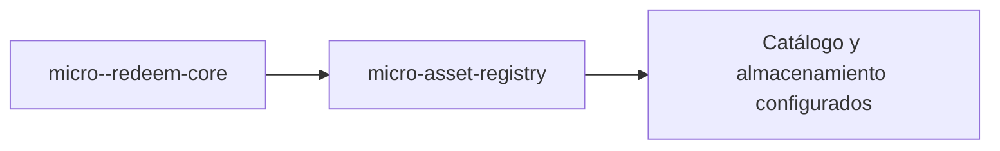

# Exchange - Micro Asset Registry

<!-- DECO-RELEASE-BADGES -->
[](../README.md#alcance-y-estado) [](../README.md#limitaciones-conocidas) [](../README.md#arquitectura)
<!-- /DECO-RELEASE-BADGES -->

<!-- DECO-NON-PRODUCTION-NOTICE -->
> **Advertencia:** prototipo en fase inicial, no apto para producción. No conectes este servicio a fondos, cuentas bancarias, wallets, datos de clientes ni credenciales reales. Las capacidades descritas son referencias al código y no pruebas de aceptación; las rutas, controles y dependencias requieren validación independiente.
<!-- /DECO-NON-PRODUCTION-NOTICE -->


**Puerto**: 3010  
**Descripción**: Catálogo centralizado de activos FIAT y CRYPTO con metadata, networks, y habilitación dinámica.

## 🎯 Propósito

Fuente única de verdad para TODOS los activos soportados en DECO EXCHANGE:
- ✅ Monedas FIAT (USD, EUR, MXN, COP, ARS, BRL, etc.)
- ✅ Criptomonedas (BTC, ETH, USDT, SOL, etc.)
- ✅ Asociación con blockchain networks (BTC, ERC20, TRC20, Solana, etc.)
- ✅ Gestión dinámica de habilitación/deshabilitación
- ✅ Metadata de compliance (KYC levels, límites)

## 🚀 Quick Start

### Requisitos

```bash
# Node.js 20+
node --version

# Yarn
yarn --version

# MongoDB
docker run -d -p 27017:27017 --name mongo mongo:7
```

### Instalación

```bash
cd Exchange--micro-asset-registry
yarn install
```

### Configuración

```bash
# Copiar .env.example a .env
cp .env.example .env

# Editar valores
vim .env
```

### Desarrollo

```bash
yarn start:dev
```

Servicio en: `http://localhost:3010`

## 📡 Endpoints

### Assets

| Endpoint | Method | Auth | Descripción |
|----------|--------|------|-------------|
| `/internal/assets` | GET | ✅ | Listar activos (filtros: type, enabled) |
| `/internal/assets/:code` | GET | ✅ | Obtener asset |
| `/internal/assets` | POST | ✅ | Crear asset |
| `/internal/assets/:code` | PUT | ✅ | Actualizar |
| `/internal/assets/:code/enable` | POST | ✅ | Habilitar |
| `/internal/assets/:code/disable` | POST | ✅ | Deshabilitar |
| `/internal/assets/:code` | DELETE | ✅ | Eliminar |

### Networks

| Endpoint | Method | Auth | Descripción |
|----------|--------|------|-------------|
| `/internal/networks` | GET | ✅ | Listar networks (filtros: kind, enabled) |
| `/internal/networks/:code` | GET | ✅ | Obtener network |
| `/internal/networks` | POST | ✅ | Crear network |
| `/internal/networks/:code` | PUT | ✅ | Actualizar |
| `/internal/networks/:code/enable` | POST | ✅ | Habilitar |
| `/internal/networks/:code/disable` | POST | ✅ | Deshabilitar |
| `/internal/networks/:code` | DELETE | ✅ | Eliminar |

### Health

| Endpoint | Method | Auth | Descripción |
|----------|--------|------|-------------|
| `/health` | GET | ❌ | Health check |

## 🔐 Autenticación

Todos los endpoints `/internal/*` requieren header:

```bash
export INTERNAL_AUTH_TOKEN="$(openssl rand -hex 32)"
# Configure el mismo valor como INTERNAL_AUTH_TOKEN del servicio.
```

Configura el mismo token aleatorio en el entorno del servicio y del cliente local. `xxxxx--xxxxx` es solo un marcador y el servicio rechaza solicitudes si el token falta o conserva ese marcador.

## 📝 Ejemplos de Uso

### Crear Asset FIAT

```bash
curl -X POST http://localhost:3010/api/v1/internal/assets \
  -H "Content-Type: application/json" \
  -H "x-internal-auth: ${INTERNAL_AUTH_TOKEN}" \
  -d '{
    "code": "USD",
    "name": "US Dollar",
    "type": "fiat",
    "decimals": 2,
    "fiatMetadata": {
      "isoCurrencyCode": "USD",
      "countries": ["US"],
      "symbol": "$"
    }
  }'
```

### Crear Asset CRYPTO

```bash
curl -X POST http://localhost:3010/api/v1/internal/assets \
  -H "Content-Type: application/json" \
  -H "x-internal-auth: ${INTERNAL_AUTH_TOKEN}" \
  -d '{
    "code": "BTC",
    "name": "Bitcoin",
    "type": "crypto",
    "decimals": 8,
    "cryptoMetadata": {
      "coinId": "bitcoin",
      "networks": ["BTC"]
    }
  }'
```

### Listar Assets Habilitados

```bash
curl -X GET "http://localhost:3010/api/v1/internal/assets?enabled=true" \
  -H "x-internal-auth: ${INTERNAL_AUTH_TOKEN}"
```

### Crear Network

```bash
curl -X POST http://localhost:3010/api/v1/internal/networks \
  -H "Content-Type: application/json" \
  -H "x-internal-auth: ${INTERNAL_AUTH_TOKEN}" \
  -d '{
    "code": "ERC20",
    "name": "Ethereum (ERC20)",
    "kind": "BLOCKCHAIN",
    "chainId": 1,
    "confirmations": 12,
    "minWithdrawalFee": 500000,
    "withdrawalFeeType": "FIXED",
    "withdrawalFeeValue": 500000
  }'
```

## 🧪 Testing

```bash
# Unit tests
yarn test

# Coverage
yarn test:cov

# E2E  tests
yarn test:e2e
```

## 📊 Estructura de Datos

### Asset Schema

```typescript
{
  code: string;              // USD, BTC
  name: string;
  type: 'fiat' | 'crypto';
  decimals: number;
  enabled: boolean;
  minAmount: number;         // Minor units
  maxAmount: number;
  
  // FIAT only
  fiatMetadata?: {
    isoCurrencyCode: string;
    countries: string[];
    symbol: string;
  };
  
  // CRYPTO only
  cryptoMetadata?: {
    coinId: string;
    contractAddress?: string;
    networks: string[];
  };
  
  // Compliance
  requiresKYC: boolean;
  level: 'BASIC' | 'VERIFIED' | 'ADVANCED';
}
```

### Network Schema

```typescript
{
  code: string;              // BTC, ERC20, TRC20
  name: string;
  kind: 'BLOCKCHAIN' | 'RAIL_FIAT';
  enabled: boolean;
  
  chainId?: number;
  confirmations?: number;
  
  minWithdrawalFee: number;
  withdrawalFeeType: 'FIXED' | 'PERCENTAGE';
  withdrawalFeeValue: number;
}
```

## 🔧 Variables de Entorno

| Variable | Required | Default | Descripción |
|----------|----------|---------|-------------|
| `PORT` | No | 3010 | Puerto del servicio |
| `NODE_ENV` | No | development | Entorno |
| `MONGODB_URI` | Yes | - | URI de MongoDB |
| `INTERNAL_AUTH_TOKEN` | Yes | `xxxxx--xxxxx` | Configure a generated token in the runtime environment; the marker is not valid. |

## 📚 Integración con Otros Servicios

Este servicio es consultado por:
- `pricing-fiat`: Validar assets FIAT antes de crear tickers
- `pricing-crypto`: Validar assets CRYPTO y obtener coinId
- `fee-aggregator`: Validar assets en quotes
- `custody-fiat`: Validar monedas FIAT soportadas
- `custody-crypto`: Obtener networks por asset

## ✅ Checklist Pre-Production

- [ ] MongoDB connection string en variables de entorno
- [ ] `INTERNAL_AUTH_TOKEN` generado con `openssl rand -hex 32`
- [ ] Seed data inicial (USD, EUR, MXN, BTC, ETH, USDT)
- [ ] Indexes creados (automático en schemas)
- [ ] Health check responde correctamente
- [ ] Logs estructurados configurados

---

**Estado**: ✅ Completado  
**Versión**: 1.0.0  
**Port**: 3010

## Relación con otros proyectos

Este esquema resume relaciones de alto nivel descritas en el repositorio. Las líneas punteadas indican integraciones incompletas o pendientes de validación; ninguna flecha certifica que el flujo esté desplegado o probado.



**Documentación relacionada:** [micro--redeem-core](../exchange--micro--redeem-core/README.md).

**Capacidad:** no hay resultados de carga publicados para este componente. Consulta la sección de [capacidad y rendimiento](../README.md#capacity) del README raíz.

**Archivos del componente:** [`.env.example`](.env.example) · [`CHANGELOG.md`](CHANGELOG.md) · [mapa general](../README.md#service-docs).

<!-- DECO-RELATION-DIAGRAM -->
