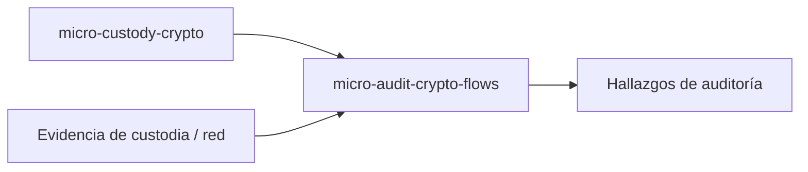

# Micro Audit — Crypto Flows

<!-- DECO-RELEASE-BADGES -->
[](../README.md#alcance-y-estado) [](../README.md#limitaciones-conocidas) [](../README.md#arquitectura)
<!-- /DECO-RELEASE-BADGES -->

<!-- DECO-NON-PRODUCTION-NOTICE -->
> **Advertencia:** prototipo en fase inicial, no apto para producción. No conectes este servicio a fondos, cuentas bancarias, wallets, datos de clientes ni credenciales reales. Las capacidades descritas son referencias al código y no pruebas de aceptación; las rutas, controles y dependencias requieren validación independiente.
<!-- /DECO-NON-PRODUCTION-NOTICE -->


[](https://go.dev/)
**Licencia: pendiente de confirmar para este subproyecto.**
[](#)

Watcher Go que monitorea discrepancias en flujos crypto en tiempo real.

## Tipo de servicio

**Background Watcher (sin puerto HTTP)** — se mantiene vivo con `select{}`.

## Funcionamiento

1. Conecta a MongoDB y lee configuración del ledger
2. Monitorea colecciones `ledger_txs` y `ledger_entries` en tiempo real
3. Detecta discrepancias entre flujos crypto registrados vs esperados
4. Reporta anomalías mediante logs estructurados (zap)

## Estructura

```
main.go              # Entry point
internal/
  config/
    ledger.go        # Configuración de DB y colecciones
```

## Variables de Entorno

| Variable | Descripción |
|----------|-------------|
| `MONGODB_URI` | Conexión a MongoDB Atlas |
| `LEDGER_DB_NAME` | Nombre de la base de datos del ledger |

## Stack

- Go 1.21+
- MongoDB Go Driver
- godotenv
- zap (structured logging)

## Ejecución

```bash
go run main.go
```

## Relación con otros proyectos

Este esquema resume relaciones de alto nivel descritas en el repositorio. Las líneas punteadas indican integraciones incompletas o pendientes de validación; ninguna flecha certifica que el flujo esté desplegado o probado.



**Documentación relacionada:** [micro-custody-crypto](../exchange--micro-custody-crypto/README.md).

**Capacidad:** no hay resultados de carga publicados para este componente. Consulta la sección de [capacidad y rendimiento](../README.md#capacity) del README raíz.

**Archivos del componente:** [`.env.example`](.env.example) · [`CHANGELOG.md`](CHANGELOG.md) · [mapa general](../README.md#service-docs).

<!-- DECO-RELATION-DIAGRAM -->
