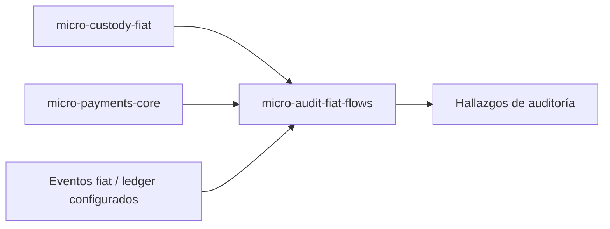

# Micro Audit — Fiat Flows

<!-- DECO-RELEASE-BADGES -->
[](../README.md#alcance-y-estado) [](../README.md#limitaciones-conocidas) [](../README.md#arquitectura)
<!-- /DECO-RELEASE-BADGES -->

<!-- DECO-NON-PRODUCTION-NOTICE -->
> **Advertencia:** prototipo en fase inicial, no apto para producción. No conectes este servicio a fondos, cuentas bancarias, wallets, datos de clientes ni credenciales reales. Las capacidades descritas son referencias al código y no pruebas de aceptación; las rutas, controles y dependencias requieren validación independiente.
<!-- /DECO-NON-PRODUCTION-NOTICE -->


[](https://nestjs.com/)
[](https://www.typescriptlang.org/)
**Licencia: pendiente de confirmar para este subproyecto.**
[](#)

Worker/Scheduler que audita depósitos fiat pendientes comparando estado en el ledger vs proveedores bancarios (Stripe/Bank API).

## Tipo de servicio

**Worker (sin puerto HTTP)** — se ejecuta como cron scheduler.

## Funcionamiento

1. Cron `EVERY_MINUTE` revisa depósitos fiat pendientes
2. Compara estado en el ledger con el estado reportado por el proveedor bancario
3. Si un depósito está `settled` en el banco pero `pending` en el ledger por >1h, dispara alarma

## Bases de Datos

- **MongoDB `deco_audit_fiat`**: base propia para registros de auditoría
- **MongoDB `deco_ledger_core`**: lectura de transacciones (read-only via `ledger_conn`)

## Variables de Entorno

| Variable | Descripción |
|----------|-------------|
| `MONGODB_URI` | Conexión a MongoDB Atlas |

## Stack

- NestJS 10
- Mongoose 8
- `@nestjs/schedule` (cron jobs)

## Instalación

```bash
yarn install
yarn start:dev
```

## Relación con otros proyectos

Este esquema resume relaciones de alto nivel descritas en el repositorio. Las líneas punteadas indican integraciones incompletas o pendientes de validación; ninguna flecha certifica que el flujo esté desplegado o probado.



**Documentación relacionada:** [micro-custody-fiat](../exchange--micro-custody-fiat/README.md) · [micro-payments-core](../exchange--micro-payments-core/README.md).

**Capacidad:** no hay resultados de carga publicados para este componente. Consulta la sección de [capacidad y rendimiento](../README.md#capacity) del README raíz.

**Archivos del componente:** [`.env.example`](.env.example) · [`CHANGELOG.md`](CHANGELOG.md) · [mapa general](../README.md#service-docs).

<!-- DECO-RELATION-DIAGRAM -->
