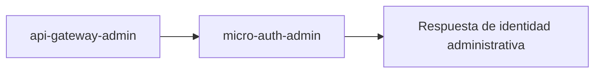

# Deco31416 Admin Auth

<!-- DECO-RELEASE-BADGES -->
  
<!-- /DECO-RELEASE-BADGES -->

<!-- DECO-NON-PRODUCTION-NOTICE -->
> **Advertencia:** prototipo en fase inicial, no apto para producción. No conectes este servicio a fondos, cuentas bancarias, wallets, datos de clientes ni credenciales reales. Las capacidades descritas son referencias al código y no pruebas de aceptación; las rutas, controles y dependencias requieren validación independiente.
<!-- /DECO-NON-PRODUCTION-NOTICE -->

Microservicio de autenticación administrativa basado en NestJS. Esta copia forma parte de la primera versión prototipo de Deco Exchange y no está lista para producción.

## Puertos locales

- API: `http://localhost:7002`
- Base path: `/api/v1`
- Swagger: `/api/docs` (solo para desarrollo)

## Configuración local

1. Copia `.env.example` a `.env`.
2. Reemplaza los marcadores de `JWT_SECRET`, `ARGON2_PEPPER`, `INTERNAL_AUTH_TOKEN` y `NOTIFICATIONS_SERVICE_TOKEN` con valores aleatorios.
3. Inicia el servicio con `yarn start:dev`.

Los marcadores `xxxxx--xxxxx` no son credenciales válidas. El launcher local puede generar JWT y pepper si faltan, pero requiere que `INTERNAL_AUTH_TOKEN` y `NOTIFICATIONS_SERVICE_TOKEN` estén configurados. El token de notificaciones debe coincidir con el servicio de notificaciones emparejado y mantenerse distinto de los otros secretos.

## Seguridad

- El panel web no debe llamar al backend con secretos incluidos en el navegador.
- Mantén `ADMIN_AUTH_ALLOW_REGISTRATION=false` salvo que exista un proceso de alta autorizado.
- No publiques `.env`, tokens, OTP, reset tokens, certificados ni claves de firma.
- No habilites Swagger en despliegues públicos.

## Licencia

Este subproyecto conserva su propio archivo `LICENSE` MIT. La raíz también incluye una licencia MIT; otros subproyectos mantienen sus propias declaraciones, incluidas algunas `UNLICENSED`.

## Relación con otros proyectos

Este esquema resume relaciones de alto nivel descritas en el repositorio. Las líneas punteadas indican integraciones incompletas o pendientes de validación; ninguna flecha certifica que el flujo esté desplegado o probado.

**Documentación relacionada:** [api-gateway-admin](../exchange--api-gateway-admin/README.md).

**Capacidad:** no hay resultados de carga publicados para este componente. Consulta la sección de [capacidad y rendimiento](../README.md#capacity) del README raíz.

**Archivos del componente:** [`.env.example`](.env.example) · [`CHANGELOG.md`](CHANGELOG.md) · [mapa general](../README.md#service-docs).

<!-- DECO-RELATION-DIAGRAM -->
