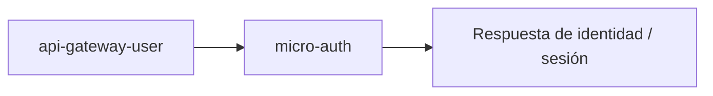

# DECO31416 Admin Auth

<!-- DECO-RELEASE-BADGES -->
[](../README.md#alcance-y-estado) [](../README.md#limitaciones-conocidas) [](../README.md#arquitectura)
<!-- /DECO-RELEASE-BADGES -->

<!-- DECO-NON-PRODUCTION-NOTICE -->
> **Advertencia:** prototipo en fase inicial, no apto para producción. No conectes este servicio a fondos, cuentas bancarias, wallets, datos de clientes ni credenciales reales. Las capacidades descritas son referencias al código y no pruebas de aceptación; las rutas, controles y dependencias requieren validación independiente.
<!-- /DECO-NON-PRODUCTION-NOTICE -->


Version actual: `0.0.9`

Microservicio privado de autenticacion administrativa para el centro operativo DECO31416.

Este servicio no autentica usuarios publicos de la landing. Su responsabilidad es validar operadores del `admin-panel--Deco31416` con email, clave y OTP, y emitir sesiones administrativas que el BFF del admin panel valida antes de llamar al backend gateway.

## Arquitectura

```text
Operador -> admin-panel--Deco31416 -> exchange--micro-auth
Operador -> admin-panel--Deco31416 -> backend gateway -> datos/micros
exchange--micro-auth -> exchange--micro-notifications -> Resend/Twilio
```

Reglas:

- El navegador no llama directo al backend con secretos.
- El admin panel valida la sesion aqui antes de usar `ADMIN_SERVER_API_KEY`.
- El registro de operadores esta desactivado por defecto con `ADMIN_AUTH_ALLOW_REGISTRATION=false`.
- Swagger solo debe estar activo en desarrollo.

## Puertos

- API local: `http://localhost:7001`
- Base path: `/api/v1`
- Swagger dev: `/api/docs`

## Variables principales

Ver `.env.example`.

Minimas para local:

```env
PORT=7001
NODE_ENV=development
CORS_ORIGIN=http://localhost:3100,http://localhost:4000
MONGODB_URI=mongodb://localhost:27017/deco31416-admin-auth
REDIS_URI=redis://localhost:6379
JWT_SECRET=xxxxx--xxxxx
ARGON2_PEPPER=xxxxx--xxxxx
JWT_ISSUER=deco31416-admin-auth
LOGIN_OTP_ENABLED=true
NOTIFICATIONS_SERVICE_URL=http://localhost:7002
NOTIFICATIONS_SERVICE_TOKEN=xxxxx--xxxxx
INTERNAL_AUTH_TOKEN=xxxxx--xxxxx
```

Los marcadores no son credenciales válidas. Configura valores aleatorios antes de iniciar el servicio. `NOTIFICATIONS_SERVICE_TOKEN` debe coincidir con el token configurado en el servicio de notificaciones correspondiente; mantenlo separado del JWT, del pepper y de `INTERNAL_AUTH_TOKEN`.

## Arranque local

```bash
cd exchange--micro-auth
yarn install
yarn start:dev
```

## Seguridad

- No imprimir passwords, OTP, reset tokens, magic links ni headers sensibles.
- No usar fallbacks de secretos.
- `JWT_SECRET`, `ARGON2_PEPPER` e `INTERNAL_AUTH_TOKEN` deben ser secretos distintos. `NOTIFICATIONS_SERVICE_TOKEN` también debe ser distinto de esos valores, pero coincidir con la configuración del servicio de notificaciones emparejado.
- CORS en producción debe apuntar solo al dominio del frontend autorizado (por ejemplo, `https://tu-dominio.example`) y al backend/gateway autorizado.

## Validacion

```bash
yarn build
```

## Relación con otros proyectos

Este esquema resume relaciones de alto nivel descritas en el repositorio. Las líneas punteadas indican integraciones incompletas o pendientes de validación; ninguna flecha certifica que el flujo esté desplegado o probado.



**Documentación relacionada:** [api-gateway-user](../exchange--api-gateway-user/README.md).

**Capacidad:** no hay resultados de carga publicados para este componente. Consulta la sección de [capacidad y rendimiento](../README.md#capacity) del README raíz.

**Archivos del componente:** [`.env.example`](.env.example) · [`CHANGELOG.md`](CHANGELOG.md) · [mapa general](../README.md#service-docs).

<!-- DECO-RELATION-DIAGRAM -->
