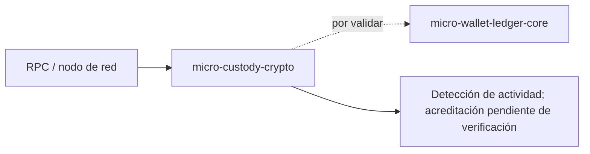

# Micro NG Custody - Ledger System

<!-- DECO-RELEASE-BADGES -->
[](../README.md#alcance-y-estado) [](../README.md#limitaciones-conocidas) [](../README.md#arquitectura)
<!-- /DECO-RELEASE-BADGES -->

<!-- DECO-NON-PRODUCTION-NOTICE -->
> **Advertencia:** prototipo en fase inicial, no apto para producción. No conectes este servicio a fondos, cuentas bancarias, wallets, datos de clientes ni credenciales reales. Las capacidades descritas son referencias al código y no pruebas de aceptación; las rutas, controles y dependencias requieren validación independiente.
<!-- /DECO-NON-PRODUCTION-NOTICE -->


Prototipo de servicio de custodia cripto con NestJS y MongoDB. El código y este documento no certifican contabilidad de doble partida completa, controles de custodia ni aptitud para operar fondos reales.

## Features

✅ **Double-Entry Bookkeeping** - Immutable, balanced transactions  
✅ **Multi-Asset Support** - Fiat and crypto assets with proper decimal handling  
✅ **Holds/Escrow** - Lock funds temporarily without journal entries  
✅ **Idempotency** - Duplicate-safe operations  
✅ **Derived Balances** - Real-time calculation from transaction history  
✅ **Full Test Coverage** - Unit and E2E tests included  
✅ **TypeScript** - Type-safe with strict coding standards  
✅ **MongoDB** - Scalable NoSQL storage with proper indexing  

## Quick Start

### Prerequisites
- Node.js 18+
- MongoDB 5+
- pnpm

### Installation

```bash
# Install dependencies
pnpm install

# Configure environment
cp .env.example .env
# Edit .env with your MongoDB connection string

# Run tests
pnpm test          # Unit tests
pnpm test:e2e      # Integration tests

# Start development server
pnpm start:dev
```

### Basic Usage

```bash
# Test the ledger endpoint
curl http://localhost:3000/ledger/test

# Create an account
curl -X POST http://localhost:3000/ledger/accounts \
  -H "Content-Type: application/json" \
  -d '{
    "ownerType": "user",
    "ownerId": "user123",
    "assetCode": "GIROD",
    "accountType": "liability"
  }'

# Check balance
curl http://localhost:3000/ledger/accounts/{accountId}/balance?assetCode=GIROD
```

## Architecture

### Core Services

- **AccountService**: Manages ledger accounts
- **PostingService**: Posts journal entries with validation
- **BalanceService**: Calculates real-time balances
- **HoldService**: Manages escrow/holds

### Data Flow

```
Request → Controller → Service → MongoDB
                ↓
           Validation (class-validator)
                ↓
           Business Logic
                ↓
           Atomic Transaction
```

## Project Structure

```
src/
├── ledger/
│   ├── controllers/
│   │   └── ledger.controller.ts
│   ├── models/
│   │   ├── *.schema.ts          # MongoDB schemas
│   │   ├── *.dto.ts              # Request/response DTOs
│   │   └── *.response.dto.ts     # Response types
│   ├── services/
│   │   ├── account.service.ts
│   │   ├── balance.service.ts
│   │   ├── hold.service.ts
│   │   └── posting.service.ts
│   └── ledger.module.ts
├── app.module.ts
└── main.ts

test/
├── ledger.e2e-spec.ts            # Integration tests
└── jest-e2e.json

docs/
├── LEDGER-DOCUMENTATION.md       # Full API docs
├── ledger-planification.md       # Technical planning
└── manifest.md                   # Implementation roadmap
```

## Key Concepts

### Double-Entry Bookkeeping

Every transaction must balance:
```
Debits = Credits (per asset)
```

Example - User deposit:
```json
{
  "lines": [
    { "account": "platform_asset", "direction": "debit", "amount": 10000 },
    { "account": "user_liability", "direction": "credit", "amount": 10000 }
  ]
}
```

### Idempotency

Provide unique keys to prevent duplicates:
```json
{
  "externalIdempotencyKey": "deposit_user123_1234567890",
  ...
}
```

### Minor Units

All amounts stored as integers to avoid floating-point errors:
- GIROD: 2 decimals → 100 minor units = 1 GIROD
- BTC: 8 decimals → 100,000,000 satoshis = 1 BTC

## Testing

### Unit Tests (23 passing)
```bash
pnpm test
```

Coverage includes:
- Account creation and retrieval
- Balance calculations with holds
- Journal entry validation
- Hold management
- Error scenarios

### E2E Tests
```bash
pnpm test:e2e
```

Tests complete workflows:
- Account creation
- Deposit transactions
- Transfers
- Escrow/hold operations

## Configuration

### Environment Variables

```env
MONGODB_URI=mongodb://localhost:27017/custody-ledger
PORT=3000
NODE_ENV=development
```

### MongoDB Indexes

Automatically created on startup:
- `accounts`: (ownerId + assetCode) unique
- `journal_entries`: externalIdempotencyKey unique
- `journal_lines`: (entryId, accountId, createdAt)
- `holds`: (accountId, state)

## Coding Standards

Following strict TypeScript and NestJS best practices:
- ✅ English for all code and documentation
- ✅ Type declarations for all variables and functions
- ✅ JSDoc for public methods
- ✅ Single responsibility per function/class
- ✅ RO-RO pattern for complex parameters
- ✅ Immutable data structures
- ✅ SOLID principles
- ✅ Comprehensive error handling

For repository-wide contribution rules, read [`CONTRIBUTING.md`](../CONTRIBUTING.md).

## Documentation

The planning documents referenced in older copies are not included in this repository snapshot. For current component relationships, see the linked wallet-ledger and audit READMEs below and the [root architecture map](../README.md#arquitectura).

## Capacity and operational maturity

No reproducible load-test results are published for this service. Latency, throughput, concurrent-user capacity, database scaling limits, and RPC/provider quotas are **not measured or validated** here. Any numeric targets from older documentation were planning notes, not benchmark results, and are not capacity guarantees.

Before sizing or operating this component, validate end-to-end consistency, confirmation depth, reconciliation, idempotency, failure recovery, provider limits, and observability in an isolated sandbox. This README does not authorize a production deployment.

## Work to validate

The following items require confirmation against the code and an explicit release plan: balance snapshots, reconciliation, durable event/outbox handling, operational dashboards, and recovery procedures. A roadmap item is not evidence that a control is implemented or tested.

## License

UNLICENSED


## Relación con otros proyectos

Este esquema resume relaciones de alto nivel descritas en el repositorio. Las líneas punteadas indican integraciones incompletas o pendientes de validación; ninguna flecha certifica que el flujo esté desplegado o probado.



**Documentación relacionada:** [micro-wallet-ledger-core](../exchange--micro-wallet-ledger-core/README.md).

**Capacidad:** no hay resultados de carga publicados para este componente. Consulta la sección de [capacidad y rendimiento](../README.md#capacity) del README raíz.

**Archivos del componente:** [`.env.example`](.env.example) · [`CHANGELOG.md`](CHANGELOG.md) · [mapa general](../README.md#service-docs).

<!-- DECO-RELATION-DIAGRAM -->
