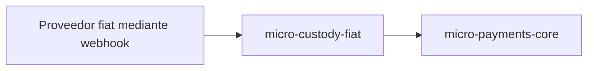

# Exchange - Micro Custody Fiat

<!-- DECO-RELEASE-BADGES -->
[](../README.md#alcance-y-estado) [](../README.md#limitaciones-conocidas) [](../README.md#arquitectura)
<!-- /DECO-RELEASE-BADGES -->

<!-- DECO-NON-PRODUCTION-NOTICE -->
> **Advertencia:** prototipo en fase inicial, no apto para producción. No conectes este servicio a fondos, cuentas bancarias, wallets, datos de clientes ni credenciales reales. Las capacidades descritas son referencias al código y no pruebas de aceptación; las rutas, controles y dependencias requieren validación independiente.
<!-- /DECO-NON-PRODUCTION-NOTICE -->


Microservicio para custodia de activos FIAT mediante integración con proveedores bancarios y de pagos (SPEI, Mercado Pago, Stripe).

## 🚀 Nuevo: Envío de Pagos SPEI con STP

Este módulo ahora soporta **envío activo de órdenes de pago SPEI** a través de STP (Sistema de Transferencias y Pagos), además de recibir webhooks.

**Características:**
- ✅ Firma digital RSA-SHA256 según estándar STP
- ✅ API REST para crear órdenes de pago
- ✅ Consulta de estado de transacciones
- ✅ Manejo de errores y reintentos
- ✅ Validación automática de CLABEs

**Pruebas de referencia:** Ver [scripts/SMOKE_TESTS_README.md](scripts/SMOKE_TESTS_README.md)

**Flujo general:** Ver [el diagrama fiat del repositorio](../README.md#flujo-fiat-de-referencia)

---

## Arquitectura

- **Webhook Ingest**: Recibe notificaciones de providers externos (INBOUND)
- **Payment Orders**: Envía órdenes de pago a STP/SPEI (OUTBOUND) 🆕
- **Signature Verification**: Valida autenticidad de webhooks con HMAC-SHA256
- **Digital Signature**: Firma órdenes con RSA-SHA256 🆕
- **Normalization**: Convierte payloads provider-específicos a dominio genérico `FiatTransfer`
- **Event Emission**: Publica eventos `FIAT_TRANSFER_DETECTED` hacia `payments-core`
- **Idempotencia**: Inbox deduplication + outbox (persistencia)
- **Reconciliación/Resiliencia**: Outbox relay con retries + circuit breaker hacia `payments-core`

## Providers Soportados

### SPEI (México) - INBOUND + OUTBOUND 🆕
- **STP**: Sistema de Transferencias y Pagos (Banxico)
  - **Webhook (INBOUND)**: `POST /api/v1/webhooks/stp`
  - **Payment Orders (OUTBOUND)**: `POST /api/v1/spei/stp/payment-orders` 🆕
  - **Signature**: HMAC-SHA256 (webhooks) + RSA-SHA256 (órdenes)
- **Banorte**: Transferencias interbancarias 24/7
  - **Endpoint**: `POST /api/v1/webhooks/banorte`

### Mercado Pago (MX, AR, BR)
- **Endpoint (unificado)**: `POST /api/v1/webhooks/:provider` con `:provider = mercadopago | mp`
- **Signature**: Header `x-signature` formato `ts=X,v1=Y`, signed string `id:X;request-id:Y;ts:Z`
- **Eventos**: `payment.created`, `payment.updated` (approved→COMPLETED, refunded→REVERSED)

### Stripe (Internacional)
- **Endpoint (unificado)**: `POST /api/v1/webhooks/stripe`
- **Signature**: Header `stripe-signature` formato `t=<ts>,v1=<hmac>`, signed payload `timestamp.rawBody`
- **Eventos**: `payment_intent.succeeded` (INBOUND), `payout.paid` (OUTBOUND)

## Flujo End-to-End

```
Provider → Webhook custody-fiat → Verify signature → Normalize → Emit event
  ↓
FIAT_TRANSFER_DETECTED → payments-core consumer → Validate → HTTP POST ledger-core
  ↓
Acreditar saldo usuario en wallet-ledger-core
```

## Setup Local

```bash
# 1. Instalar dependencias
yarn install

# 2. Configurar .env (copiar desde .env.example)
cp .env.example .env

# 3. Ajustar URLs y secrets
MONGODB_URI=mongodb://localhost:27017/deco_micro_custody_fiat
REDIS_URL=redis://localhost:6379
INTERNAL_AUTH_TOKEN=xxxxx--xxxxx
PAYMENTS_CORE_URL=http://localhost:3002/api/v1

# Outbox relay (publicación confiable hacia payments-core)
OUTBOX_RELAY_ENABLED=true
OUTBOX_RELAY_BATCH_SIZE=25
OUTBOX_RELAY_LOCK_MS=30000
OUTBOX_RELAY_MAX_ATTEMPTS=20

# Circuit breaker (payments-core)
CB_PAYMENTS_CORE_ENABLED=true
CB_PAYMENTS_CORE_FAILURE_THRESHOLD=5
CB_PAYMENTS_CORE_RESET_TIMEOUT_MS=30000

# Secrets de providers (obtener de dashboards)
SPEI_STP_SECRET=tu_secret_stp
SPEI_BANORTE_SECRET=tu_secret_banorte
MERCADOPAGO_WEBHOOK_SECRET=xxxxx--xxxxx
STRIPE_WEBHOOK_SECRET=xxxxx--xxxxx

# 4. Iniciar MongoDB + Redis (Docker)
docker-compose up -d

# 5. Compilar y arrancar
yarn build
yarn start:dev
```

## Testing Smoke

### 1. Test End-to-End (evento simulado)

Valida el flujo completo sin webhooks reales:

```bash
yarn test:smoke
```

Este test:
- ✅ Verifica health de los 3 servicios
- ✅ Simula evento `FIAT_TRANSFER_DETECTED` 
- ✅ Verifica registro en outbox
- ✅ Verifica acreditación en ledger

Ver [scripts/SMOKE_TESTS_README.md](scripts/SMOKE_TESTS_README.md) para más detalles.

### 2. Test Webhooks Reales (con firmas)

Simula webhooks reales de providers con verificación de firmas:

```bash
yarn test:webhooks
```

Este test envía webhooks reales a:
- `POST /webhooks/stp` (con firma HMAC-SHA256)
- `POST /webhooks/mercadopago` (con firma + timestamp)
- `POST /webhooks/stripe` (con firma Stripe)

**Nota**: En modo dev las firmas usan secrets mock. Para testing real, configurar secrets en `.env`.

### 3. Test manual individual

```bash
curl -X POST http://localhost:3001/api/v1/internal/test/emit-transfer-detected \
  -H "Content-Type: application/json" \
  -H "x-internal-auth: dev" \
  -d '{
    "provider": "stp",
    "userId": "user_12345",
    "currency": "MXN",
    "amountMinorUnits": "50000"
  }'
```

**Respuesta esperada:**
```json
{
  "status": "emitted",
  "transferId": "uuid-xxx",
  "correlationId": "uuid-yyy",
  "paymentsResponse": {
    "status": "processed",
    "transferId": "uuid-xxx",
    "ledgerResponse": {...}
  }
}
```

### 2. Webhook real SPEI (desde STP)

```bash
# Payload ejemplo STP
curl -X POST http://localhost:3001/api/v1/webhooks/stp \
  -H "Content-Type: application/json" \
  -H "x-signature: hmac-sha256-signature-here" \
  -d '{
    "id": "transfer_123",
    "amount": 500.00,
    "currency": "MXN",
    "reference": "user_12345",
    "status": "completed",
    "created_at": "2025-01-01T10:00:00Z"
  }'
```

### 3. Verificar acreditación en ledger

```bash
# Consultar balance del usuario
curl -X GET http://localhost:3003/api/v1/wallets/user_12345/balances \
  -H "x-internal-auth: dev"
```

## Configuración Producción

### Variables Críticas

```bash
NODE_ENV=production
WEBHOOKS_INGEST_TRANSPORT=bull  # Usar Bull + Redis en prod
MONGODB_URI=mongodb+srv://...  # MongoDB Atlas
REDIS_URL=rediss://...  # Redis con TLS
INTERNAL_AUTH_TOKEN=xxxxx--xxxxx
```

### Secrets Providers

1. **SPEI STP**: Obtener de portal STP → Webhooks → Secret
2. **SPEI Banorte**: Obtener de consola Banorte → API Keys
3. **Mercado Pago**: Dashboard → Configuración → Webhooks → Signing secret
4. **Stripe**: Dashboard → Webhooks → Signing secret (formato `whsec_...`)

### Registro de Webhooks

- **STP**: Configurar URL `https://tu-dominio.com/api/v1/webhooks/stp`
- **Banorte**: Configurar URL `https://tu-dominio.com/api/v1/webhooks/banorte`
- **Mercado Pago**: Configurar URL `https://tu-dominio.com/api/v1/webhooks/mercadopago`
- **Stripe**: Configurar URL `https://tu-dominio.com/api/v1/webhooks/stripe`

## Arquitectura Pluggable

La nueva implementación unifica routing y lógica común (verify → dedupe → normalize → outbox) y deja la lógica específica por provider en adapters.

El flujo de referencia y sus límites están descritos en [el README raíz](../README.md#flujo-fiat-de-referencia).

## Seguridad

- ✅ Verificación de firmas HMAC-SHA256 en todos los webhooks
- ✅ Timestamp validation (±5 minutos) para prevenir replay attacks
- ✅ Internal auth token para endpoints service-to-service
- ✅ Idempotencia con inbox deduplication por `idempotencyKey`
- ✅ Rate limiting (TODO: implementar en gateway)

## Monitoreo

- **Health check**: `GET /health` (devuelve status 200 si OK)
- **Logs estructurados**: Winston con formato JSON
- **Métricas**: TODO - Prometheus + Grafana
- **Alertas**: TODO - Configurar en observability platform

## Arquitectura de Código

```
src/
├── domain/
│   └── fiat-transfer.types.ts       # Tipos genéricos de dominio
├── webhooks/
│   ├── spei/
│   │   ├── spei-signature-verifier.service.ts
│   │   ├── spei-normalizer.service.ts
│   │   ├── spei-webhook.controller.ts
│   │   ├── spei-webhook.service.ts
│   │   ├── spei-webhooks.ingest.service.ts
│   │   ├── spei-ingest.consumer.ts
│   │   └── spei-webhooks.module.ts
│   ├── mercadopago/
│   │   ├── mercadopago-signature-verifier.service.ts
│   │   ├── mercadopago-normalizer.service.ts
│   │   ├── mercadopago-webhook.controller.ts
│   │   ├── mercadopago-webhook.service.ts
│   │   ├── mercadopago-ingest.service.ts
│   │   ├── mercadopago-ingest.consumer.ts
│   │   └── mercadopago-webhooks.module.ts
│   ├── stripe/
│   │   ├── stripe-signature-verifier.service.ts
│   │   ├── stripe-normalizer.service.ts
│   │   ├── stripe-webhook.controller.ts
│   │   ├── stripe-webhook.service.ts
│   │   ├── stripe-ingest.service.ts
│   │   ├── stripe-ingest.consumer.ts
│   │   └── stripe-webhooks.module.ts
│   ├── test-events.controller.ts    # Test helper endpoint
│   └── webhooks.module.ts
├── shared/
│   ├── inbox/                       # Inbox deduplication
│   └── outbox/                      # Outbox reliable publishing
├── app.module.ts
└── main.ts
```

## Próximos Pasos (Roadmap)

- [ ] **Refactorización arquitectura pluggable**: Crear `FiatProviderPort` interface, factory de providers, routing dinámico
- [ ] **Reconciliación automática**: Cron job que detecta drift entre provider y ledger
- [ ] **Circuit breaker**: Patrón para evitar cascading failures ante caída de payments-core o ledger-core
- [ ] **Smoke tests end-to-end**: Script automatizado que valida flujo completo
- [ ] **Métricas y observabilidad**: Prometheus + Grafana + alertas PagerDuty
- [ ] **Soporte multi-moneda**: Extender normalización para USD, ARS, BRL, CLP

## Soporte

- **Documentación técnica**: Ver carpeta `docs/` en raíz del proyecto
- **Issues**: Reportar en GitHub repository
- **Contacto**: xxxxx--xxxxx@example.invalid

## Relación con otros proyectos

Este esquema resume relaciones de alto nivel descritas en el repositorio. Las líneas punteadas indican integraciones incompletas o pendientes de validación; ninguna flecha certifica que el flujo esté desplegado o probado.



**Documentación relacionada:** [micro-payments-core](../exchange--micro-payments-core/README.md).

**Capacidad:** no hay resultados de carga publicados para este componente. Consulta la sección de [capacidad y rendimiento](../README.md#capacity) del README raíz.

**Archivos del componente:** [`.env.example`](.env.example) · [`CHANGELOG.md`](CHANGELOG.md) · [mapa general](../README.md#service-docs).

<!-- DECO-RELATION-DIAGRAM -->
