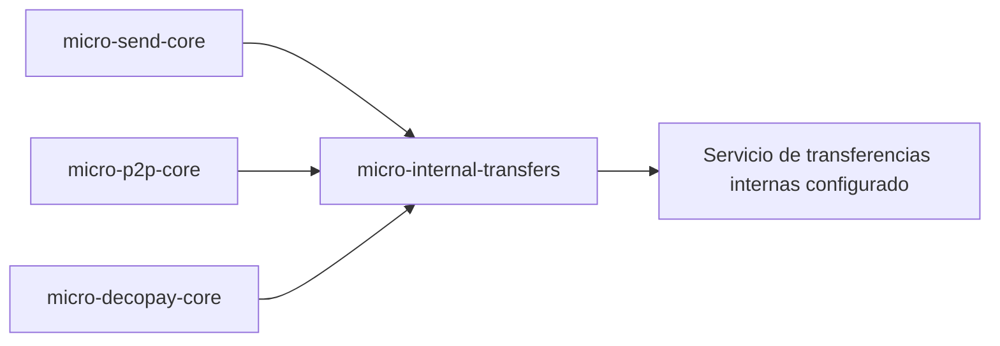

# DECO EXCHANGE — Micro Internal Transfers

<!-- DECO-RELEASE-BADGES -->
[](../README.md#alcance-y-estado) [](../README.md#limitaciones-conocidas) [](../README.md#arquitectura)
<!-- /DECO-RELEASE-BADGES -->

<!-- DECO-NON-PRODUCTION-NOTICE -->
> **Advertencia:** prototipo en fase inicial, no apto para producción. No conectes este servicio a fondos, cuentas bancarias, wallets, datos de clientes ni credenciales reales. Las capacidades descritas son referencias al código y no pruebas de aceptación; las rutas, controles y dependencias requieren validación independiente.
<!-- /DECO-NON-PRODUCTION-NOTICE -->


Microservicio para transferencias internas entre usuarios de la plataforma DECO EXCHANGE.

## Dominio

Este micro maneja **movimientos de dinero entre usuarios** dentro de la plataforma:

| Tipo | Estado | Descripción |
|------|--------|-------------|
| **P2P QR** | ✅ Implementado | Pagos/cobros via código QR de 6 dígitos |
| **P2P Code** | ✅ Implementado | Pagos con código numérico sin QR |
| **Collect QR** | ✅ Implementado | Cobros QR (terminal de cobro) |
| **DECOPAY** | 🔜 Futuro | Pagos en comercios / tarjeta virtual |
| **Splits** | 🔜 Futuro | Dividir cuentas entre usuarios |
| **Payment Requests** | 🔜 Futuro | Solicitudes de pago entre usuarios |

## Arquitectura

```
Frontend → api-gateway-user → micro-internal-transfers → wallet-ledger-core
                                                        ↘ micro-notifications (futuro)
```

**Este micro NO toca balances directamente.** Orquesta la lógica de negocio (generar código, validar, expirar) y delega la ejecución contable a `wallet-ledger-core`.

## API Endpoints

Base: `POST /api/v1/internal/p2p/...`

| Método | Ruta | Descripción |
|--------|------|-------------|
| POST | `/generate-code` | Genera código P2P + datos QR |
| POST | `/receive-with-code` | Paga usando código de 6 dígitos |
| POST | `/request-otp` | Solicita OTP pre-transferencia |
| POST | `/cancel` | Cancela un código activo |
| GET | `/active/:userId` | Lista códigos pendientes |
| GET | `/health` | Health check |

## Variables de Entorno

| Variable | Default | Descripción |
|----------|---------|-------------|
| `PORT` | `3006` | Puerto del servidor |
| `API_PREFIX` | `api/v1` | Prefijo global de rutas |
| `MONGODB_URI` | — | URI de MongoDB |
| `WALLET_LEDGER_URL` | `http://localhost:9001/api/v1` | URL de wallet-ledger-core |
| `INTERNAL_AUTH_TOKEN` | `xxxxx--xxxxx` | Configurar un token aleatorio en el entorno; el marcador no es válido. |

## Desarrollo

```bash
# Instalar dependencias
yarn install

# Desarrollo
yarn start:dev

# Build
yarn build

# Producción
yarn start:prod
```

## Puerto

**3006** (configurable via `PORT`)

## Relación con otros proyectos

Este esquema resume relaciones de alto nivel descritas en el repositorio. Las líneas punteadas indican integraciones incompletas o pendientes de validación; ninguna flecha certifica que el flujo esté desplegado o probado.



**Documentación relacionada:** [micro-send-core](../exchange--micro-send-core/README.md) · [micro-p2p-core](../exchange--micro-p2p-core/README.md) · [micro-decopay-core](../exchange--micro-decopay-core/README.md).

**Capacidad:** no hay resultados de carga publicados para este componente. Consulta la sección de [capacidad y rendimiento](../README.md#capacity) del README raíz.

**Archivos del componente:** [`.env.example`](.env.example) · [`CHANGELOG.md`](CHANGELOG.md) · [mapa general](../README.md#service-docs).

<!-- DECO-RELATION-DIAGRAM -->
