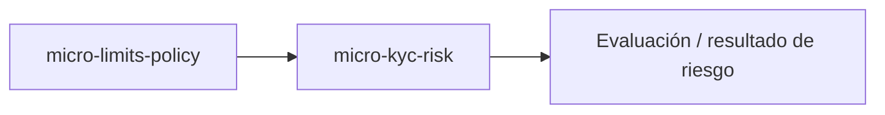

# exchange--micro-kyc-risk

<!-- DECO-RELEASE-BADGES -->
[](../README.md#alcance-y-estado) [](../README.md#limitaciones-conocidas) [](../README.md#arquitectura)
<!-- /DECO-RELEASE-BADGES -->

<!-- DECO-NON-PRODUCTION-NOTICE -->
> **Advertencia:** prototipo en fase inicial, no apto para producción. No conectes este servicio a fondos, cuentas bancarias, wallets, datos de clientes ni credenciales reales. Las capacidades descritas son referencias al código y no pruebas de aceptación; las rutas, controles y dependencias requieren validación independiente.
<!-- /DECO-NON-PRODUCTION-NOTICE -->


Microservicio inicial para KYC, AML y riesgo operativo de DECO EXCHANGE.

## Alcance inicial

- Crear y consultar casos de revisión KYC/Risk.
- Exponer resumen operativo para el admin panel.
- Definir reglas iniciales de revisión manual.
- Evaluar perfiles de riesgo de usuario con semáforo verde, naranja y rojo.
- Persistir casos, reglas y perfiles de riesgo en MongoDB.
- Servir como base para integraciones futuras con documentos, sanciones, AML, OSINT, blockchain analytics y monitoreo transaccional.

## Endpoints iniciales

- `GET /health`
- `GET /api/v1/kyc-risk/overview`
- `GET /api/v1/kyc-risk/cases`
- `POST /api/v1/kyc-risk/cases`
- `PATCH /api/v1/kyc-risk/cases/:caseId/status`
- `GET /api/v1/kyc-risk/rules`
- `GET /api/v1/kyc-risk/risk-profiles`
- `GET /api/v1/kyc-risk/risk-profiles/:userId`
- `POST /api/v1/kyc-risk/risk-profiles/assess`
- `GET /api/v1/kyc-risk/risk-matrix`

## Desarrollo

```bash
yarn install
yarn start:dev
```

Puerto sugerido: `9028`.

Variables principales:

- `MONGODB_URI`: conexión MongoDB del entorno develop.
- `REDIS_URL`: conexión Redis compartida para integraciones futuras.
- `INTERNAL_AUTH_TOKEN`: token interno para comunicación entre gateway y microservicios.
- `KYC_RISK_SEED_DEMO_DATA`: opcional; usar `true` solo para cargar datos demo en entornos visuales.

## Estado

Base inicial conectada al Gateway Admin con persistencia MongoDB. No genera datos demo salvo que `KYC_RISK_SEED_DEMO_DATA=true`. Autenticación interna fina, auditoría y fuentes externas reales quedan como siguientes pasos.

## Relación con otros proyectos

Este esquema resume relaciones de alto nivel descritas en el repositorio. Las líneas punteadas indican integraciones incompletas o pendientes de validación; ninguna flecha certifica que el flujo esté desplegado o probado.



**Documentación relacionada:** [micro-limits-policy](../exchange--micro-limits-policy/README.md).

**Capacidad:** no hay resultados de carga publicados para este componente. Consulta la sección de [capacidad y rendimiento](../README.md#capacity) del README raíz.

**Archivos del componente:** [`.env.example`](.env.example) · [`CHANGELOG.md`](CHANGELOG.md) · [mapa general](../README.md#service-docs).

<!-- DECO-RELATION-DIAGRAM -->
