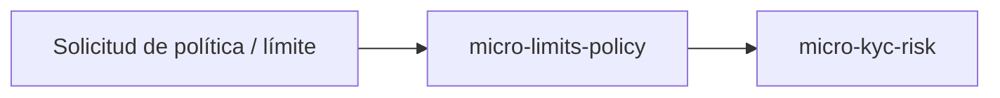

# exchange--micro-limits-policy

<!-- DECO-RELEASE-BADGES -->
[](../README.md#alcance-y-estado) [](../README.md#limitaciones-conocidas) [](../README.md#arquitectura)
<!-- /DECO-RELEASE-BADGES -->

<!-- DECO-NON-PRODUCTION-NOTICE -->
> **Advertencia:** prototipo en fase inicial, no apto para producción. No conectes este servicio a fondos, cuentas bancarias, wallets, datos de clientes ni credenciales reales. Las capacidades descritas son referencias al código y no pruebas de aceptación; las rutas, controles y dependencias requieren validación independiente.
<!-- /DECO-NON-PRODUCTION-NOTICE -->


Limits policy microservice for DECO EXCHANGE.

This service centralizes operational limits used by fiat, crypto, P2P, payments,
remittances, transfers and trading flows. It is designed to be consumed through
the user/admin gateways, never directly from a frontend.

## Architecture

```text
Admin Panel -> BFF Next /api/* -> Gateway Admin -> limits-policy
User operations -> Gateway User/domain service -> limits-policy (filtered contract pending)
```

The Admin Panel must never call this microservice directly.

## Endpoints

Prefix: `/api/v1`

- `GET /health`
- `GET /limits-policy/overview`
- `GET /limits-policy/rules`
- `GET /limits-policy/rules/:id`
- `GET /limits-policy/changes`
- `GET /limits-policy/requests?status=PENDING`
- `POST /limits-policy/rules/:id/requests`
- `PATCH /limits-policy/rules/:id` (compatibility alias that creates a pending request)
- `POST /limits-policy/requests/:id/approve`
- `POST /limits-policy/requests/:id/reject`
- `GET /limits-policy/evaluate`
- `POST /limits-policy/precheck`

Example evaluation:

```text
/api/v1/limits-policy/evaluate?operation=WITHDRAW&currency=COP&amount=1500000&kycLevel=LEVEL_2&riskLevel=GREEN&country=CO
```

Example operational precheck:

```json
{
  "operation": "WITHDRAW",
  "assetType": "FIAT",
  "product": "WITHDRAWALS",
  "country": "CO",
  "currency": "COP",
  "kycLevel": "LEVEL_2",
  "riskLevel": "GREEN",
  "amount": 250000,
  "dailyUsed": 1000000,
  "monthlyUsed": 4500000,
  "availableBalance": 600000,
  "custodyAvailable": 1200000,
  "custodyProviderStatus": "ONLINE",
  "riskScore": 24,
  "userId": "USR-1001",
  "sourceService": "exchange--micro-withdrawal-orchestrator",
  "operationId": "withdrawal-123",
  "idempotencyKey": "withdrawal-123-precheck"
}
```

The response returns `decision`, `canExecute`, `requiresApproval`,
`holdRecommended`, `policyVersion`, `downstreamChecks` and `nextAction`. Domain
services must treat `BLOCK` as non-executable and `REVIEW` as waiting for admin
approval before touching ledger or custody.

When `userId` is provided, the precheck consults
`exchange--micro-kyc-risk` through `KYC_RISK_SERVICE_URL` and adds a
`kyc-risk-profile` downstream check. Red/restricted profiles block execution;
orange/monitoring profiles require review; green/active profiles pass. If
KYC/Risk is unavailable, the default fail mode is `review`.

## Environment

```env
PORT=9031
INTERNAL_AUTH_TOKEN=xxxxx--xxxxx
MONGODB_URI=mongodb://localhost:27017/deco-exchange-dev
LIMITS_POLICY_SEED_DEFAULTS=true
KYC_RISK_SERVICE_URL=http://localhost:9028/api/v1
KYC_RISK_TIMEOUT_MS=3000
KYC_RISK_FAIL_MODE=review
```

## Current scope

Version `0.1.5` exposes Mongo-backed policy rules, evaluation output, audited
change requests and maker-checker approvals. Every requested update requires a
reason, records actor metadata and stores before snapshots in
`limit_policy_change_requests`. Approved requests increment the rule version and
store before/after snapshots in `limit_policy_changes`.

Operational precheck is available for downstream services to validate approved
policy versions, daily/monthly usage, ledger balance hints, custody liquidity
and risk score before execution. It can enrich the decision with the persisted
KYC/Risk profile when `userId` is present. The limits service still does not move
money: ledger and custody execution remains owned by their domain services.

Default bootstrap rules include governed P2P Level 2 execution and are upserted
incrementally, so new bootstrap defaults can be added without overwriting
admin-managed policy changes.

## Relación con otros proyectos

Este esquema resume relaciones de alto nivel descritas en el repositorio. Las líneas punteadas indican integraciones incompletas o pendientes de validación; ninguna flecha certifica que el flujo esté desplegado o probado.



**Documentación relacionada:** [micro-kyc-risk](../exchange--micro-kyc-risk/README.md).

**Capacidad:** no hay resultados de carga publicados para este componente. Consulta la sección de [capacidad y rendimiento](../README.md#capacity) del README raíz.

**Archivos del componente:** [`.env.example`](.env.example) · [`CHANGELOG.md`](CHANGELOG.md) · [mapa general](../README.md#service-docs).

<!-- DECO-RELATION-DIAGRAM -->
