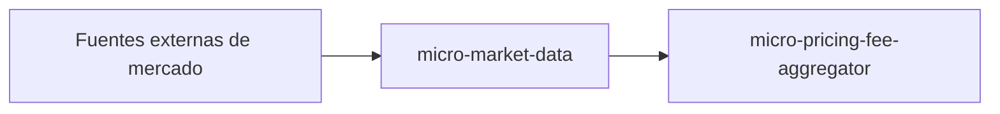

# exchange--micro-market-data

<!-- DECO-RELEASE-BADGES -->
[](../README.md#alcance-y-estado) [](../README.md#limitaciones-conocidas) [](../README.md#arquitectura)
<!-- /DECO-RELEASE-BADGES -->

<!-- DECO-NON-PRODUCTION-NOTICE -->
> **Advertencia:** prototipo en fase inicial, no apto para producción. No conectes este servicio a fondos, cuentas bancarias, wallets, datos de clientes ni credenciales reales. Las capacidades descritas son referencias al código y no pruebas de aceptación; las rutas, controles y dependencias requieren validación independiente.
<!-- /DECO-NON-PRODUCTION-NOTICE -->


Market data microservice for DECO EXCHANGE.

This service normalizes market-facing data for Spot, market analysis, price alerts and data API screens.

## Architecture

```text
Landing/User -> Gateway User -> market-data -> pricing aggregator
Admin Panel -> BFF Next /api/* -> Gateway Admin -> market-data -> pricing aggregator
```

The Admin Panel must never call this microservice directly.

## Endpoints

Prefix: `/api/v1`

- `GET /health`
- `GET /market-data/overview`
- `GET /market-data/assets`
- `GET /market-data/tickers`
- `GET /market-data/tickers/:symbol`
- `GET /market-data/status`

## Environment

Copy `.env.example` to `.env.local` or `.env`.

```env
PORT=9030
INTERNAL_AUTH_TOKEN=xxxxx--xxxxx
PRICING_AGGREGATOR_URL=http://localhost:3013
```

## Scripts

```bash
yarn install
yarn typecheck
yarn build
yarn start:dev
```

## Current scope

Version `0.1.0` is the base service contract. It reads from the existing pricing aggregator and returns degraded source status when the upstream is unavailable.

## Relación con otros proyectos

Este esquema resume relaciones de alto nivel descritas en el repositorio. Las líneas punteadas indican integraciones incompletas o pendientes de validación; ninguna flecha certifica que el flujo esté desplegado o probado.



**Documentación relacionada:** [micro-pricing-fee-aggregator](../exchange--micro-pricing-fee-aggregator/README.md).

**Capacidad:** no hay resultados de carga publicados para este componente. Consulta la sección de [capacidad y rendimiento](../README.md#capacity) del README raíz.

**Archivos del componente:** [`.env.example`](.env.example) · [`CHANGELOG.md`](CHANGELOG.md) · [mapa general](../README.md#service-docs).

<!-- DECO-RELATION-DIAGRAM -->
