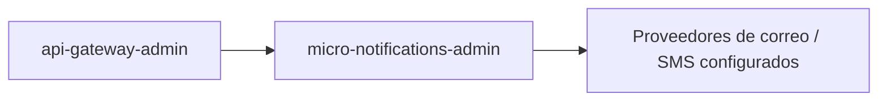

# Micro Notifications (Admin)

<!-- DECO-RELEASE-BADGES -->
[](../README.md#alcance-y-estado) [](../README.md#limitaciones-conocidas) [](../README.md#arquitectura)
<!-- /DECO-RELEASE-BADGES -->

<!-- DECO-NON-PRODUCTION-NOTICE -->
> **Advertencia:** prototipo en fase inicial, no apto para producción. No conectes este servicio a fondos, cuentas bancarias, wallets, datos de clientes ni credenciales reales. Las capacidades descritas son referencias al código y no pruebas de aceptación; las rutas, controles y dependencias requieren validación independiente.
<!-- /DECO-NON-PRODUCTION-NOTICE -->


[](https://nestjs.com/)
[](https://nodejs.org/)
[](https://www.typescriptlang.org/)
[](LICENSE)
[](#)

Microservicio de notificaciones para administradores.

## Puertos

- API: `http://localhost:7003`
- Base path: `/api/v1`
- Swagger: `/api/docs`

## Arranque local

```bash
cd Exchange--micro-notifications-admin
yarn install
yarn start:dev
```

## Scripts

- `yarn start:dev` — desarrollo (watch)
- `yarn build` / `yarn start:prod` — producción
- `yarn test` — tests

## Recursos

- [Documentación de NestJS](https://docs.nestjs.com) para consultar el framework.
- [Mapa general de Deco Exchange](../README.md) y sus límites de prototipo.
- Antes de integrar proveedores de correo o SMS, configura credenciales sandbox en `.env` local y valida webhooks y permisos.

## License

Este subproyecto incluye su propio archivo `LICENSE`; la licencia del repositorio completo debe revisarse junto con las de los demás servicios.

## Relación con otros proyectos

Este esquema resume relaciones de alto nivel descritas en el repositorio. Las líneas punteadas indican integraciones incompletas o pendientes de validación; ninguna flecha certifica que el flujo esté desplegado o probado.



**Documentación relacionada:** [api-gateway-admin](../exchange--api-gateway-admin/README.md).

**Capacidad:** no hay resultados de carga publicados para este componente. Consulta la sección de [capacidad y rendimiento](../README.md#capacity) del README raíz.

**Archivos del componente:** [`.env.example`](.env.example) · [`CHANGELOG.md`](CHANGELOG.md) · [mapa general](../README.md#service-docs).

<!-- DECO-RELATION-DIAGRAM -->
