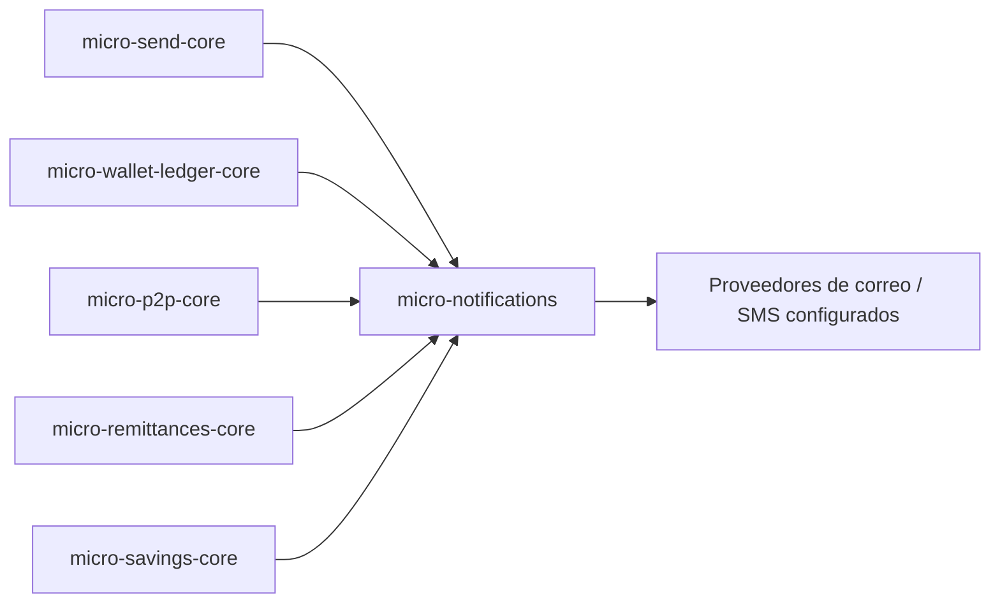

# DECO31416 Admin Notifications

<!-- DECO-RELEASE-BADGES -->
[](../README.md#alcance-y-estado) [](../README.md#limitaciones-conocidas) [](../README.md#arquitectura)
<!-- /DECO-RELEASE-BADGES -->

<!-- DECO-NON-PRODUCTION-NOTICE -->
> **Advertencia:** prototipo en fase inicial, no apto para producción. No conectes este servicio a fondos, cuentas bancarias, wallets, datos de clientes ni credenciales reales. Las capacidades descritas son referencias al código y no pruebas de aceptación; las rutas, controles y dependencias requieren validación independiente.
<!-- /DECO-NON-PRODUCTION-NOTICE -->


Version actual: `0.0.6`

Microservicio privado de notificaciones administrativas para DECO31416. Atiende OTP, seguridad de login, reset de clave y mensajes operativos emitidos por `exchange--micro-auth`.

No debe ser consumido por la landing publica ni por el navegador. Es un servicio server-to-server.

## Arquitectura

```text
exchange--micro-auth -> exchange--micro-notifications -> Resend / Twilio
```

Reglas:

- Autenticacion S2S con `SERVICE_TOKENS`.
- HMAC opcional para integraciones futuras.
- Swagger solo en desarrollo.
- CORS en produccion con allowlist, nunca wildcard.
- Twilio es opcional; email por Resend es la base del flujo OTP.

## Puertos

- API local: `http://localhost:7002`
- Base path: `/api/v1`
- Swagger dev: `/api/docs`

## Variables principales

Ver `.env.example`.

Minimas para local:

```env
PORT=7002
NODE_ENV=development
CORS_ORIGIN=http://localhost:3100,http://localhost:4000,http://localhost:7001
REDIS_URI=redis://localhost:6379
RESEND_API_KEY=xxxxx--xxxxx
RESEND_FROM_EMAIL=soporte@deco31416.com
SERVICE_TOKENS={"deco31416-admin-auth":"replace_with_shared_admin_notifications_token"}
```

## Arranque local

```bash
cd C:\Users\HP\Desktop\Deco-31416-Landing\exchange--micro-notifications
yarn install
yarn start:dev
```

## Seguridad

- No imprimir `SERVICE_TOKENS`, `HMAC_KEYS`, API keys ni payloads sensibles.
- `SERVICE_TOKENS` debe coincidir con `NOTIFICATIONS_SERVICE_TOKEN` en `exchange--micro-auth`.
- En produccion `CORS_ORIGIN` debe estar configurado explicitamente.
- Los endpoints debug sin autenticacion estan removidos.

## Validacion

```bash
yarn build
```

## Relación con otros proyectos

Este esquema resume relaciones de alto nivel descritas en el repositorio. Las líneas punteadas indican integraciones incompletas o pendientes de validación; ninguna flecha certifica que el flujo esté desplegado o probado.



**Documentación relacionada:** [micro-send-core](../exchange--micro-send-core/README.md) · [micro-wallet-ledger-core](../exchange--micro-wallet-ledger-core/README.md) · [micro-p2p-core](../exchange--micro-p2p-core/README.md) · [micro-remittances-core](../exchange--micro-remittances-core/README.md) · [micro-savings-core](../exchange--micro-savings-core/README.md).

**Capacidad:** no hay resultados de carga publicados para este componente. Consulta la sección de [capacidad y rendimiento](../README.md#capacity) del README raíz.

**Archivos del componente:** [`.env.example`](.env.example) · [`CHANGELOG.md`](CHANGELOG.md) · [mapa general](../README.md#service-docs).

<!-- DECO-RELATION-DIAGRAM -->
