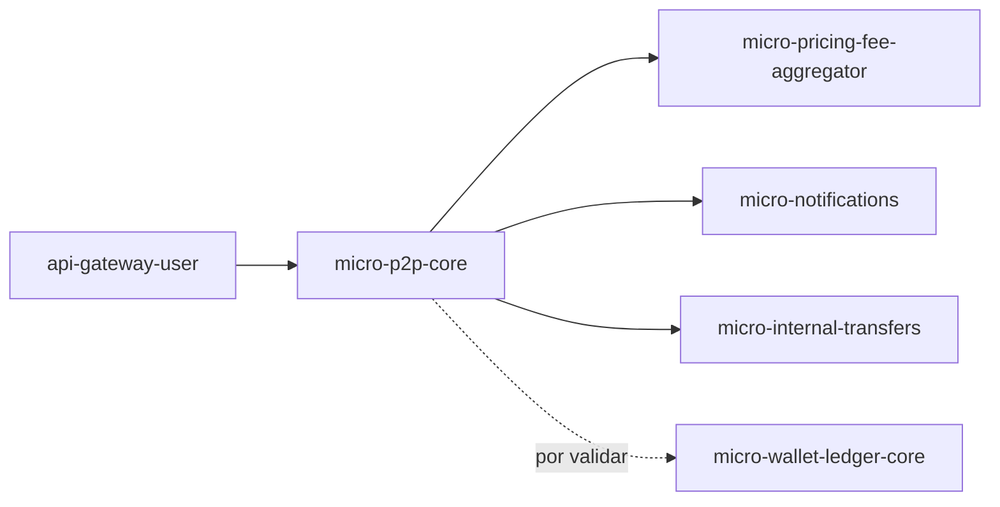

# P2P Core

<!-- DECO-RELEASE-BADGES -->
  
<!-- /DECO-RELEASE-BADGES -->

<!-- DECO-NON-PRODUCTION-NOTICE -->
> **Advertencia:** prototipo en fase inicial, no apto para producción. No conectes este servicio a fondos, cuentas bancarias, wallets, datos de clientes ni credenciales reales. Las capacidades descritas son referencias al código y no pruebas de aceptación; las rutas, controles y dependencias requieren validación independiente.
<!-- /DECO-NON-PRODUCTION-NOTICE -->

Servicio inicial de dominio P2P de Deco Exchange. Esta carpeta forma parte del prototipo temprano y debe revisarse junto con el gateway de usuario, pricing, notificaciones, transferencias internas y ledger antes de integrar cualquier flujo.

## Alcance observado

El código configura clientes para autenticación, notificaciones, wallet ledger, agregador de pricing, custody crypto y signature keys. El uso de esos clientes y los flujos de reserva, escrow, liquidación y liberación requieren validación end-to-end. No usar con fondos o usuarios reales.

## Configuración local

Consulta `.env.example`. Sus valores son marcadores y direcciones locales de ejemplo; el servicio no arrancará con dependencias externas sin configuración local válida.

## Estado

Prototipo inicial, no apto para producción. No se dispone en este repositorio de pruebas de carga ni de una cifra de usuarios o transacciones por segundo soportadas.

## Relación con otros proyectos

Este esquema resume relaciones de alto nivel descritas en el repositorio. Las líneas punteadas indican integraciones incompletas o pendientes de validación; ninguna flecha certifica que el flujo esté desplegado o probado.

**Documentación relacionada:** [api-gateway-user](../exchange--api-gateway-user/README.md) · [micro-pricing-fee-aggregator](../exchange--micro-pricing-fee-aggregator/README.md) · [micro-notifications](../exchange--micro-notifications/README.md) · [micro-internal-transfers](../exchange--micro-internal-transfers/README.md) · [micro-wallet-ledger-core](../exchange--micro-wallet-ledger-core/README.md).

**Capacidad:** no hay resultados de carga publicados para este componente. Consulta la sección de [capacidad y rendimiento](../README.md#capacity) del README raíz.

**Archivos del componente:** [`.env.example`](.env.example) · [`CHANGELOG.md`](CHANGELOG.md) · [mapa general](../README.md#service-docs).

<!-- DECO-RELATION-DIAGRAM -->
