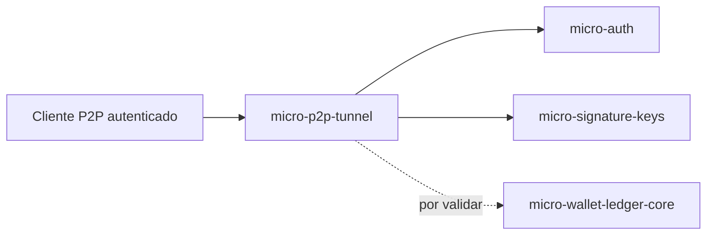

# DECO EXCHANGE — Micro P2P Tunnel

<!-- DECO-RELEASE-BADGES -->
[](../README.md#alcance-y-estado) [](../README.md#limitaciones-conocidas) [](../README.md#arquitectura)
<!-- /DECO-RELEASE-BADGES -->

<!-- DECO-NON-PRODUCTION-NOTICE -->
> **Advertencia:** prototipo en fase inicial, no apto para producción. No conectes este servicio a fondos, cuentas bancarias, wallets, datos de clientes ni credenciales reales. Las capacidades descritas son referencias al código y no pruebas de aceptación; las rutas, controles y dependencias requieren validación independiente.
<!-- /DECO-NON-PRODUCTION-NOTICE -->


Microservicio de **autorización bilateral P2P en tiempo real** via WebSocket (Socket.IO).

## Concepto

A diferencia del flujo P2P estándar (cobrador genera QR → pagador escanea y autoriza solo), el **Túnel P2P** crea una sesión donde **ambas partes autorizan simultáneamente** y ven el progreso del otro en tiempo real con valores enmascarados (asteriscos).

```
┌─────────────────────────────────────────┐
│  Pago: $50.00 MXN                       │
│  Motivo: "Almuerzo"                      │
│                                          │
│  TÚ (Cobrador)     │  PAGADOR            │
│  ✅ PIN: ••••••     │  ⬜ PIN: ______     │
│  ✅ Clave: ••••••   │  ⏳ Clave: ______   │
│  ✅ Email OTP: •••• │  ⬜ Email OTP: ____ │
│                                          │
│  Estado: Esperando autorización completa  │
└─────────────────────────────────────────┘
```

## Arquitectura

```
Dashboard ←── WebSocket (Socket.IO) ──→ micro-p2p-tunnel
                                            ├── micro-signature-keys  (verificar PIN/clave)
                                            ├── micro-internal-transfers (generar código P2P)
                                            └── wallet-ledger-core (ejecutar transferencia)
```

**Puerto:** 3020  
**WebSocket namespace:** `/tunnel`

## Flujo

1. **Cobrador** crea sesión → recibe `sessionId` + `inviteCode` (6 dígitos)
2. **Pagador** se une con el `inviteCode` → ambos conectados por WebSocket
3. Ambos ven el panel de autorización bilateral
4. Cada uno coloca sus claves (PIN, clave dinámica, email OTP)
5. El otro ve `✅ PIN: ••••••` (asteriscos, nunca el valor real)
6. Cuando **ambos** completan todos los métodos → se ejecuta la transferencia automáticamente
7. Ambos reciben el resultado en tiempo real

## WebSocket Events

### Client → Server

| Evento | Payload | Descripción |
|--------|---------|-------------|
| `tunnel:create` | `{ currency, amountMinorUnits, concept? }` | Crear sesión |
| `tunnel:join` | `{ inviteCode }` | Unirse a sesión |
| `tunnel:auth` | `{ sessionId, method, value }` | Enviar autorización |
| `tunnel:cancel` | `{ sessionId }` | Cancelar sesión |

### Server → Client

| Evento | Dirección | Payload |
|--------|-----------|---------|
| `tunnel:created` | → Creador | `{ sessionId, inviteCode, expiresAt }` |
| `tunnel:joined` | → Ambos | `{ sessionId, participants, paymentDetails }` |
| `tunnel:auth-update` | → Ambos | `{ userId, method, status, masked }` |
| `tunnel:auth-failed` | → Quien falló | `{ method, message }` |
| `tunnel:both-authorized` | → Ambos | `{ message }` |
| `tunnel:executing` | → Ambos | `{ status: "processing" }` |
| `tunnel:completed` | → Ambos | `{ txId, correlationId, success }` |
| `tunnel:transfer-failed` | → Ambos | `{ reason }` |
| `tunnel:cancelled` | → Ambos | `{ reason, cancelledBy }` |
| `tunnel:expired` | → Ambos | `{ sessionId }` |
| `tunnel:error` | → Quien causó | `{ message }` |

## API Endpoints (HTTP)

Base: `/api/v1`

| Método | Ruta | Descripción |
|--------|------|-------------|
| GET | `/health` | Health check |

> Toda la interacción se realiza por WebSocket, no por REST.

## Variables de Entorno

| Variable | Default | Descripción |
|----------|---------|-------------|
| `PORT` | `3020` | Puerto del servidor HTTP + WebSocket |
| `API_PREFIX` | `api/v1` | Prefijo global de rutas HTTP |
| `NODE_ENV` | `development` | Entorno |
| `MONGODB_URI` | — | URI de MongoDB (misma BD que los demás micros) |
| `INTERNAL_AUTH_TOKEN` | — | Token de autenticación entre microservicios |
| `SIGNATURE_KEYS_URL` | `http://localhost:3007/api/v1` | URL de micro-signature-keys |
| `WALLET_LEDGER_URL` | `http://localhost:9001/api/v1` | URL de wallet-ledger-core |
| `INTERNAL_TRANSFERS_URL` | `http://localhost:3006/api/v1` | URL de micro-internal-transfers |
| `AUTH_SERVICE_URL` | `http://localhost:7000/api/v1` | URL de micro-auth |
| `SESSION_TTL_MINUTES` | `15` | Tiempo de vida de una sesión |
| `SESSION_MAX_AUTH_ATTEMPTS` | `5` | Intentos máximos de autorización |
| `CORS_ORIGIN` | `http://localhost:3100` | Origen CORS permitido |

## Desarrollo

```bash
# Instalar dependencias
yarn install

# Desarrollo (watch mode)
yarn start:dev

# Build
yarn build

# Producción
yarn start:prod
```

## Estructura

```
src/
├── main.ts                           # Bootstrap + Socket.IO adapter
├── app.module.ts                     # Root module (Mongo, Config, Tunnel)
├── health/
│   ├── health.controller.ts          # GET /health
│   └── health.module.ts
├── shared/
│   └── clients/
│       ├── auth.client.ts            # HTTP client → micro-auth
│       ├── signature-keys.client.ts  # HTTP client → micro-signature-keys
│       └── wallet-ledger.client.ts   # HTTP client → wallet-ledger-core
└── tunnel/
    ├── tunnel.module.ts              # Tunnel feature module
    ├── tunnel.gateway.ts             # WebSocket Gateway (Socket.IO)
    ├── tunnel.service.ts             # Business logic (sessions, auth, execution)
    ├── tunnel-session.schema.ts      # MongoDB schema for sessions
    └── dto/
        ├── create-session.dto.ts     # DTO: create tunnel session
        ├── join-session.dto.ts       # DTO: join with invite code
        └── auth-event.dto.ts         # DTO: submit auth method
```

## Railway

Configurado en `railway.json`. Variables de entorno se configuran en el panel de Railway.

```bash
# Build command (auto-detected by Nixpacks)
yarn build

# Start command
node dist/main
```

## Relación con otros proyectos

Este esquema resume relaciones de alto nivel descritas en el repositorio. Las líneas punteadas indican integraciones incompletas o pendientes de validación; ninguna flecha certifica que el flujo esté desplegado o probado.



**Documentación relacionada:** [micro-auth](../exchange--micro-auth/README.md) · [micro-signature-keys](../exchange--micro-signature-keys/README.md) · [micro-wallet-ledger-core](../exchange--micro-wallet-ledger-core/README.md).

**Capacidad:** no hay resultados de carga publicados para este componente. Consulta la sección de [capacidad y rendimiento](../README.md#capacity) del README raíz.

**Archivos del componente:** [`.env.example`](.env.example) · [`CHANGELOG.md`](CHANGELOG.md) · [mapa general](../README.md#service-docs).

<!-- DECO-RELATION-DIAGRAM -->
