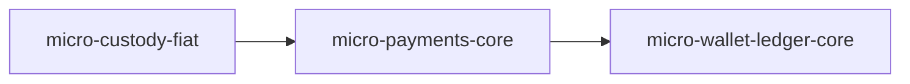

# Micro Payments Core

<!-- DECO-RELEASE-BADGES -->
[](../README.md#alcance-y-estado) [](../README.md#limitaciones-conocidas) [](../README.md#arquitectura)
<!-- /DECO-RELEASE-BADGES -->

<!-- DECO-NON-PRODUCTION-NOTICE -->
> **Advertencia:** prototipo en fase inicial, no apto para producción. No conectes este servicio a fondos, cuentas bancarias, wallets, datos de clientes ni credenciales reales. Las capacidades descritas son referencias al código y no pruebas de aceptación; las rutas, controles y dependencias requieren validación independiente.
<!-- /DECO-NON-PRODUCTION-NOTICE -->


[](https://nestjs.com/)
[](https://www.typescriptlang.org/)
**Licencia/redistribución: pendiente de confirmar; el paquete declara `UNLICENSED`.**
[](#)

**Puerto**: 3002

Microservicio para confirmación y reconciliación de pagos. Procesa eventos fiat, transferencias P2P y se comunica con el wallet-ledger.

## Módulos

| Módulo | Descripción |
|--------|-------------|
| `domain/p2p` | Controlador y servicio P2P, esquema de códigos QR |
| `consumers/` | Procesador de eventos fiat, cliente wallet-ledger |
| `health/` | Health checks |
| `shared/guards/` | Guards de autenticación |

## API Prefix

`/api/v1`

## Endpoints

### P2P
- `POST /api/v1/p2p/generate` — Generar código de pago QR
- `POST /api/v1/p2p/resolve` — Resolver código de pago
- `POST /api/v1/p2p/confirm` — Confirmar transferencia P2P

### Health
- `GET /health` — Health check

## Variables de Entorno

| Variable | Descripción | Default |
|----------|-------------|---------|
| `PORT` | Puerto del servicio | `3002` |
| `MONGODB_URI` | Conexión a MongoDB Atlas | — |
| `REDIS_URL` | URL de Redis para Bull queues | — |
| `INTERNAL_AUTH_TOKEN` | Token de autenticación interna | — |
| `WALLET_LEDGER_SERVICE_URL` | URL del servicio wallet-ledger | — |

## Stack

- NestJS 11, Mongoose 8, Bull (Redis queues)
- Axios, ioredis, class-validator, uuid
- Node >=20.0.0

## Instalación

```bash
yarn install
yarn start:dev
```

## Relación con otros proyectos

Este esquema resume relaciones de alto nivel descritas en el repositorio. Las líneas punteadas indican integraciones incompletas o pendientes de validación; ninguna flecha certifica que el flujo esté desplegado o probado.



**Documentación relacionada:** [micro-custody-fiat](../exchange--micro-custody-fiat/README.md) · [micro-wallet-ledger-core](../exchange--micro-wallet-ledger-core/README.md).

**Capacidad:** no hay resultados de carga publicados para este componente. Consulta la sección de [capacidad y rendimiento](../README.md#capacity) del README raíz.

**Archivos del componente:** [`.env.example`](.env.example) · [`CHANGELOG.md`](CHANGELOG.md) · [mapa general](../README.md#service-docs).

<!-- DECO-RELATION-DIAGRAM -->
