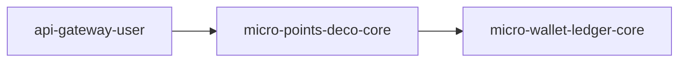

# exchange--micro-points-deco-core

<!-- DECO-RELEASE-BADGES -->
[](../README.md#alcance-y-estado) [](../README.md#limitaciones-conocidas) [](../README.md#arquitectura)
<!-- /DECO-RELEASE-BADGES -->

<!-- DECO-NON-PRODUCTION-NOTICE -->
> **Advertencia:** prototipo en fase inicial, no apto para producción. No conectes este servicio a fondos, cuentas bancarias, wallets, datos de clientes ni credenciales reales. Las capacidades descritas son referencias al código y no pruebas de aceptación; las rutas, controles y dependencias requieren validación independiente.
<!-- /DECO-NON-PRODUCTION-NOTICE -->


Microservicio core para Puntos Deco, la red fisica verificada de DECO EXCHANGE
para efectivo, saldo digital, remesas y liquidez local.

## Regla de arquitectura

```text
Landing / Usuario -> Gateway User -> points-deco-core
Admin Panel -> BFF /api/* -> Gateway Admin -> points-deco-core
```

Ningun frontend debe llamar este microservicio directo.

## Alcance inicial

- Puntos Deco: cajeros, comercios y empresas verificadas.
- Ubicacion aproximada publica y ubicacion exacta protegida.
- Servicios: deposito, retiro, remesa y cambio asistido.
- Ordenes presenciales con QR/PIN/geofence como contratos futuros.
- Disputas, reportes, cumplimiento y evidencia operativa.

Puntos Deco es linea propia. P2P, Remesas, Bolsillito, Custodia, Ledger y
Pricing son dominios separados que complementan la operacion.

## Scripts

```bash
yarn install
yarn typecheck
yarn test
yarn build
yarn start:dev
```

## Runtime smoke

Cuando el micro y los gateways esten levantados, se puede validar la ruta
directa y por gateways:

```powershell
$env:INTERNAL_AUTH_TOKEN="..."
$env:ADMIN_JWT="..." # opcional, solo para Gateway Admin
.\scripts\smoke-runtime.ps1
```

El smoke no define ni modifica MongoDB/Redis. Toma tokens desde el entorno.

## Endpoints internos iniciales

Base: `/api/v1/points-deco`

- `GET /health`
- `GET /points-deco/overview`
- `GET /points-deco/points`
- `GET /points-deco/nearby`
- `POST /points-deco/orders/quote`
- `POST /points-deco/orders`
- `GET /points-deco/orders`
- `GET /points-deco/orders/:id`
- `POST /points-deco/orders/:id/accept`
- `POST /points-deco/orders/:id/reveal-location`
- `POST /points-deco/orders/:id/check-in`
- `POST /points-deco/orders/:id/confirm-code`
- `POST /points-deco/orders/:id/confirm-cash-received`
- `POST /points-deco/orders/:id/confirm-cash-delivered`
- `POST /points-deco/orders/:id/complete-settlement`
- `POST /points-deco/orders/:id/cancel`
- `POST /points-deco/orders/:id/dispute`
- `GET /points-deco/orders/:id/settlement`
- `GET /points-deco/disputes`
- `GET /points-deco/disputes/:id`
- `POST /points-deco/disputes/:id/review`
- `POST /points-deco/disputes/:id/resolve`
- `POST /points-deco/disputes/:id/approve-resolution`
- `POST /points-deco/disputes/:id/reject-resolution`
- `POST /points-deco/disputes/:id/execute-resolution`
- `POST /points-deco/disputes/:id/reject`
- `GET /points-deco/economic-actions`
- `POST /points-deco/economic-actions/:id/queue`
- `POST /points-deco/economic-actions/:id/execute`
- `POST /points-deco/economic-actions/:id/reject`
- `GET /points-deco/reports`
- `GET /points-deco/reports/fiscal`
- `GET /points-deco/reports/fiscal.csv`
- `GET /points-deco/receipts`
- `GET /points-deco/settlements`
- `GET /points-deco/orders/:id/receipt`
- `GET /points-deco/cash/summary`
- `GET /points-deco/cash/positions`
- `GET /points-deco/cash/movements`
- `POST /points-deco/cash/adjustments`
- `POST /points-deco/cash/close-day`

Todos los endpoints de dominio requieren `x-internal-auth` o Bearer token con
`INTERNAL_AUTH_TOKEN`.

## Acciones economicas sin hold confirmado

Cuando una disputa aprobada por maker-checker intenta ejecutar `refund_user` o
`release_to_point`, el micro solo muta saldos si existe un hold confirmado en el
ledger. Si la orden no tiene hold seguro, se registra una accion en
`points_deco_economic_actions` con estado `pending_review`.

Estas acciones no mueven dinero por si solas. Son tickets operativos
idempotentes para que admin, custodia, ledger o conciliacion ejecuten el ajuste
por el flujo correspondiente, dejando evidencia de disputa, orden, punto,
usuario, monedas, montos y razon del bloqueo automatico.

Flujo administrativo disponible:

- `pending_review -> queued_for_custody`: checker/admin aprueba la cola de
  custodia o ledger.
- `queued_for_custody -> executed`: el micro intenta primero el adapter ledger
  automatico para `non_hold_refund` seguro hacia wallet de usuario o
  `non_hold_point_payout` hacia cuenta sistema del Punto Deco. Si aplica, queda
  ejecutado con referencia `txId`/`eventId`; si no es seguro, permanece en cola
  manual con razon auditada.
- `pending_review|queued_for_custody -> rejected`: admin rechaza el ajuste con
  razon auditada.

La ejecucion automatica cubre:

- `refund_user` sin hold confirmado cuando existe `userId`, moneda destino y
  monto destino.
- `release_to_point` sin hold confirmado cuando existe `pointId`, moneda de
  origen y monto de origen; el destino contable es
  `SYSTEM:POINTS_DECO:POINT:{pointId}` en `wallet-ledger-core`.

Antes de aplicar `release_to_point`, el micro registra una intencion
idempotente en `custody-fiat` para que la salida real por proveedor quede
trazable y conciliable. Si la intencion de custodia falla, la accion permanece
en cola de revision y no se aplica el payout contable por ledger.

La liquidacion al Punto Deco ejecutada por este micro es contable interna. La
salida real por proveedor fiat/crypto queda separada para dispatch, conciliacion
y auditoria por pais.

Adapter interno usado:

```text
POST {CUSTODY_FIAT_SERVICE_URL}/internal/points-deco/settlement-intents
POST {WALLET_LEDGER_SERVICE_URL}/internal/ledger/points-deco/economic-actions
```

La llave idempotente es estable por accion:

```text
points-deco:{actionId}:ledger-economic-action:v1
```

## Control de limites

`POST /points-deco/orders` ejecuta un precheck contra
`exchange--micro-limits-policy` antes de persistir la orden. La decision se
guarda junto a la orden:

- `ALLOW`: la orden puede avanzar al siguiente paso operativo con auditoria.
- `REVIEW`: la orden nace marcada para aprobacion administrativa antes de tocar
  ledger, custodia o efectivo.
- `BLOCK`: la orden se rechaza y no se persiste.

Puntos Deco evalua el lado fiat de la operacion cuando existe, mapea
`cash_in` a `DEPOSIT/FUNDING`, `cash_out` a `WITHDRAW/WITHDRAWALS`,
`remittance` a `REMITTANCE/REMITTANCES` y cambios asistidos a
`CONVERT/POINTS_DECO`.

## Pricing

`POST /points-deco/orders/quote` consulta
`exchange--micro-pricing-fee-fiat` cuando la operacion puede expresarse como
par fiat. Para `USDT` y `USDC`, Puntos Deco usa `USD` como referencia
operativa de stablecoin.

El micro guarda en la cotizacion y en la orden:

- `pricingSource`: `pricing-fee-fiat` o `local-fallback`.
- `pricingOperation`: `BUY` o `SELL`.
- `pricingCorridor`: corredor operativo, por defecto `retail`.
- `pricingMethod`: metodo reportado por pricing cuando existe.
- `pricingWarning`: motivo del fallback cuando pricing no responde.

Variables:

```dotenv
PRICING_FIAT_SERVICE_URL=http://localhost:3014/api/v1
POINTS_DECO_PRICING_TIMEOUT_MS=3000
POINTS_DECO_PRICING_CORRIDOR=retail
```

## Maquina de estados

Las ordenes presenciales avanzan por endpoints explicitos:

```text
created -> accepted -> location_revealed -> user_checked_in -> code_verified
code_verified -> cash_received/cash_delivered -> settlement_pending -> completed
```

La maquina bloquea transiciones invalidas, registra `auditTrail` y guarda
timestamps por estado. Una orden con decision de limites `REVIEW` no puede
aceptarse hasta que exista aprobacion administrativa. `cancelled`, `expired` y
`disputed` son estados terminales para operacion.

## Holds de ledger

`cash_out` y `remittance` requieren retencion de saldo en
`exchange--micro-wallet-ledger-core`.

- Al crear una orden persistente, Puntos Deco solicita
  `POST /internal/ledger/holds`.
- Si el ledger responde `held`, la orden puede avanzar cuando limites tambien
  permite operar.
- Si el ledger falla o queda en revision, la orden no puede aceptarse hasta que
  administracion resuelva.
- Al cancelar una orden con hold confirmado, Puntos Deco solicita
  `POST /internal/ledger/holds/release` antes de cancelar.
- Al confirmar efectivo entregado, Puntos Deco solicita
  `POST /internal/ledger/holds/capture` y deja la orden en
  `settlement_pending`.

Variables:

```dotenv
WALLET_LEDGER_SERVICE_URL=http://localhost:9001/api/v1
POINTS_DECO_LEDGER_FAIL_MODE=review
```

## Caja del Punto

La caja fisica se registra por Punto Deco y moneda. Es informacion interna de
operacion: el usuario final nunca debe ver el saldo exacto del punto, solo
rangos seguros de disponibilidad.

- `confirm-cash-received` crea un movimiento `order_cash_received`.
- `confirm-cash-delivered` crea un movimiento `order_cash_delivered`.
- `cash/adjustments` permite ajustes administrativos auditables.
- `cash/close-day` genera cierre diario sin alterar saldo.
- Los movimientos de salida no permiten saldos fisicos negativos.
- `cash/summary` consolida saldos fisicos, entradas, salidas y movimientos que
  requieren revision operativa.

## Comprobantes operativos

`orders/:id/receipt` y `receipts` generan comprobantes JSON a partir de la
orden, movimientos de caja y estado del ledger. El comprobante queda listo para
descarga futura en PDF/CSV desde Admin Panel, sin declarar todavia un recibo
fiscal definitivo.

## Conciliacion y liquidacion

`orders/:id/settlement` y `settlements` cruzan efectivo recibido, efectivo
entregado, estado de ledger, decision de limites y evidencia operativa. El
endpoint `orders/:id/complete-settlement` solo completa la orden si el cierre
queda `balanced`.

Si existe diferencia de caja, ledger sin captura, limites pendientes o disputa,
la liquidacion queda en `review_required` con `approvalStatus` en
`pending_admin_review`. Las liquidaciones balanceadas quedan con
`fiscalReportStatus=ready_for_export` para exportacion fiscal posterior.

El estado del comprobante puede ser:

- `draft`: la orden tiene evidencia parcial y puede seguir operando.
- `final`: la orden esta completada.
- `review_required`: falta evidencia, existe disputa o ledger requiere revision.

## Disputas operativas

`orders/:id/dispute` abre una disputa y enriquece el caso con punto, usuario,
tipo de orden, monedas, montos, rol de apertura, SLA y evidencia. El flujo
administrativo separado permite:

- `disputes/:id/review`: asignar revision y registrar responsable.
- `disputes/:id/resolve`: guardar decision administrativa auditada y dejarla
  pendiente de checker.
- `disputes/:id/approve-resolution`: aprobar la decision con un segundo
  administrador.
- `disputes/:id/reject-resolution`: devolver la decision a revision cuando el
  checker no la aprueba.
- `disputes/:id/execute-resolution`: ejecutar o preparar de forma idempotente
  el siguiente paso controlado segun la resolucion aprobada.
- `disputes/:id/reject`: rechazar el caso sin aplicar cambios economicos.

La resolucion de una disputa siempre queda trazable y aprobada por
maker-checker. El maker y el checker deben ser administradores distintos.
`execute-resolution` ya ejecuta `cancel_order`, `refund_user` y
`release_to_point` mediante el order executor cuando existe un hold confirmado
en `wallet-ledger-core`. Si la disputa requiere reembolso o liquidacion sin
hold seguro, el caso queda en revision administrativa hasta conectar el flujo
dedicado de custodia/ledger.

## Reportes fiscales

`reports/fiscal` genera un resumen administrativo desde liquidaciones reales:

- total de liquidaciones
- cierres listos para exportar
- cierres en revision
- diferencias acumuladas origen/destino en minor units
- filas por orden con estado de ledger, aprobacion y estado fiscal

`reports/fiscal.csv` exporta las mismas filas en CSV para conciliacion,
contabilidad y soporte de auditoria. PDF queda como siguiente export formal,
usando esta misma fuente de verdad para no duplicar calculos.

## Auditoria fiat

Al confirmar efectivo recibido o entregado, Puntos Deco envia evidencia a
`exchange--micro-audit-fiat-flows`:

```text
POST /api/v1/audit-fiat-flows/evidence/points-deco
```

La evidencia incluye orden, punto, moneda, monto en minor units, saldo fisico
antes/despues, actor, razon y metadata de ledger. Si auditoria fiat no responde,
la operacion devuelve `fiatAudit.status = review_required` para conciliacion
administrativa posterior.

Cuando `orders/:id/complete-settlement` cierra una liquidacion balanceada,
Puntos Deco tambien envia la conciliacion final:

```text
POST /api/v1/audit-fiat-flows/reconciliation/points-deco
```

La conciliacion incluye esperado vs real por moneda, diferencias, estado de
ledger, aprobacion, estado fiscal y razones de revision. Si auditoria fiat no
responde, la orden queda completada pero devuelve
`fiatReconciliation.status = review_required` para seguimiento administrativo.

Variable:

```dotenv
AUDIT_FIAT_FLOWS_SERVICE_URL=http://localhost:9034/api/v1
```

## Developer docs

En ambientes distintos de `production`, Swagger queda disponible en:

```text
/developer/docs
/developer/docs-json
```

En `NODE_ENV=production` no se monta esta documentacion.

## Observabilidad

El micro emite logs JSON por request con `requestId`, metodo, ruta, status y
duracion. Si el gateway envia `x-request-id` o `x-correlation-id`, el micro lo
respeta y lo devuelve como `x-request-id`.

## Siguiente fase

- Conectar conciliacion final con recibos exportables PDF/CSV.
- Integrar custodia fiat, remesas y auditoria fiat productiva.
- Agregar tests de contratos y smoke tests por gateway.

## Relación con otros proyectos

Este esquema resume relaciones de alto nivel descritas en el repositorio. Las líneas punteadas indican integraciones incompletas o pendientes de validación; ninguna flecha certifica que el flujo esté desplegado o probado.



**Documentación relacionada:** [api-gateway-user](../exchange--api-gateway-user/README.md) · [micro-wallet-ledger-core](../exchange--micro-wallet-ledger-core/README.md).

**Capacidad:** no hay resultados de carga publicados para este componente. Consulta la sección de [capacidad y rendimiento](../README.md#capacity) del README raíz.

**Archivos del componente:** [`.env.example`](.env.example) · [`CHANGELOG.md`](CHANGELOG.md) · [mapa general](../README.md#service-docs).

<!-- DECO-RELATION-DIAGRAM -->
