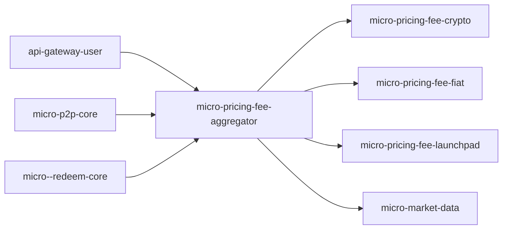

# Fee Aggregator (Quote Service)

<!-- DECO-RELEASE-BADGES -->
[](../README.md#alcance-y-estado) [](../README.md#limitaciones-conocidas) [](../README.md#arquitectura)
<!-- /DECO-RELEASE-BADGES -->

<!-- DECO-NON-PRODUCTION-NOTICE -->
> **Advertencia:** prototipo en fase inicial, no apto para producción. No conectes este servicio a fondos, cuentas bancarias, wallets, datos de clientes ni credenciales reales. Las capacidades descritas son referencias al código y no pruebas de aceptación; las rutas, controles y dependencias requieren validación independiente.
<!-- /DECO-NON-PRODUCTION-NOTICE -->


Puerto: **3013**

Consolidador final que combina asset-registry + pricing + fees para generar quotes ejecutables.

**Features:**
- Quote generation con TTL (Redis)
- Fee resolution jerárquica (GLOBAL→NETWORK→ASSET→PAIR)
- Integration con pricing-fiat/crypto
- Fees: entrada, salida, envío P2P, devoluciones, uso servicios

Arquitectura completa en implementation_plan.md

## Quick Start
```bash
cd Exchange--micro-pricing-fee-aggregator
yarn install
yarn build
yarn start:dev
```

## Endpoints
- `POST /quotes` - Crear quote con TTL
- `GET /quotes/:quoteId` - Obtener quote
- `POST /quotes/:quoteId/validate` - Validar quote
- `POST /quotes/:quoteId/mark-used` - Marcar como usado
- `POST /fees/resolve` - Resolver fee (simulación)

## Relación con otros proyectos

Este esquema resume relaciones de alto nivel descritas en el repositorio. Las líneas punteadas indican integraciones incompletas o pendientes de validación; ninguna flecha certifica que el flujo esté desplegado o probado.



**Documentación relacionada:** [api-gateway-user](../exchange--api-gateway-user/README.md) · [micro-p2p-core](../exchange--micro-p2p-core/README.md) · [micro--redeem-core](../exchange--micro--redeem-core/README.md) · [micro-pricing-fee-crypto](../exchange--micro-pricing-fee-crypto/README.md) · [micro-pricing-fee-fiat](../exchange--micro-pricing-fee-fiat/README.md) · [micro-pricing-fee-launchpad](../exchange--micro-pricing-fee-launchpad/README.md) · [micro-market-data](../exchange--micro-market-data/README.md).

**Capacidad:** no hay resultados de carga publicados para este componente. Consulta la sección de [capacidad y rendimiento](../README.md#capacity) del README raíz.

**Archivos del componente:** [`.env.example`](.env.example) · [`CHANGELOG.md`](CHANGELOG.md) · [mapa general](../README.md#service-docs).

<!-- DECO-RELATION-DIAGRAM -->
