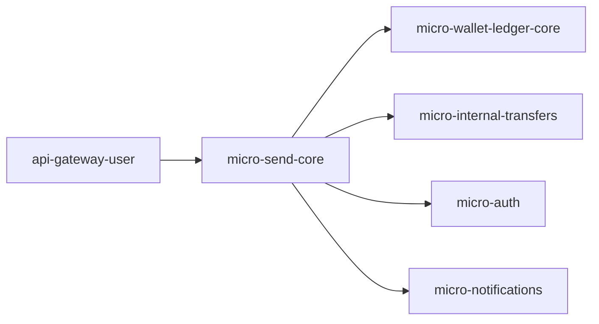

# micro-send-core

<!-- DECO-RELEASE-BADGES -->
[](../README.md#alcance-y-estado) [](../README.md#limitaciones-conocidas) [](../README.md#arquitectura)
<!-- /DECO-RELEASE-BADGES -->

<!-- DECO-NON-PRODUCTION-NOTICE -->
> **Advertencia:** prototipo en fase inicial, no apto para producción. No conectes este servicio a fondos, cuentas bancarias, wallets, datos de clientes ni credenciales reales. Las capacidades descritas son referencias al código y no pruebas de aceptación; las rutas, controles y dependencias requieren validación independiente.
<!-- /DECO-NON-PRODUCTION-NOTICE -->


> **DECO EXCHANGE** — Orchestrates send operations across multiple microservices

## Overview

| Property | Value |
|----------|-------|
| **Port** | 9010 |
| **Prefix** | `api/v1` |
| **Framework** | NestJS |
| **Package Manager** | yarn |

## Endpoints

- `POST /api/v1/send — Execute a send operation`
- `GET /api/v1/health — Health check`

## Dependencies (service-to-service)

micro-auth (:7000), payments-core (:9000), wallet-ledger (:9001), internal-transfers (:3006), notifications (:7004)

## Infrastructure

Stateless (no DB/Redis). Aggregates responses from auth, payments, wallet-ledger, internal-transfers, and notifications.

## Environment Variables

Configured via `.env.local` (primary) with `.env` as fallback.

Key variables:
- `PORT` — Service port (default: 9010)
- `MONGODB_URI` — MongoDB Atlas connection string
- `REDIS_URL` — Redis Railway (ballast) connection string
- `INTERNAL_AUTH_TOKEN` — Service-to-service authentication token
- `API_PREFIX` — API route prefix (default: `api/v1`)
- `NODE_ENV` — Environment (`development` / `production`)

## Development

```bash
# Install dependencies
yarn install

# Start in development mode (watch)
yarn start:dev

# Build for production
yarn build

# Start production
yarn start:prod
```

## Architecture

This service is part of the DECO EXCHANGE microservices ecosystem.
Communication flow: `dashboard → api-gateway-user (:8081) → micro-send-core (:9010)`

All inter-service calls include `X-Internal-Auth` header for authentication.

## Relación con otros proyectos

Este esquema resume relaciones de alto nivel descritas en el repositorio. Las líneas punteadas indican integraciones incompletas o pendientes de validación; ninguna flecha certifica que el flujo esté desplegado o probado.



**Documentación relacionada:** [api-gateway-user](../exchange--api-gateway-user/README.md) · [micro-wallet-ledger-core](../exchange--micro-wallet-ledger-core/README.md) · [micro-internal-transfers](../exchange--micro-internal-transfers/README.md) · [micro-auth](../exchange--micro-auth/README.md) · [micro-notifications](../exchange--micro-notifications/README.md).

**Capacidad:** no hay resultados de carga publicados para este componente. Consulta la sección de [capacidad y rendimiento](../README.md#capacity) del README raíz.

**Archivos del componente:** [`.env.example`](.env.example) · [`CHANGELOG.md`](CHANGELOG.md) · [mapa general](../README.md#service-docs).

<!-- DECO-RELATION-DIAGRAM -->
