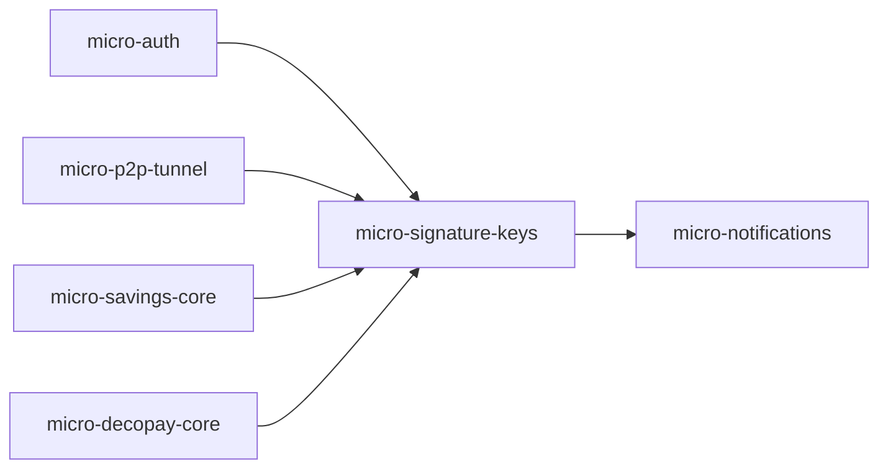

# Exchange — micro-signature-keys

<!-- DECO-RELEASE-BADGES -->
[](../README.md#alcance-y-estado) [](../README.md#limitaciones-conocidas) [](../README.md#arquitectura)
<!-- /DECO-RELEASE-BADGES -->

<!-- DECO-NON-PRODUCTION-NOTICE -->
> **Advertencia:** prototipo en fase inicial, no apto para producción. No conectes este servicio a fondos, cuentas bancarias, wallets, datos de clientes ni credenciales reales. Las capacidades descritas son referencias al código y no pruebas de aceptación; las rutas, controles y dependencias requieren validación independiente.
<!-- /DECO-NON-PRODUCTION-NOTICE -->


[](https://nestjs.com/)
[](https://nodejs.org/)
[](https://www.typescriptlang.org/)
[](#)

Microservicio independiente de **firma digital** para DECO EXCHANGE.
Gestiona PINs numéricos por usuario y claves dinámicas TOTP-like para autorización de operaciones.

## Arquitectura

```
dashboard-user (BFF)
  └─→ api-gateway-user (:8081)
        └─→ micro-signature-keys (:3007)
              ├─ Signature (PIN)
              ├─ Dynamic Key (TOTP-like)
              └─→ micro-notifications (:7004) — envío OTP al cambiar firma
```

## Puerto

- API: `http://localhost:3007`
- Base path: `/api/v1`

## Dominios

### 1. Signature (PIN)

- PIN numérico de N dígitos (configurable: 2, 3, 4, 6, 8)
- Crear firma por primera vez
- Verificar PIN para autorizar operaciones
- Cambiar PIN (requiere PIN actual)
- Bloqueo tras 5 intentos fallidos (15 min cooldown)
- Hash HMAC-SHA256 (nunca texto plano)

### 2. Dynamic Key (Clave Dinámica TOTP-like)

- Código que rota cada N segundos (default: 60s)
- Longitud configurable (2, 3, 4, 6, 8 dígitos)
- Verificación con ventana ±1 período
- Activar / desactivar por usuario
- HMAC-SHA256 + truncado dinámico (RFC 4226)

## Endpoints

### Signature (PIN)

| Método | Ruta                   | Descripción                    |
|--------|------------------------|--------------------------------|
| GET    | `/signature/status`    | Estado de la firma del usuario |
| POST   | `/signature`           | Crear firma (PIN)              |
| POST   | `/signature/verify`    | Verificar PIN                  |
| PUT    | `/signature`           | Cambiar PIN                    |

### Dynamic Key (Clave Dinámica)

| Método | Ruta                     | Descripción              |
|--------|--------------------------|--------------------------|
| GET    | `/dynamic-key/status`    | Estado de clave dinámica |
| POST   | `/dynamic-key/enable`    | Activar clave dinámica   |
| POST   | `/dynamic-key/disable`   | Desactivar clave dinámica|
| GET    | `/dynamic-key/current`   | Obtener código actual    |
| POST   | `/dynamic-key/verify`    | Verificar código         |

### Health

| Método | Ruta      | Descripción  |
|--------|-----------|--------------|
| GET    | `/health` | Health check |

## Configuración (.env)

```env
PORT=3007
API_PREFIX=api/v1
NODE_ENV=development

MONGODB_URI=mongodb://localhost:27017/DECOX-signature-keys

INTERNAL_AUTH_SECRET=your-internal-auth-secret
NOTIFICATIONS_SERVICE_URL=http://localhost:7004
NOTIFICATIONS_INTERNAL_SECRET=xxxxx--xxxxx

SIGNATURE_PIN_LENGTH=6

DYNAMIC_KEY_LENGTH=6
DYNAMIC_KEY_PERIOD_SECONDS=60
DYNAMIC_KEY_ALGORITHM=sha256
```

Ver `.env.template` para referencia completa.

## Arranque local

```bash
cd Exchange--micro-signature-keys
npm install
npm run start:dev
```

## Scripts

| Script              | Descripción                |
|---------------------|----------------------------|
| `npm run start:dev` | Desarrollo (watch)         |
| `npm run build`     | Compilar para producción   |
| `npm run start:prod`| Ejecutar build compilado   |
| `npm run lint`      | Lint + autofix             |
| `npm run format`    | Formatear con Prettier     |

## Estructura

```
src/
├── main.ts                          # Bootstrap NestJS
├── app.module.ts                    # Root module (Config, Mongo, dominios)
├── domain/
│   ├── signature/                   # Dominio PIN
│   │   ├── dto/                     # DTOs validados
│   │   ├── schemas/                 # Mongoose schemas
│   │   ├── signature.controller.ts
│   │   ├── signature.service.ts
│   │   └── signature.module.ts
│   └── dynamic-key/                 # Dominio Clave Dinámica
│       ├── dto/
│       ├── schemas/
│       ├── dynamic-key.controller.ts
│       ├── dynamic-key.service.ts
│       └── dynamic-key.module.ts
├── health/                          # Health check
│   ├── health.controller.ts
│   └── health.module.ts
└── shared/
    └── notifications-client.service.ts  # Cliente HTTP → micro-notifications
```

## Seguridad

- PINs hasheados con HMAC-SHA256 (nunca almacenados en texto plano)
- Bloqueo automático tras 5 intentos fallidos (cooldown 15 min)
- Comunicación interna protegida con `x-internal-auth` header
- Claves dinámicas derivadas con HMAC-SHA256 + truncado (RFC 4226)
- `ValidationPipe` global con whitelist + forbidNonWhitelisted

## Relación con otros proyectos

Este esquema resume relaciones de alto nivel descritas en el repositorio. Las líneas punteadas indican integraciones incompletas o pendientes de validación; ninguna flecha certifica que el flujo esté desplegado o probado.



**Documentación relacionada:** [micro-auth](../exchange--micro-auth/README.md) · [micro-p2p-tunnel](../exchange--micro-p2p-tunnel/README.md) · [micro-savings-core](../exchange--micro-savings-core/README.md) · [micro-decopay-core](../exchange--micro-decopay-core/README.md) · [micro-notifications](../exchange--micro-notifications/README.md).

**Capacidad:** no hay resultados de carga publicados para este componente. Consulta la sección de [capacidad y rendimiento](../README.md#capacity) del README raíz.

**Archivos del componente:** [`.env.example`](.env.example) · [`CHANGELOG.md`](CHANGELOG.md) · [mapa general](../README.md#service-docs).

<!-- DECO-RELATION-DIAGRAM -->
