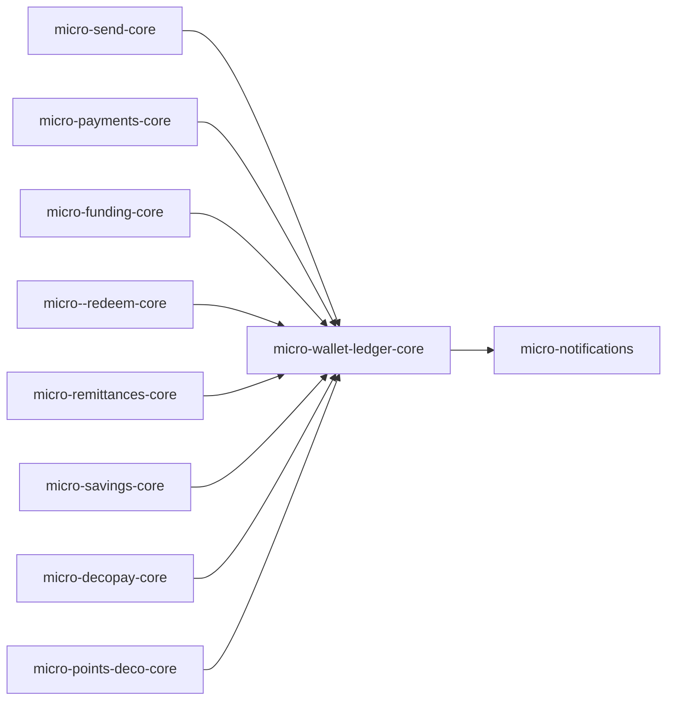

# Exchange - Micro Wallet Ledger Core

<!-- DECO-RELEASE-BADGES -->
[](../README.md#alcance-y-estado) [](../README.md#limitaciones-conocidas) [](../README.md#arquitectura)
<!-- /DECO-RELEASE-BADGES -->

<!-- DECO-NON-PRODUCTION-NOTICE -->
> **Advertencia:** prototipo en fase inicial, no apto para producción. No conectes este servicio a fondos, cuentas bancarias, wallets, datos de clientes ni credenciales reales. Las capacidades descritas son referencias al código y no pruebas de aceptación; las rutas, controles y dependencias requieren validación independiente.
<!-- /DECO-NON-PRODUCTION-NOTICE -->


**CEX Centralized Ledger & Wallet Service** - Fuente única de verdad para saldos de usuarios en el DECO EXCHANGE.

## 🎯 Propósito

Este microservicio implementa:

- **Cuentas internas**: `accountId` opaco (UUID) + `accountNumber` público (9+checkdigit Luhn) con QR permanente
- **Wallets multi-moneda**: `availableBalance` + `lockedBalance` por cuenta/moneda
- **Ledger inmutable**: Transacciones append-only con doble-entrada para `FIAT_DEPOSIT_CONFIRMED`, `P2P_TRANSFER`, `ADJUSTMENT`
- **Inbox/Outbox**: Idempotencia en ingesta de eventos + publicación confiable de `LEDGER_BALANCE_UPDATED`
- **OTP step-up**: Requerido para P2P (configurable, OTP real via Redis + bypass opcional)
- **Límites v1**: Máximo 1,000 MXN por transferencia P2P


## 📁 Estructura

```
src/
├── main.ts
├── app.module.ts
├── health/                 # Health check
├── idempotency/           # Inbox para deduplicación
├── outbox/                # Outbox para eventos salientes
├── shared/
│   ├── money/             # Minor units (BigInt), tabla decimales
│   └── security/          # InternalAuthGuard + OtpService
└── modules/
    ├── accounts/          # Cuentas USER/SYSTEM
    ├── wallets/           # Saldos por moneda
    ├── ledger/            # LedgerTx (append-only) + service + controller
    └── transfers/         # P2P con OTP y límites
```

## 🚀 Inicio rápido

### Requisitos

- Node.js >= 20
- Yarn 1.22.22
- MongoDB (local o remoto)
- Redis (local o remoto)

### Instalación

```powershell
cd Exchange--micro-wallet-ledger-core
yarn install
```

### Configuración

Copiar `.env.example` a `.env` y ajustar:

```dotenv
MONGODB_URI=mongodb://localhost:27017/deco_micro_wallet_ledger_core
REDIS_URL=redis://localhost:6379
INTERNAL_AUTH_TOKEN=xxxxx--xxxxx
# Opcional (solo dev): si está seteado, este código siempre valida
OTP_BYPASS_CODE=xxxxx--xxxxx

# OTP real (Redis)
OTP_TTL_SECONDS=300
# Por defecto devuelve el OTP en dev y lo oculta en prod
OTP_RETURN_IN_RESPONSE=true

# (Opcional) Envío OTP vía micro-notifications
NOTIFICATIONS_BASE_URL=http://localhost:3005/api/v1
NOTIFICATIONS_BEARER_TOKEN=<token_configurado_en_micro_notifications>
```

### Build

```powershell
yarn build
```

### Desarrollo

```powershell
yarn start:dev
```

Servicio levantado en `http://localhost:3003/api/v1`.

### Desde VS Code

Usar la tarea `(dev) start:dev all (payments + ledger + custody)` para levantar los 3 microservicios en terminales paralelos.

## 🧪 Smoke Tests

Script PowerShell incluido para validar el flujo completo:

```powershell
.\smoke-tests.ps1
```

**Pasos del smoke test:**

1. Health check
2. Ensure account (`user_test_123`)
3. Ensure wallet (`MXN`)
4. Simular deposit confirmado (500 MXN)
5. Transfer P2P (`user_test_123` → `user_test_456`, 100 MXN)
6. Verificar balances finales

## 📡 Endpoints principales

### Cuentas

- `POST /api/v1/internal/accounts/ensure/:userId` - Crear/obtener cuenta de usuario
- `GET /api/v1/internal/accounts/by-user/:userId` - Obtener cuenta por userId

**Headers requeridos:** `x-internal-auth: dev`

### Wallets

- `POST /api/v1/internal/wallets/ensure` - Crear/obtener wallet para cuenta+moneda
  ```json
  { "accountId": "...", "currency": "MXN" }
  ```
- `GET /api/v1/internal/wallets/user/:userId` - Listar todas las wallets de un usuario
- `GET /api/v1/internal/wallets/user/:userId/summary` - Resumen de balance total (USD + fiat/crypto breakdown)
- `GET /api/v1/internal/wallets/user/:userId/transactions?page=1&limit=20&type=P2P_TRANSFER&currency=MXN&days=30` - Historial de transacciones paginado con filtros
- `GET /api/v1/internal/wallets/user/:userId/history?days=30` - Puntos diarios de balance total (gráfico)
- `GET /api/v1/internal/wallets/:accountId/:currency` - Obtener wallet específica

### Ledger

- `POST /api/v1/internal/ledger/fiat-deposit-confirmed` - Aplicar depósito FIAT confirmado
  ```json
  {
    "eventId": "evt_123",
    "userId": "user_123",
    "currency": "MXN",
    "amountMinorUnits": "500000000",
    "correlationId": "corr_123"
  }
  ```

### Transferencias

- `POST /api/v1/internal/transfers/p2p/request-otp` - Genera OTP para P2P (y lo envía por email si se provee)
  ```json
  {
    "userId": "user_123",
    "email": "user@example.com"
  }
  ```

- `POST /api/v1/internal/transfers/p2p` - Transferencia P2P
  ```json
  {
    "fromUserId": "user_123",
    "toUserId": "user_456",
    "currency": "MXN",
    "amountMinorUnits": "100000000",
    "otp": "123456"
  }
  ```


**Límites:** Max 1,000 MXN (1,000,000,000 minor units)

## 🔐 Seguridad

- **Internal auth:** Header `x-internal-auth` obligatorio (configurable en `.env`)
- **OTP bypass dev:** si seteas `OTP_BYPASS_CODE`, ese valor siempre valida (útil para testing local)
- **OTP real:** `POST /internal/transfers/p2p/request-otp` genera OTP con TTL en Redis; opcionalmente lo envía usando `micro-notifications`

## 📊 Invariantes

- **No negativos:** `availableBalance >= 0` siempre
- **Atomicidad P2P:** Debit + credit en misma transacción Mongo
- **Idempotencia:** Inbox deduplica eventos por `eventId`
- **Outbox confiable:** `LEDGER_BALANCE_UPDATED` se publica al confirmar transacción

## 🛠 Stack técnico

- **NestJS 11** + TypeScript
- **MongoDB** (cuentas, wallets, ledger, inbox, outbox)
- **Redis + Bull** (colas para procesamiento asíncrono)
- **Mongoose** (ODM con transacciones para atomicidad)

## 📚 Documentación relacionada

La documentación publicable de esta copia está distribuida entre los README de [`payments-core`](../exchange--micro-payments-core/README.md), [`send-core`](../exchange--micro-send-core/README.md), [`funding-core`](../exchange--micro-funding-core/README.md) y el [mapa de arquitectura raíz](../README.md#arquitectura). Los documentos de planificación externos no están incluidos en este paquete.


## 🤝 Integración con otros micros

- **micro-payments-core** → Publica `FIAT_DEPOSIT_CONFIRMED` → Ledger lo consume vía endpoint interno
- **micro-custody-fiat** → Publica eventos SPEI → Payments-core confirma → Ledger acredita
- **micro-custody-crypto** → Similar flujo para crypto deposits/withdrawals

---

**Estado:** prototipo inicial; la consistencia contable y las integraciones entre servicios requieren validación de extremo a extremo antes de cualquier uso operativo.

## Relación con otros proyectos

Este esquema resume relaciones de alto nivel descritas en el repositorio. Las líneas punteadas indican integraciones incompletas o pendientes de validación; ninguna flecha certifica que el flujo esté desplegado o probado.



**Documentación relacionada:** [micro-send-core](../exchange--micro-send-core/README.md) · [micro-payments-core](../exchange--micro-payments-core/README.md) · [micro-funding-core](../exchange--micro-funding-core/README.md) · [micro--redeem-core](../exchange--micro--redeem-core/README.md) · [micro-remittances-core](../exchange--micro-remittances-core/README.md) · [micro-savings-core](../exchange--micro-savings-core/README.md) · [micro-decopay-core](../exchange--micro-decopay-core/README.md) · [micro-points-deco-core](../exchange--micro-points-deco-core/README.md) · [micro-notifications](../exchange--micro-notifications/README.md).

**Capacidad:** no hay resultados de carga publicados para este componente. Consulta la sección de [capacidad y rendimiento](../README.md#capacity) del README raíz.

**Archivos del componente:** [`.env.example`](.env.example) · [`CHANGELOG.md`](CHANGELOG.md) · [mapa general](../README.md#service-docs).

<!-- DECO-RELATION-DIAGRAM -->
