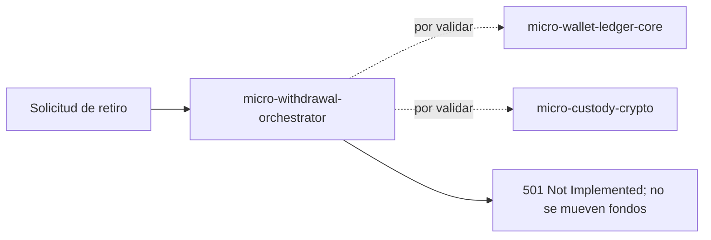

# Micro Withdrawal Orchestrator

<!-- DECO-RELEASE-BADGES -->
[](../README.md#alcance-y-estado) [](../README.md#limitaciones-conocidas) [](../README.md#arquitectura)
<!-- /DECO-RELEASE-BADGES -->

<!-- DECO-NON-PRODUCTION-NOTICE -->
> **Advertencia:** prototipo en fase inicial, no apto para producción. No conectes este servicio a fondos, cuentas bancarias, wallets, datos de clientes ni credenciales reales. Las capacidades descritas son referencias al código y no pruebas de aceptación; las rutas, controles y dependencias requieren validación independiente.
<!-- /DECO-NON-PRODUCTION-NOTICE -->


[](https://nestjs.com/)
[](https://www.typescriptlang.org/)
**Licencia: pendiente de confirmar para este subproyecto.**
[](#)

**Puerto**: 7015

Microservicio que orquesta el proceso completo de retiros (withdrawals), aplicando políticas de autorización antes de procesar cada operación.

## Módulos

| Módulo | Descripción |
|--------|-------------|
| `policy/` | `auth-policy.service.ts` — Validación de políticas de retiro |
| `withdrawals/` | Servicio principal, esquema MongoDB, módulo |

## Endpoints

### Withdrawals
- `POST /withdrawals` — Solicitar retiro
- `GET /withdrawals/:id` — Consultar estado de retiro

### Health
- `GET /health` — Health check

## Variables de Entorno

| Variable | Descripción | Default |
|----------|-------------|---------|
| `PORT` | Puerto del servicio | `7015` |
| `MONGODB_URI` | Conexión a MongoDB Atlas | — |
| `INTERNAL_AUTH_TOKEN` | Token de autenticación interna | — |

## Stack

- NestJS 10, Mongoose 8
- Axios, uuid

## Instalación

```bash
yarn install
yarn start:dev
```

## Relación con otros proyectos

Este esquema resume relaciones de alto nivel descritas en el repositorio. Las líneas punteadas indican integraciones incompletas o pendientes de validación; ninguna flecha certifica que el flujo esté desplegado o probado.



**Documentación relacionada:** [micro-wallet-ledger-core](../exchange--micro-wallet-ledger-core/README.md) · [micro-custody-crypto](../exchange--micro-custody-crypto/README.md).

**Capacidad:** no hay resultados de carga publicados para este componente. Consulta la sección de [capacidad y rendimiento](../README.md#capacity) del README raíz.

**Archivos del componente:** [`.env.example`](.env.example) · [`CHANGELOG.md`](CHANGELOG.md) · [mapa general](../README.md#service-docs).

<!-- DECO-RELATION-DIAGRAM -->
